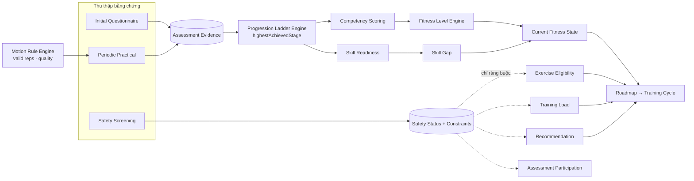
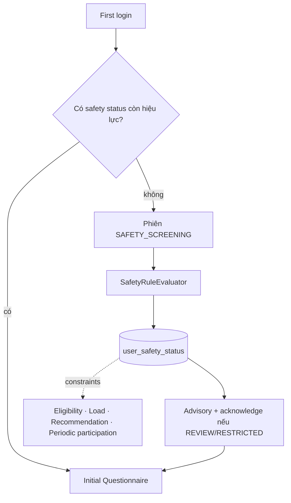
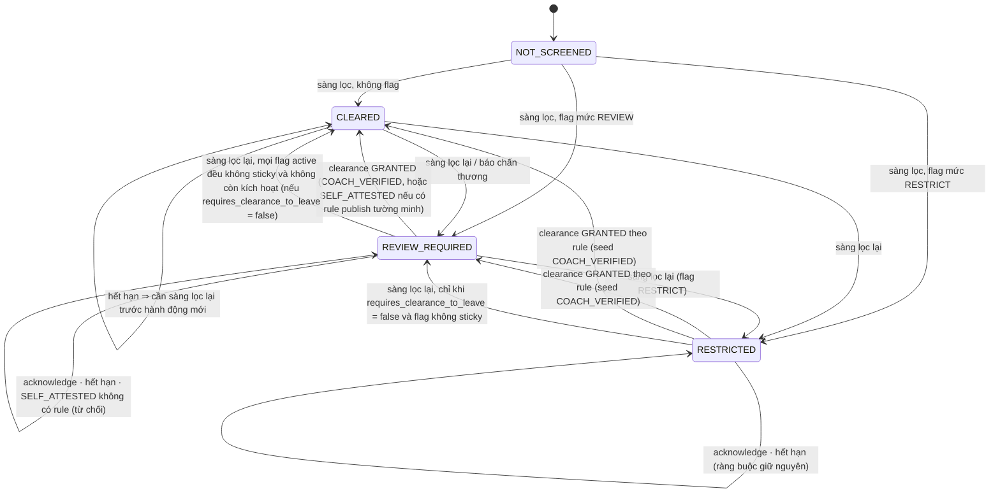
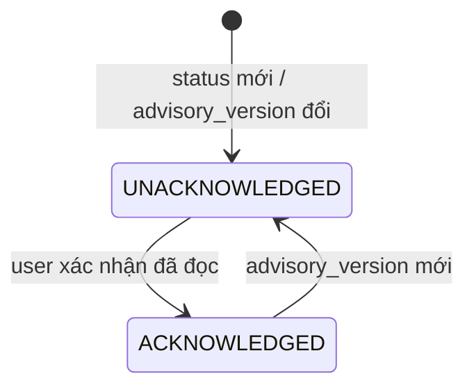
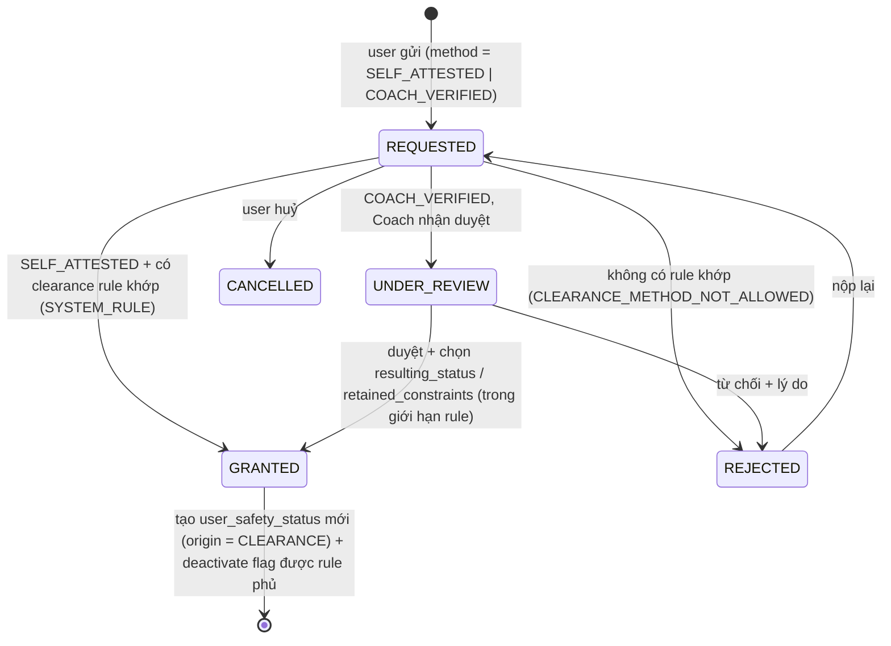
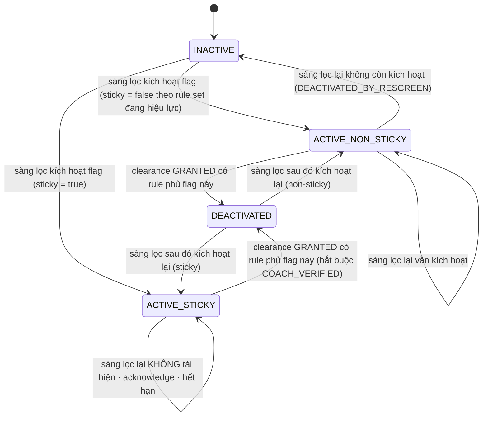
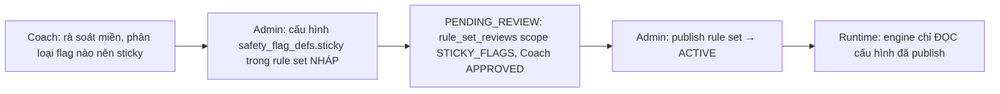
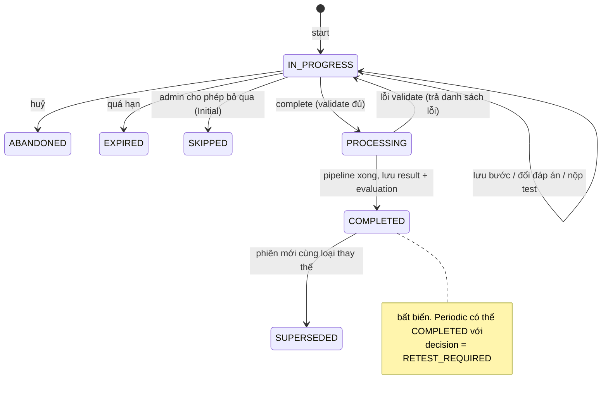
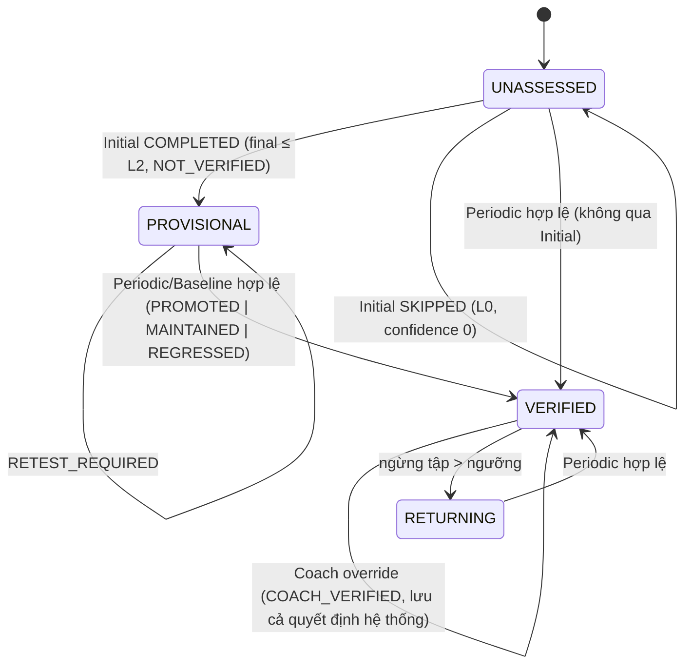

# CalisHealth — Đặc tả Assessment Framework V2 (sau 5 quyết định đã xác nhận)

> Trạng thái: **v2.3 — F1–F4 đã chốt; Giai đoạn 1 đã áp dụng lên calishealth; Giai đoạn 2 (engine thuần + 67 test) xong — xem §27, §28** · Ngày: 2026-10-08
> Thay đổi v2.2: §3.5–§3.8 (4 khái niệm safety tách biệt, clearance rule, state machine, vòng đời sticky + quản trị), §8.1 (Baseline: fast-track, attempt, Stability, thuật toán quyết định, RETEST),
> §10.3/§10.3b (DDL), §13, §15, §21–§23, §24 (A–E bản cuối), **§25 (invariants vs tham số rule set)**, **§26 (mâu thuẫn còn lại)**. Conflict C24–C27.
> Thay đổi v2.1 (đã có): §2.3, §4.2 (trọng số cấu hình), §5.6 (Coach duyệt), C19–C23.
>
> **Thứ tự ưu tiên khi các tài liệu mâu thuẫn:**
> `confirmAssessmentAns.md` (5 quyết định) **>** tài liệu này **>** `LEVEL_ASSESSMENT_ROADMAP_DESIGN.md` (gọi tắt **[LAR]**) **>** `assessmentFamework.md` / `ruleEniges.md`.
>
> Tài liệu này **thay thế** `INITIAL_ASSESSMENT_DESIGN.md` (bản trước, đã xoá vì chứa các quy tắc cũ). Những phần [LAR] không bị
> Conflict Register ở Phần A chạm tới (thang ladder số liệu, độ tin cậy nguồn, hợp nhất đa nguồn, 6 cổng, hysteresis,
> giáo án mẫu, double progression) **vẫn hiệu lực** và chỉ được tham chiếu bằng số mục.

## Năm quyết định (tóm tắt)

| # | Quyết định | Hệ quả cốt lõi |
|---|---|---|
| 1 | Kinh nghiệm tập **không** vào điểm năng lực | Mỗi câu hỏi có `evidence_role`; chỉ role "hiệu năng" được chấm điểm |
| 2 | Trong **cùng một ladder** lấy **giai đoạn cao nhất đạt được**, không lấy trung bình | Thực thể mới **Progression Ladder / Stage**; điểm tính từ stage cao nhất; nhiều nhóm bằng chứng khác nhau vẫn có trọng số |
| 3 | Dùng chung `assessment_*`, **không** có bảng `initial_*`/`periodic_*` | `assessment_type` + `execution_mode` + `source`; bảng chuyên biệt chỉ khi có nhu cầu miền thật sự |
| 4 | Level đầu vào **tối đa L2**, luôn `PROVISIONAL` | Tách `candidateLevel / finalLevel / levelStatus / verificationStatus / capApplied` |
| 5 | **Safety Screening** là bước 0, **độc lập** với năng lực & level | Module Safety riêng; chỉ tác động Eligibility / Load / Recommendation / Assessment participation |

---

# PHẦN A — CONFLICT REGISTER (OLD RULE → NEW RULE → IMPLEMENTATION IMPACT)

Gồm cả mâu thuẫn với spec gốc, với [LAR], và **hai lỗi do chính bản thiết kế trước của tôi** (đánh dấu ⚠ tự sửa).

| # | Nguồn | OLD RULE | NEW RULE | IMPLEMENTATION IMPACT |
|---|---|---|---|---|
| C1 | assessmentFamework §14 (ví dụ), §7 | "Training experience" có `questionWeight = 0.15` trong điểm PUSH | Kinh nghiệm/tần suất/kinh nghiệm kháng lực là **CONTEXT**: không có trọng số năng lực, không tăng/giảm điểm | `assessment_questions.evidence_role`; validator từ chối `question_competency_weights` cho role không-chấm-điểm; `ScoringEvidence` chỉ dựng được từ role chấm điểm; DTO tách `contributingAnswers` / `contextualAnswers`; test G1 |
| C2 ⚠ | INITIAL_ASSESSMENT_DESIGN §3.2 | Kinh nghiệm cao + số liệu khớp → "cộng nhẹ" hệ số chất lượng `q` | Bỏ cộng thưởng. Kinh nghiệm chỉ được dùng để **phát hiện bất thường** (hạ confidence) và suy ra `progression_speed` | Xoá tham số `experience_consistency_bonus`; `ConsistencyCheckService` là nơi duy nhất đọc CONTEXT cho độ tin cậy |
| C3 | assessmentFramework §14, §16; [LAR] §5.2, §5.5 | Trung bình có trọng số các câu; hoặc `max(nodeScore)` các nấc | Trong một ladder: **highestAchievedStage** = stage cao nhất có `PASS` hợp lệ + thoả tiên quyết; điểm = vị trí stage + hiệu năng trong stage. Giữa **nhóm bằng chứng khác nhau**: trọng số cấu hình | Thực thể `progression_ladders / stages / stage_prerequisites`; `ProgressionLadderEngine`; `CompetencyScoringEngine` nhận kết quả ladder; test G2 |
| C4 | [LAR] §5.2 `entry_value`; §5.3 | "Vào được nấc nếu hiệu năng ≥ entry"; các dải điểm được phép **chồng** (Dip 50–65, Pike 60–72; Plank 5–35, Hollow 30–50) | Stage `PASS` = `value ≥ pass_value` **và** tiên quyết bắt buộc không FAIL. Dải điểm của các stage **phải đơn điệu, không chồng** (nếu không, stage cao hơn có thể cho điểm thấp hơn stage thấp) | Validator `LADDER_BANDS_MONOTONIC`; điều chỉnh thang PUSH/CORE ở §5.6 |
| C5 | assessmentFramework §35 | Bảng `initial_assessment_*`, `periodic_assessment_*` | **Xoá.** Dùng `assessment_*` chung | Mục 9–10; [LAR] `assessment_test_items`/`assessment_test_results` được **hấp thụ** vào `assessment_questions(item_kind=PRACTICAL_TEST)` + `assessment_metrics` + `assessment_evidence` |
| C6 | assessmentFramework §4, §36 | Chỉ `INITIAL`, `PERIODIC` | Thêm `SAFETY_SCREENING` (QUESTIONNAIRE, không chấm điểm); Baseline Test = `PERIODIC` có `purpose = BASELINE` | Seed `assessment_types`; không thêm bảng |
| C7 | assessmentFramework §18–§21, §47; [LAR] §7 | Initial có thể ra L0–L4 | Initial **tối đa L2**; mọi level Initial là `PROVISIONAL / NOT_VERIFIED`; L3/L4 chỉ do Periodic/Coach | Mục 6, 7, 17; `capApplied`, `levelCap`; invariant trong engine + test G4 |
| C8 ⚠ | INITIAL_ASSESSMENT_DESIGN §8.1 | "candidate = level cao nhất qua **cả cổng**" nhưng ví dụ lại ghi *candidate = INTERMEDIATE, final = BEGINNER vì cổng trượt* — tự mâu thuẫn | Chuỗi bốn bước rõ ràng: `candidateLevel` (theo điểm tổng) → `gatedLevel` (sau cổng) → `adjustedLevel` (sau chất lượng dữ liệu) → `finalLevel` (sau trần) | Mục 6.3; cột mới trong `level_evaluations` |
| C9 ⚠ | INITIAL_ASSESSMENT_DESIGN §8.2; [LAR] §13.2 | "Skill gate ở level tạm thời không bao giờ đạt cho L3+" ⇒ không thể có candidate L3/L4 | Với **candidate**, Skill gate xét trên `ACHIEVED_SELF_REPORTED` (`PASS_SELF_REPORTED`); trần L2 mới là thứ chặn | `level_requirements.self_reported_acceptable`; mục 6.2 |
| C10 | [LAR] §8.4, §9 bước 4c; INITIAL §8.1(c), E13, test 8 | Cờ an toàn ⇒ `final ≤ L1` | **Xoá.** An toàn **độc lập** với level & điểm; chỉ áp ở Eligibility / Load / Recommendation / Participation | `FitnessLevelEngine` và `CompetencyScoringEngine` **không có tham số safety**; ArchUnit test; test G5 |
| C11 | [LAR] §9 bước 4a | `max_provisional_level` là tham số tuỳ chỉnh | Là **bất biến nghiệp vụ**: tham số chỉ nhận giá trị ≤ L2; engine `assert` lại | Validator `rule_set`; test G4 |
| C12 | assessmentFramework §52 | Register → First Login → Initial | Register → First Login → **Safety Screening** → Initial Questionnaire → Initial Fitness State → Initial Cycle | Guard 409 `SAFETY_SCREENING_REQUIRED`; route guard React |
| C13 | [LAR] §8.2 bước A; `user_screening` | Sàng lọc là "bước A" của bài Initial, lưu `user_screening` | Phiên `SAFETY_SCREENING` riêng (dùng chung framework) + `user_safety_status` (append-only) | Mục 3 |
| C14 | [LAR] §14.3 | Chọn giáo án từ Current State + Goal + Gap | Thêm **Safety Constraints** và **Recent Performance** làm đầu vào bắt buộc | Mục 18 |
| C15 | [LAR] §13.2 | `user_skill_progress` theo `exercise_id` | Theo **stage** + `origin` (`DIRECT`/`INFERRED`) + `verification_status` | Mục 10 |
| C16 | assessmentFramework §37 | Danh sách service | Thêm `SafetyScreeningService`, `SafetyConstraintService`, `ProgressionLadderEngine`, `EvidenceRecorder` | Mục 11 |
| C17 | assessmentFramework §42 | 7 câu hỏi giải thích | **14 câu** (mục Audit trong `confirmAssessmentAns.md`) | Mục 20 — mỗi câu có nguồn dữ liệu |
| C18 | [LAR] §16.2 | DDL dùng `BIGINT` | FK tới bảng hiện có (`assessment_questions`, `assessment_sessions`, …) là **`BIGINT UNSIGNED`**; MySQL từ chối FK lệch kiểu | Mọi DDL ở mục 10 dùng `UNSIGNED` |
| C19 | [LAR] §11.6 | Fast-track **bỏ qua Stability Gate** (và yêu cầu `Overall ≥ promote_min + 10`, `r_AI ≥ 0.85`) | Fast-track chỉ **bỏ giới hạn "tối đa +1 level/lần"** cho Baseline thực hành đầu tiên. **Mọi cổng của level đích** (Performance, Quality, Competency, Skill, Stability, Reliability) vẫn phải PASS | §8.1; Stability cần định nghĩa cho lần đo đầu (điểm xác nhận A); bỏ hai điều kiện biên của [LAR] |
| C20 | V2 §3.3 bản đầu (`SELF_ATTESTED` → `CLEARED`) | User tự xác nhận sau khi đọc advisory được chuyển `REVIEW_REQUIRED` → `CLEARED` | **Acknowledgement** (đã đọc) và **Clearance** (được gỡ hạn chế) là hai khái niệm tách biệt. Tự xác nhận **không bao giờ** đổi status hay ràng buộc. `REVIEW_REQUIRED` giữ ràng buộc cho tới khi có clearance hợp lệ; `RESTRICTED` chỉ Coach gỡ | §3.5–§3.6; bảng `safety_acknowledgements`, `safety_clearances`, `safety_policies`; API; test G5 |
| C21 | V2 §3.5 bản đầu | Hiệu lực safety 180 ngày (viết cứng trong đặc tả) | Hiệu lực nằm trong `safety_policies.validity_days` theo status, versioned bằng rule set; 180 chỉ là giá trị seed | §3.5, §10.3 |
| C22 | V2 §4.2 bản đầu | `LADDER 0.75 / QUALITY 0.25` | Hai trọng số là tham số của **rule set có version**; Java không chứa giá trị mặc định | §4.2, §15, test G6 |
| C23 | V2 §5.6 bản đầu | Thang PUSH/CORE đề xuất | Là giá trị **tạm thời** `COACHING_BENCHMARK`; rule set chỉ publish được khi có **coach review APPROVED** | `rule_set_reviews`; §15 |
| C24 | V2 v2.1 §3.5 (phương thức `COACH_VERIFIED`/`PROFESSIONAL_DOCUMENT_REVIEWED`, "tự khai báo không phải phương thức") | Clearance không có `SELF_ATTESTED` | Bốn khái niệm tách biệt; `clearance_method ∈ {NONE, SELF_ATTESTED, COACH_VERIFIED}`; `SELF_ATTESTED` chỉ qua **clearance rule publish tường minh** (không mặc định); tài liệu chỉ là `evidence_ref` | `safety_clearance_rules`; §3.5–§3.6; G5+ |
| C25 | V2 v2.1 §3.5 (sticky: Coach/Admin cấu hình chung) | Danh sách sticky do "Coach/Admin" | Coach **phân loại**, Admin **cấu hình trong rule set**, publish có review `STICKY_FLAGS`; không đổi lúc runtime; vòng đời có audit | `safety_flag_defs.rule_set_id/sticky`, `user_safety_flags`; §3.8 |
| C26 | V2 v2.1 §8.1 (đường P3: 1–2 attempt + `rep_consistency`) | Stability Baseline đề xuất | Sàn **L0–L1: 1, L2–L4: 2 attempt độc lập**; mọi attempt phải thoả; không `rep_consistency` | `assessment_attempts`; §8.1.3; I11 |
| C27 | V2 v2.1 §8.1 bước 4 & E21 (hạ level, nhãn `REGRESSED`) | Hạ về level cao nhất đạt | Như cũ **chỉ trên bằng chứng tin cậy**; đo không tin cậy ⇒ `RETEST_REQUIRED`, không đổi state, không tiêu thụ fast-track | §8.1.4–§8.1.6; I8 |

---

# PHẦN B — ĐẶC TẢ CẬP NHẬT

## 1. Domain architecture



**Quy tắc phụ thuộc (bắt buộc, kiểm tra bằng ArchUnit):**

| Cấm | Lý do |
|---|---|
| `engine.competency`, `engine.progression`, `engine.level` → `safety.*` | Quyết định 5: an toàn độc lập với năng lực & level |
| `CompetencyScoringEngine` đọc item có role CONTEXT/PROFILE/SAFETY/GOAL/CONSTRAINT | Quyết định 1 |
| `Gemini*` → bất kỳ engine quyết định nào | Gemini chỉ diễn giải kết quả đã xác thực |
| `MotionRuleEngine` ↔ `FitnessLevelEngine` gọi trực tiếp | Hai trách nhiệm khác nhau: Rule Engine trả "hợp lệ/chất lượng", Level Engine trả "level" |

**Từ vựng chuẩn:**

| Thuật ngữ | Giá trị |
|---|---|
| `candidateLevel` | Level theo **điểm tổng** (chưa cổng) |
| `gatedLevel` | Level cao nhất ≤ candidate mà mọi cổng *đánh giá được* đều đạt |
| `adjustedLevel` | `gatedLevel` sau điều chỉnh chất lượng dữ liệu (CONFLICT, độ tin cậy thấp) |
| `finalLevel` | `min(adjustedLevel, levelCap)` — level được gán |
| `levelStatus` | `UNASSESSED` · `PROVISIONAL` · `VERIFIED` · `RETURNING` |
| `verificationStatus` | `NOT_VERIFIED` (tự khai báo) · `MEASURED_VERIFIED` (AI) · `COACH_VERIFIED` |
| `safetyStatus` | `CLEARED` · `REVIEW_REQUIRED` · `RESTRICTED` (tên cuối cùng có thể chốt khi triển khai) |
| `acknowledgement` | User xác nhận **đã đọc** advisory. **Không** đổi status/ràng buộc |
| `clearance` | Quy trình riêng (`REQUESTED → UNDER_REVIEW → GRANTED \| REJECTED`) do người có thẩm quyền duyệt; chỉ `GRANTED` mới có thể đổi status |
| `capApplied` | `adjustedLevel > levelCap` |

---

## 2. Assessment architecture (dùng chung)

### 2.1 Loại, chế độ, nguồn

| `assessment_type` | `execution_mode` | `source` | Chấm điểm năng lực | Ảnh hưởng level |
|---|---|---|---|---|
| `INITIAL` | `QUESTIONNAIRE` | `SELF_REPORTED` | Có | `PROVISIONAL`, **tối đa L2** |
| `PERIODIC` (`purpose = STANDARD \| BASELINE`) | `PRACTICAL` | `AI_MEASURED` / `COACH_VERIFIED` | Có | `VERIFIED`, L0–L4 |
| `SAFETY_SCREENING` | `QUESTIONNAIRE` | `SELF_REPORTED` | **Không** | **Không** — chỉ sinh `safetyStatus` |
| *(tương lai)* `COACH`, `REASSESSMENT`, `SKILL_SPECIFIC`, `CUSTOM` | | | | thêm bằng dữ liệu, không đổi code khung |

`INITIAL` và `PERIODIC` **không** bị ép cùng yêu cầu dữ liệu: Initial chủ yếu dùng `assessment_responses`; Periodic dùng thêm
`assessment_metrics`, `assessment_evidence` (liên kết `movement_sessions`, phiên bản Motion Rule, độ tin cậy camera).

### 2.2 `evidence_role` — cơ chế thực thi Quyết định 1 và 5

Mỗi câu hỏi/mục kiểm tra **bắt buộc** khai báo một role:

| `evidence_role` | Ví dụ | Vào điểm năng lực | Vào độ tin cậy | Dùng cho |
|---|---|---|---|---|
| `PERFORMANCE_LADDER` | Push-up/Pull-up/Plank (theo stage) | ✔ qua Ladder | ✔ | Điểm, stage, skill readiness |
| `PERFORMANCE_SUPPORT` | Đo năng lực độc lập ngoài ladder *(v1 chưa dùng, dự phòng)* | ✔ | ✔ | Điểm |
| `SELF_RATING_CHOICE` | Mobility 5 mức | ✔ (nhóm CHOICE) | ✔ (loại LOW) | Điểm MOBILITY |
| `QUALITY_MEASURED` | valid ratio, ROM, form (Periodic) | ✔ (nhóm QUALITY) | ✔ | Điểm + Quality gate |
| `CONTEXT_EXPERIENCE` | Thời gian tập, buổi/tuần, kinh nghiệm kháng lực, mức vận động | ✘ | chỉ để **hạ** khi bất thường | Mâu thuẫn, `progression_speed`, cá nhân hoá |
| `RELIABILITY_MODIFIER` | Tự tin form, "con số lần cuối thử khi nào" | ✘ | ✔ (hệ số ≤ 1, không bao giờ cộng) | `r_i` |
| `PROFILE` | Tuổi, giới tính, chiều cao, cân nặng | ✘ | ✘ | Ngữ cảnh tải/biến thể |
| `GOAL` | Mục tiêu chính/phụ | ✘ | ✘ | Skill gap, roadmap |
| `CONSTRAINT` | Ngày/tuần, phút/buổi, dụng cụ, nơi tập | ✘ | ✘ | Roadmap, eligibility |
| `SAFETY` | PAR-Q+ | ✘ **tuyệt đối** | ✘ | `safetyStatus` |

Thực thi ở **bốn lớp**: (1) `EvidenceRole.contributesToScore()` — một nơi duy nhất trong Java; (2) validator lúc publish template;
(3) `ScoringEvidence` là kiểu dữ liệu chỉ dựng được từ role chấm điểm (factory ném lỗi); (4) test kiến trúc + test G1/G5.

### 2.3 Ánh xạ thực thể miền → bảng vật lý

Không đổi tên hàng loạt bảng hiện có (rủi ro, không mang lại giá trị). Tên miền dùng trong code/DTO; bảng vật lý như sau:

| Thực thể miền | Bảng vật lý | Ghi chú |
|---|---|---|
| AssessmentType | `assessment_types` | + `execution_mode`, `scored` |
| AssessmentTemplate / **AssessmentVersion** | `assessment_templates` | Mỗi bản ghi **là** một version (đã có `version`, `root_id`, `parent_id`); `PUBLISHED` là bất biến. **Đã xác nhận:** không tạo bảng `assessment_versions`; chỉ xem xét lại nếu một yêu cầu miền thực sự đòi hỏi |
| AssessmentSection | `assessment_sections` (**mới**) | Thay `section_title` dạng chuỗi |
| AssessmentItem | `assessment_questions` + `assessment_template_questions` | + `evidence_role`, `item_kind` (`QUESTION` / `PRACTICAL_TEST`), `visibility_json` |
| AssessmentOption | `assessment_question_options` | |
| AssessmentAnswerRule | `assessment_score_rules` | + `answer_kind`, `representative_value`, `stage_id` |
| AssessmentSession | `assessment_sessions` | + `execution_mode`, `current_step`, `supersedes_session_id`, `expires_at`, `rule_set_id`, `algorithm_version` |
| AssessmentAnswer | `assessment_responses` | + `value_json`, `normalized_score`, `evidence_role` |
| AssessmentEvidence | `assessment_evidence` (**mới**) | Một dòng cho mỗi (session, stage) — Quyết định 2 |
| AssessmentMetric | `assessment_metrics` (**mới**) | Giá trị đo (Periodic); Initial không dùng |
| AssessmentReliability | `assessment_reliability` (**mới**) | Yếu tố độ tin cậy theo phạm vi (item/competency/session) |
| AssessmentResult | `assessment_results` + `assessment_result_competencies` + `assessment_ladder_results` (**mới**) | |

---

## 3. Safety screening architecture

### 3.1 Luồng



Safety Screening **không chặn** user làm Initial Questionnaire (năng lực vẫn đo bình thường); nó chặn/giới hạn **hành vi tập
và bài test thể lực**.

### 3.2 Câu hỏi: "có nên đưa khuyến nghị tập không hạn chế không?"

Không chẩn đoán, không dùng điểm sức khoẻ (`confirmAssessmentAns.md`). Bộ câu hỏi lấy cảm hứng từ PAR-Q+ (7 câu Có/Không + vùng
đau/chấn thương). Luật cấu hình, **bảo thủ**:

```
safety_rules:  điều kiện (JSON trên đáp án)  →  flag_code  (+ mức: REVIEW | RESTRICT)
safetyStatus = RESTRICTED       nếu có flag mức RESTRICT
             = REVIEW_REQUIRED  nếu không có RESTRICT nhưng có flag mức REVIEW
             = CLEARED          nếu không có flag
```

### 3.3 Ràng buộc sinh ra (`safety_constraint_defs`) và nơi áp dụng

| Loại | Ví dụ | Bộ áp dụng |
|---|---|---|
| `EXERCISE_EXCLUDE` (theo tag) | `PLYOMETRIC`, `INVERSION`, `OVERHEAD_LOADED`, `HIGH_IMPACT` | `ExerciseEligibilityEngine` |
| `REGION_LIMIT` | vai/cổ tay/gối/lưng dưới | `ExerciseEligibilityEngine` + `ExerciseRestriction` |
| `LOAD_CAP` | `max_rpe`, `volume_multiplier`, `max_sets` | `TrainingCycleGenerator` |
| `RECOMMENDATION_PENALTY` | giảm điểm bài rủi ro | `RecommendationEngine` |
| `ASSESSMENT_PARTICIPATION` | `NO_MAX_EFFORT_TEST`, `REQUIRE_CLEARANCE` | `PeriodicAssessmentV2Service` |
| `ADVISORY` | khuyến nghị tham vấn chuyên môn y tế | UI (phải bấm xác nhận đã đọc) |

Hành vi mặc định theo trạng thái (cấu hình được):

| Status | Hành vi |
|---|---|
| `CLEARED` | Không ràng buộc riêng từ safety |
| `REVIEW_REQUIRED` | Advisory (user phải **acknowledge** ở các hành động cấu hình); mặc định `LOAD_CAP` (RPE trần), loại bài plyometric/lộn ngược, **không** bài test tối đa. **Ràng buộc giữ nguyên, kể cả sau khi acknowledge**, cho tới khi có **clearance hợp lệ** (§3.5) |
| `RESTRICTED` | Chỉ nội dung nền tảng cường độ thấp; Periodic chỉ bài an toàn; gỡ theo **clearance rule** khi `requires_clearance_to_leave = true` (seed: chỉ `COACH_VERIFIED`) |

Mọi giá trị "mặc định" ở bảng này nằm trong `safety_constraint_defs` / `safety_policies` (versioned theo rule set), không nằm trong Java.

### 3.4 Độc lập với năng lực — bốn bảo đảm

1. Không có cột/khoá ngoại nào từ `user_competency_scores`, `level_evaluations`, `user_level_state` tới `user_safety_status`.
2. Chữ ký `CompetencyScoringEngine.score(...)` và `FitnessLevelEngine.evaluate(...)` **không nhận** safety.
3. Kiểm tra kiến trúc (ArchUnit) cấm phụ thuộc.
4. Test: đổi `safetyStatus` ⇒ điểm 6 năng lực và level **không đổi** (G5-3).

Ngoại lệ có chủ đích: bài test bị loại vì ràng buộc → stage tương ứng là `NOT_ASSESSED` (**không phải** FAIL, không hạ điểm,
không hạ level). Thiếu dữ liệu chỉ có thể làm *không thăng hạng được* (Competency gate thiếu dữ liệu), không bao giờ làm *giảm*.

### 3.5 Bốn khái niệm tách biệt (chốt theo quyết định C)

| # | Khái niệm | Giá trị | Bản chất | Tự nó đổi status? |
|---|---|---|---|---|
| 1 | **Safety Status** | `CLEARED` · `REVIEW_REQUIRED` · `RESTRICTED` | Kết quả của luật an toàn trên đáp án sàng lọc (và của clearance đã `GRANTED`) | — |
| 2 | **User Acknowledgement** | đã / chưa xác nhận (theo `advisory_version`) | **Hành động/bằng chứng** "đã đọc khuyến nghị". Không phải trạng thái clearance | **Không** |
| 3 | **Clearance Method** | `NONE` · `SELF_ATTESTED` · `COACH_VERIFIED` | Cách mà status hiện tại đã được gỡ/giảm. `NONE` = chưa có clearance | Chỉ khi có **clearance rule đã publish** cho phép |
| 4 | **Applied Safety Constraints** | danh sách ràng buộc đang hiệu lực | Hệ quả áp vào Eligibility / Load / Recommendation / Participation | — |

Định nghĩa phương thức:

- `NONE` — chưa có clearance.
- `SELF_ATTESTED` — user ký cam kết (có `attestation_text_version`). **Không** tự có hiệu lực: chỉ hiệu lực khi tồn tại một **clearance rule được publish tường minh** cho (status hiện tại, tập flag, phương thức này). Hệ thống tự quyết định (`decided_by = SYSTEM_RULE`), không cần người duyệt.
- `COACH_VERIFIED` — Coach xác minh (có thể đính kèm tài liệu); `decided_by = REVIEWER`.

**Hành vi mặc định** (không cần cấu hình thêm, bất biến):

```
REVIEW_REQUIRED
   → user acknowledge
   → VẪN là REVIEW_REQUIRED, ràng buộc giữ nguyên
   → vẫn được sinh/tiếp tục Training Cycle có ràng buộc (nếu action không bị chặn bởi policy)
   → Periodic chỉ được tham gia theo constraints (vd. không bài test tối đa)

RESTRICTED
   → chỉ tập bị hạn chế, ràng buộc mạnh hơn
   → gỡ hạn chế theo clearance rule (seed: chỉ COACH_VERIFIED) khi `requires_clearance_to_leave = true`
```

**Clearance rule** (`safety_clearance_rules`, versioned theo rule set) là **nguồn duy nhất** cho phép đổi status bằng clearance:

| from_status | Phạm vi flag | Phương thức | → resulting_status | Ghi chú |
|---|---|---|---|---|
| `REVIEW_REQUIRED` | mọi flag không sticky đang active | `COACH_VERIFIED` | `CLEARED` (hoặc `REVIEW_REQUIRED` + giữ ràng buộc) | **seed mặc định** |
| `RESTRICTED` | mọi flag đang active | `COACH_VERIFIED` | `REVIEW_REQUIRED` hoặc `CLEARED` | **seed mặc định** |
| `REVIEW_REQUIRED` | *flag cụ thể, không sticky* | `SELF_ATTESTED` | `CLEARED` | **không seed**: chỉ tồn tại khi coach duyệt + admin publish tường minh |

Không có rule khớp ⇒ yêu cầu clearance bị từ chối (`CLEARANCE_METHOD_NOT_ALLOWED`). Validator lúc publish (xem §15): rule `SELF_ATTESTED` phải khai báo `from_status` và flag cụ thể, **không được bao phủ flag sticky**, và cần `rule_set_reviews` loại `CLEARANCE_RULES` do Coach `APPROVED`; rule `COACH_VERIFIED` phải có `reviewer_role`.

Các quy tắc còn lại:

1. **Acknowledgement chỉ mở khoá** các hành động liệt kê trong `safety_policies.require_acknowledgement_for` (seed: sinh Cycle, bắt đầu Periodic). Không bao giờ đổi status/ràng buộc.
2. **Safety không chặn Initial Questionnaire.** Chỉ khi một policy đã publish liệt kê `INITIAL_QUESTIONNAIRE` trong `blocked_actions` thì hành động đó mới bị chặn (seed: rỗng). Luồng chuẩn: Register → First Login → Safety Screening → Initial Questionnaire → Initial Fitness State → Training Cycle.
3. `GRANTED` tạo **dòng `user_safety_status` mới** (`origin = CLEARANCE`, `clearance_method` = phương thức đã dùng); dòng cũ không sửa. Người duyệt/rule có thể **giữ lại** một số ràng buộc (`retained_constraints`).
4. Hiệu lực: `safety_policies.validity_days` theo status (cấu hình; 180 chỉ là seed). Hết hạn **không** làm hạn chế biến mất: `CLEARED` hết hạn ⇒ phải sàng lọc lại trước hành động mới; `REVIEW_REQUIRED`/`RESTRICTED` hết hạn ⇒ ràng buộc vẫn hiệu lực tới khi sàng lọc lại/clearance.
5. Sàng lọc lại khi: hết hạn; báo chấn thương/đau; `RETURNING`; trước Periodic nếu quá hạn; Baseline bị user dừng vì đau (§8.1.6). Không đổi: dòng `origin = RESCREEN_UNCHANGED`.
6. Sàng lọc lại có thể **hạ** status chỉ khi (i) mọi flag đang active là không sticky và không còn được kích hoạt, và (ii) `requires_clearance_to_leave = false` cho status hiện tại (seed: `REVIEW_REQUIRED` = false; `RESTRICTED` = true).

### 3.6 State machine an toàn

**(a) Safety status** — chỉ đổi bởi *sàng lọc* hoặc *clearance rule được thoả*; **không bao giờ** bởi acknowledge:



**(b) Acknowledgement** (độc lập, theo dòng status + `advisory_version`; **không** tác động (a)):



**(c) Clearance request** (độc lập; chỉ `GRANTED` mới sinh dòng ở (a)):



### 3.7 Ranh giới miền Safety

`SAFETY_SCREENING` là một `assessment_type` dùng chung `assessment_sessions/responses`. Miền **Safety** sở hữu riêng: `safety_flag_defs`, `safety_rules`, `safety_constraint_defs`, `safety_flag_constraints`, `safety_policies`, `safety_clearance_rules`, `user_safety_status`, `user_safety_flags`, `safety_acknowledgements`, `safety_clearances`, và package `service/safety`. Safety **đọc** `assessment_responses` của phiên của nó; framework assessment chỉ **hỏi** Safety qua giao diện `SafetyGate` (còn hiệu lực? action bị chặn? đã acknowledge?) — không đọc ngược trạng thái nội bộ. Không có đường nào từ Safety tới engine tính điểm/level.

### 3.8 Vòng đời cờ `sticky` và quản trị cấu hình

**Vòng đời một cờ của một user** (lưu như chuỗi sự kiện append-only `user_safety_flags`; trạng thái hiện tại = sự kiện mới nhất của cặp user + flag):



- Gỡ cờ sticky **luôn** để lại dấu vết kiểm toán: `clearance_id`, người duyệt, thời điểm, `rule_set_id` (sự kiện `DEACTIVATED_BY_CLEARANCE`).
- Sticky không thể bị gỡ bằng `SELF_ATTESTED` (validator, §15) và không biến mất chỉ vì đáp án sàng lọc lại khác.
- `sticky` được **phân giải từ rule set đang ACTIVE tại thời điểm kích hoạt/sàng lọc lại** và được ghi vào sự kiện (không đổi hồi tố, không đổi âm thầm). Rule set mới đổi `sticky` của một flag chỉ có hiệu lực ở lần sàng lọc đánh giá flag đó kế tiếp.

**Phân vai và quản trị (không đổi sticky lúc runtime):**



Không có API runtime nào sửa `sticky`; mọi thay đổi là một rule set mới có version + review của Coach + người publish (Admin), tất cả được audit.

---

## 4. Competency scoring

### 4.1 Bốn loại nhóm bằng chứng (`evidence group`)

| Nhóm | Nguồn | Initial | Periodic | Điểm nhóm `S_g` |
|---|---|---|---|---|
| `LADDER` | `highestAchievedStage` + hiệu năng trong stage đó (A + B của quyết định 2 — luôn đi cùng nhau) | ✔ | ✔ | `base_s + span_s × min(1, v_s / target_s)` (§5.5) |
| `CHOICE` | Câu tự đánh giá chức năng (mobility) | ✔ | — | điểm option (0/25/50/75/100) |
| `QUALITY` | Chất lượng vận động từ Rule Engine | **vắng** | ✔ | `form_score` hoặc tổ hợp cấu hình (valid ratio, ROM) |
| `SUPPORT` | Đo độc lập ngoài ladder | dự phòng | dự phòng | cấu hình |

**Độ tin cậy (nhóm D của quyết định 2) không phải một nhóm điểm** — nó là hệ số `r` và `confidence` (§4.3): độ tin cậy thấp không
được làm điểm thấp đi, chỉ làm kết quả kém chắc chắn.

> Lý do gộp A và B: "stage cao nhất" và "hiệu năng trong stage" cùng đến từ một câu trả lời và B chỉ có nghĩa **trong khuôn khổ**
> stage đó. Hai đại lượng được lưu riêng (`highestAchievedStage`, `stagePerformanceRatio`) để giải thích, nhưng điểm là hàm xác
> định của cả hai. **Đã xác nhận** (điểm 3): giữ một nhóm `LADDER`; trọng số nhóm cấu hình được (§4.2).

### 4.2 Công thức

```
ScoringEvidence = tập (group g, S_g, w_g, r_g)  chỉ từ role chấm điểm          ← CONTEXT/SAFETY/PROFILE/GOAL/CONSTRAINT không bao giờ vào đây

Score_c   = Σ_g ( S_g × w_g × r_g ) / Σ_g ( w_g × r_g )          g ∈ nhóm CÓ dữ liệu     (nhóm vắng ≠ 0, bị loại khỏi mẫu số)
```

Năng lực không có nhóm nào → `score = null`, `confidence = 0` (không phải 0 điểm).

#### Trọng số nhóm: cấu hình trong rule set có version (đã sửa theo phản hồi điểm 3)

`LADDER_WEIGHT`, `QUALITY_WEIGHT` (và `CHOICE_WEIGHT`, `SUPPORT_WEIGHT`) là **tham số của `rule_set`**, lưu ở `engine_parameters`. **Code Java không chứa
giá trị mặc định**; thiếu tham số cần dùng ⇒ rule set không publish được.

| `param_key` | Ý nghĩa | Giá trị seed (khởi điểm sản phẩm, `PRODUCT_RULE`, coach duyệt) |
|---|---|---|
| `group_weight.INITIAL.LADDER_WEIGHT` | Trọng số nhóm LADDER khi chấm Initial | 1.00 |
| `group_weight.INITIAL.CHOICE_WEIGHT` | Nhóm tự đánh giá (mobility) | 1.00 |
| `group_weight.PERIODIC.LADDER_WEIGHT` | Nhóm LADDER khi chấm Periodic | **0.75** |
| `group_weight.PERIODIC.QUALITY_WEIGHT` | Nhóm QUALITY khi chấm Periodic | **0.25** |
| `group_weight.<TYPE>.<COMPETENCY>.<GROUP>_WEIGHT` | *(tuỳ chọn)* ghi đè cho một năng lực | — |

Thứ tự phân giải: ghi đè theo năng lực → mặc định theo `assessment_type` → lỗi cấu hình. `0.75 / 0.25` **không phải bất biến**: admin đổi trong bản nháp rule set,
coach duyệt (`rule_set_reviews`), publish thành version mới.

- Công thức chia cho `Σ w_g r_g` nên trọng số **không cần cộng bằng 1** (chỉ tỉ lệ có ý nghĩa).
- Validator lúc publish: mọi trọng số ≥ 0; với mỗi (type, năng lực) tổng trọng số các nhóm *có thể có dữ liệu* > 0; `LADDER_WEIGHT > 0` cho năng lực có ladder; `QUALITY_WEIGHT = 0` là hợp lệ (tắt nhóm chất lượng).
- Tái lập: mỗi `assessment_results.snapshot_json` lưu `rule_set_id` và **trọng số hiệu lực đã dùng**; đổi rule set **không** tính lại kết quả cũ.
- Công cụ kiểm tra: `POST /api/v1/admin/rule-sets/{draftId}/simulate?sessionId=…` tính lại một phiên đã lưu bằng rule set nháp (không ghi DB) để coach thấy tác động của đổi trọng số.

### 4.3 Độ tin cậy & confidence

```
r_i  = base_class × form_factor × recency_factor            mỗi hệ số ∈ (0,1], không bao giờ > 1
         base_class : HIGH 0.9 · MEDIUM 0.7 · LOW 0.4        (số rep/giây có chuẩn · khoảng/nấc · mobility chức năng)
         form_factor: 0.70 · 0.80 · 0.90 · 1.00 · 1.00       (5 mức tự tin về form; không thưởng cho tự tin cao)
         recency    : 1.00 (≤30 ngày) · 0.85 (1–6 tháng) · 0.60 (ước chừng)
r_g  = trung bình r_i trong nhóm
coverage_c   = Σ w_g(đã trả lời) / Σ w_g(hiển thị)
answerConf_c = coverage_c × ( Σ w_g r_g / Σ w_g ) × q_c      q_c: hệ số chất lượng dữ liệu ([LAR] §6.2; CONFLICT → 0.3)
mergeWeight  = r_base(nguồn) × q_c                            dùng khi trộn đa nguồn ([LAR] §6.3); SELF_REPORTED 0.50
```

Điểm tổng, EWMA, trend, hợp nhất đa nguồn: giữ nguyên [LAR] §6.3–6.4.

### 4.4 Quyết định 1 — các điểm thực thi

| Hạng mục | Thay đổi |
|---|---|
| Thuật toán | Engine chỉ nhận `ScoringEvidence`; role CONTEXT không đến được đây |
| Trọng số câu hỏi | `question_competency_weights` **cấm** cho role không chấm điểm (validator lúc publish + test tích hợp quét toàn bộ template) |
| Answer rules | Câu CONTEXT dùng `answer_kind = CONTEXT_ENUM` → giá trị thứ tự (tháng, buổi/tuần), **không** có `normalized_score` 0–100 |
| Cấu hình | `evidence_role` NOT NULL; seed template gán đúng role |
| DTO | `contributingAnswers[]` ≠ `contextualAnswers[]` (trả lời mục Audit #1–#2) |
| Mâu thuẫn | CONTEXT là đầu vào của luật C01–C08 (§9.4) |
| Roadmap | `progression_speed ∈ {SLOW, NORMAL, FAST}` từ bảng cấu hình (kinh nghiệm × tần suất × kháng lực) → độ dốc tăng tải của Cycle #1; **không** đổi điểm/level |

---

## 5. Progression ladder model

### 5.1 Thực thể

| Thực thể | Vai trò | Ghi chú |
|---|---|---|
| `ProgressionLadder` | Một chuỗi tiến trình thuộc một năng lực (`PUSH_LADDER`, `PULL_LADDER`, `LEGS_LADDER`, `CORE_LADDER`, `SKILL_LADDER`) | Thuộc `rule_set` ⇒ có version |
| `ProgressionStage` | Một nấc: `exercise`, `rank` (thứ tự toàn phần), `metric` (`VALID_REPS`/`HOLD_SEC`), `pass_value`, `target_value`, `base_score`, `span_score`, `min_form_score` (Periodic) | `rank` quyết định "cao hơn" kể cả khi có nhánh song song |
| `StagePrerequisite` | Cạnh `stage → prerequisite_stage`: `mandatory`, `bypass_policy` (`NONE` mặc định / `ALLOW_BYPASS`) | Đồ thị có hướng không chu trình; cấu hình, **không** hardcode trong Java |

`exercise_progressions` (nội dung huấn luyện NEXT/REGRESSION/ALTERNATIVE) **không** dùng để quyết định stage đánh giá — tránh để
nội dung huấn luyện đổi làm sai lịch sử đánh giá. Có thể seed cạnh tiên quyết từ bảng đó một lần.

### 5.2 Trạng thái evidence của một stage

| Trạng thái | Ý nghĩa |
|---|---|
| `PASS` | Có số liệu trực tiếp, `value ≥ pass_value` (Periodic: và valid rep, `form ≥ min_form_score`) |
| `FAIL` | Có số liệu **trực tiếp, đủ và tin cậy** nhưng `< pass_value` (user khai "đã thử nhưng chưa làm được", hoặc attempt hợp lệ không đạt). **Chỉ** loại bằng chứng này mới là bằng chứng tiêu cực |
| `UNRELIABLE` | Có dữ liệu nhưng đo không tin cậy (`INVALID_MEASUREMENT`, pose confidence thấp…) — **không phải FAIL**, không dùng để chấm điểm hay hạ level (I19) |
| `NOT_ASSESSED` | Không có số liệu (câu ẩn / bỏ qua / bị loại vì ràng buộc / thiếu dụng cụ) — **không phải FAIL** |
| `INFERRED_PASS` | Không hỏi, nhưng là tiên quyết bắt buộc (bắc cầu) của một stage `PASS` đã được chấp nhận; `origin = INFERRED`, không tính vào `coverage` |
| `REJECTED_PREREQ` | Báo `PASS` nhưng một tiên quyết bắt buộc là `FAIL` tường minh, không có `ALLOW_BYPASS` |

### 5.3 Thuật toán

```
evaluateLadder(ladder, evidence[stage → value|valid-metrics]):
  1. Với mỗi stage tăng dần theo rank:
        raw[s] = PASS | FAIL | NOT_ASSESSED          theo pass_value (và valid/quality nếu PRACTICAL)
  2. Với mỗi stage s có raw[s] = PASS:
        nếu ∃ tiên quyết bắt buộc p của s với raw[p] = FAIL  và edge không ALLOW_BYPASS:
              status[s] = REJECTED_PREREQ           (ghi lý do + stage p)
        ngược lại status[s] = PASS
  3. Suy luận: với mỗi s ∈ PASS, mọi tiên quyết bắt buộc (bắc cầu) p có raw[p] = NOT_ASSESSED → INFERRED_PASS
  4. highestAchievedStage = stage có rank lớn nhất trong {PASS}               (INFERRED luôn thấp hơn PASS sinh ra nó)
  5. nếu có PASS:  ladderScore = base_s + span_s × min(1, value_s / target_s)   (s = highest)
     nếu không PASS: ladderScore = 0 CHỈ khi user khai tường minh "đã thử nhưng chưa làm được bài nào" HOẶC nấc THẤP NHẤT là FAIL (bằng chứng tiêu cực đủ + tin cậy); FAIL ở nấc cao KHÔNG suy ra không làm được nấc thấp (I19)
     nếu còn lại (không số liệu / chưa thử):             ladderScore = null  (không phải 0); có dữ liệu không tin cậy => state UNRELIABLE, score null
  6. Ghi mọi stage (kể cả bị loại) vào assessment_evidence với reason — KHÔNG xoá bằng chứng bậc thấp
```

### 5.4 Ví dụ có số (thang PUSH ở §5.6; `pass_value` Push-up 5, Dip 3, Pike 3 — số minh hoạ)

| Push-up | Dip | Pike | Kết quả |
|---|---|---|---|
| 21 PASS | 4 PASS | 1 FAIL | `highest = DIP`; `50 + 15×min(1, 4/15) = 54.0` |
| 21 PASS | 4 PASS | 3 PASS | `highest = PIKE`; `65 + 10×min(1, 3/15) = 67.0` |
| 3 FAIL | 4 PASS | — | Dip có tiên quyết bắt buộc Push-up → `REJECTED_PREREQ`; `highest = INCLINE` hoặc không có; nếu không có PASS và nấc thấp nhất không FAIL → `ladderScore = null` (NO_EVIDENCE, I19), không phải 0 |
| 21 PASS | 2 FAIL | 3 PASS | Chỉ chấp nhận Pike **nếu** Pike không đặt Dip làm tiên quyết bắt buộc (cấu hình). Nếu Pike cần Dip → `REJECTED_PREREQ`, `highest = PUSH_UP` |

### 5.5 Thu thập trong bảng câu hỏi (Initial)

Loại câu `PROGRESSION_LADDER`: user chọn **stage cao nhất đã làm được** + giá trị (`{"stage":"DIP","value":6}`); backend tạo evidence
`PASS` cho stage đó và `INFERRED_PASS` cho tiên quyết bắc cầu. Để có `FAIL` tường minh (và phát hiện mâu thuẫn C06), câu
**kiểm chứng nấc dưới** hiển thị có điều kiện khi stage khai báo ≥ ngưỡng `verify_from_rank`. Mỗi câu hiệu năng có ảnh/GIF tiêu chuẩn rep
hợp lệ.

### 5.6 Thang đề xuất — **giá trị tạm thời** `COACHING_BENCHMARK` (điều chỉnh [LAR] §5.3 cho đơn điệu)

Quy tắc **đã xác nhận**: dải điểm các stage **đơn điệu, không chồng** (validator `LADDER_BANDS_MONOTONIC`, không thể tắt). Các con số dưới đây chỉ là khởi điểm:
cấu hình được trong `progression_stages`, sửa chỉ trong **bản nháp** rule set; muốn publish phải có `rule_set_reviews.decision = APPROVED` do **Coach** ký
(chu trình `DRAFT → PENDING_REVIEW → ACTIVE`). Sửa số liệu xong validator chạy lại toàn bộ (đơn điệu, `pass ≤ target`, DAG).

| Ladder | Stage (rank tăng) : [base–base+span] / target |
|---|---|
| PUSH | Incline push-up 0–20/20 · Push-up 20–50/30 · Dip 50–65/15 · Pike push-up **65–75**/15 · Pseudo-planche **75–87**/12 · Wall HSPU **87–100**/8 |
| PULL | Dead hang 0–10/60s · Scapular pull-up 10–20/12 · Australian row 20–35/20 · Negative 35–45/5 · Pull-up 45–75/15 · C2B 75–88/10 · Muscle-up 88–100/5 |
| LEGS | Assisted squat 0–20/20 · Squat 20–45/50 · Bulgarian 45–65/15 · Shrimp 65–85/8 · Pistol 85–100/8 |
| CORE | Plank **0–30**/90s · Hollow 30–50/60s · Hanging leg raise 50–65/15 · L-sit 65–85/30s · Dragon flag 85–100/8 |
| SKILL | Wall plank/pike hold 0–20/30s · Crow 20–40/30s · Chest-to-wall handstand 40–60/60s · Free handstand 60–80/30s · Free HSPU (partial) 80–100/5 |

Phần đổi so với [LAR]: PUSH (Dip/Pike/Pseudo/HSPU) và CORE (Plank/Hollow). `COACHING_BENCHMARK`.

### 5.7 Skill readiness dùng cùng ladder

Một skill node = một stage. `READY` khi mọi tiên quyết bắt buộc là `PASS`/`INFERRED_PASS`. Dữ liệu tự khai báo chỉ tạo
`ACHIEVED_SELF_REPORTED` (đủ để mở bài **luyện**; đủ cho Skill gate của **candidate** Initial; **không** đủ cho Skill gate của quyết định
Periodic). Muscle-up `NOT_READY` nếu "explosive pull" thiếu, bất kể điểm tổng.

---

## 6. Fitness Level Engine

### 6.1 Một engine, hai chế độ

`FitnessLevelEngine.evaluate(input, mode)` — `mode ∈ {INITIAL, PERIODIC}`; **không** có tham số safety, **không** gọi Motion Rule Engine
(chỉ đọc kết quả đã lưu).

| Cổng | INITIAL | PERIODIC |
|---|---|---|
| Overall (điểm tổng) | ✔ | ✔ |
| Competency | ✔ (`null` ⇒ FAIL) | ✔ |
| Skill | ✔ `PASS_SELF_REPORTED` được chấp nhận cho candidate | ✔ chỉ stage `ACHIEVED` do đo/Coach |
| Reliability | ✔ trên `answerConfidence`, `dataQuality` | ✔ trên chất lượng camera ([LAR] §11.2) |
| Performance / Quality / Stability | `NOT_EVALUATED` | ✔ |

`NOT_EVALUATED` **không phải** `FAIL`: không đủ dữ liệu để đánh giá, nên không được dùng để trừ điểm hay chặn.

**Từ vựng trạng thái cổng (I19):** `PASS` · `PASS_SELF_REPORTED` · `FAIL` · `NOT_EVALUATED` · `INSUFFICIENT_EVIDENCE` · `UNRELIABLE`.
`FAIL` chỉ khi có bằng chứng **đủ + tin cậy** chưa đạt yêu cầu. `INSUFFICIENT_EVIDENCE` (thiếu dữ liệu: chưa đo, câu bỏ qua, không có dụng cụ, test bị loại bởi safety, `null` năng lực) và `UNRELIABLE` (đo không tin cậy) có chung hệ quả:
**chặn việc xác nhận/thăng hạng lên mức cần bằng chứng đó, nhưng không bao giờ làm giảm điểm năng lực, không hạ level, không sinh `REGRESSED`, không kích hoạt downgrade `CONFLICT`/`LOW_CONFIDENCE`**.
Cột gate trong DB phải đủ rộng (`VARCHAR(30)`).

### 6.2 Yêu cầu theo level

`level_requirements` ([LAR] §7.2) giữ nguyên; thêm cột `self_reported_acceptable` cho dòng Skill gate để cho phép candidate L3/L4
trong Initial (C9). Mọi con số mặc định là `COACHING_BENCHMARK/PRODUCT_RULE`, coach duyệt trước khi publish rule set.

### 6.3 Chuỗi bốn bước & trần

```
1. candidateLevel = level cao nhất có  Overall ≥ overall_promote_min(L)                       [theo điểm]
2. gatedLevel     = level cao nhất ≤ candidate mà mọi cổng ĐÁNH GIÁ ĐƯỢC đều PASS (hoặc PASS_SELF_REPORTED)
3. adjustedLevel  = gatedLevel, rồi áp theo thứ tự:
        a. năng lực bắt buộc của gatedLevel bị CONFLICT        ⇒ −1 level (tối thiểu L0)      CONFLICT_DOWNGRADE
        b. (ĐÃ BỎ ở v2.4, I19) độ chắc chắn thấp chỉ được GHI NHẬN (LOW_CONFIDENCE_NOTED), KHÔNG hạ level: thiếu/ước chừng không phải bằng chứng tiêu cực
4. levelCap       = INITIAL → min(max_initial_level, L2) ; PERIODIC → L4
   finalLevel     = min(adjustedLevel, levelCap)
   capApplied     = adjustedLevel > levelCap          → reason INITIAL_LEVEL_CAP_APPLIED
```

**Bất biến** (engine `assert`, mỗi build đều có test): `mode = INITIAL ⇒ finalLevel ≤ L2 ∧ levelStatus = PROVISIONAL ∧ verificationStatus = NOT_VERIFIED`.
Không có bước nào đọc safety.

Ví dụ A (spec §21; `Overall = .20·65+.20·38+.15·70+.20·60+.10·65+.15·30 = 54.1`):

```
candidate L2 (54.1 ≥ 50) → L2 gate: PULL 38 < 40 ✗ → gated L1 → adjusted L1 → final L1, capApplied = false
reason: COMPETENCY_GATE_FAILED(PULL, 38 < 40)
```

Ví dụ B (tự khai báo rất mạnh; Overall 80, mọi cổng L3 đạt bằng `PASS_SELF_REPORTED`):

```
candidate L3 → gated L3 → adjusted L3 → final L2, capApplied = true, levelStatus = PROVISIONAL, verificationStatus = NOT_VERIFIED
reason: INITIAL_LEVEL_CAP_APPLIED  "Initial self-reported assessment cannot verify L3/L4."
```

### 6.4 Kết quả

```json
{
  "assessmentType": "INITIAL", "executionMode": "QUESTIONNAIRE", "source": "SELF_REPORTED",
  "candidateLevel": "ADVANCED", "gatedLevel": "ADVANCED", "adjustedLevel": "ADVANCED",
  "finalLevel": "INTERMEDIATE", "levelCap": "INTERMEDIATE", "capApplied": true,
  "levelStatus": "PROVISIONAL", "verificationStatus": "NOT_VERIFIED",
  "overallScore": 80.0, "answerConfidence": 0.62,
  "gates": { "overall": "PASS", "competency": "PASS", "skill": "PASS_SELF_REPORTED", "reliability": "PASS",
             "performance": "NOT_EVALUATED", "quality": "NOT_EVALUATED", "stability": "NOT_EVALUATED" },
  "reasons": [ { "code": "INITIAL_LEVEL_CAP_APPLIED", "message": "Initial self-reported assessment cannot verify L3/L4." } ],
  "algorithmVersion": "FITNESS_LEVEL_ENGINE_V2", "ruleSetId": 1
}
```

`candidateLevel = ADVANCED` được **lưu và trả về để audit**, nhưng UI **không** hiển thị như một level xác nhận (§12.4).

---

## 7. Initial Assessment algorithm

### 7.1 Câu hỏi (sau khi tách Safety thành bước 0)

| Bước | Nội dung | `evidence_role` |
|---|---|---|
| (0) | **Safety Screening — phiên riêng, xem §3** | `SAFETY` |
| 1 | Hồ sơ: tuổi, giới tính, chiều cao, cân nặng (BMI do hệ thống tính, không hỏi) | `PROFILE` |
| 2 | Kinh nghiệm: thời gian tập, buổi/tuần, kinh nghiệm kháng lực, mức vận động | `CONTEXT_EXPERIENCE` |
| 3–6, 8 | PUSH, PULL, LEGS, CORE, SKILL — câu ladder + "con số lần cuối thử khi nào" + tự tin về form | `PERFORMANCE_LADDER`, `RELIABILITY_MODIFIER` |
| 7 | MOBILITY — 3 câu chức năng 5 mức | `SELF_RATING_CHOICE` |
| 9 | Mục tiêu: chính (1) + phụ (≤ 2) | `GOAL` |
| 10 | Ngày/tuần, phút/buổi, dụng cụ, nơi tập, phong cách | `CONSTRAINT` |

Mục tiêu 6–8 phút, mỗi user thấy ~20–24 câu nhờ `visibility_json` (câu ẩn **không** vào mẫu số; chỉ câu hiển thị-nhưng-bỏ-qua mới giảm `coverage`).
Pull-up chỉ hỏi **một lần** (là stage của PULL_LADDER), không còn hai câu như spec §8/§10.

### 7.2 Thuật toán (khớp 12 bước của `confirmAssessmentAns.md`)

| Bước | Hành động | Thành phần |
|---|---|---|
| 0 | Kiểm tra `safetyStatus` còn hiệu lực; nếu không → 409. Nạp **constraints** (chỉ để lưu vào state/roadmap) | `SafetyStatusService` |
| 1 | Thu thập đáp án theo bước, upsert idempotent | `InitialAssessmentService` |
| 2 | Chuẩn hoá: `LADDER`/`RANGE_OPTION` → giá trị đại diện (**cận dưới** của khoảng), `CATEGORICAL` → điểm option, `CONTEXT_ENUM` → giá trị thứ tự | `AnswerNormalizationService` |
| 3 | Phát hiện mâu thuẫn (CONTEXT + hiệu năng + kiểm chứng nấc dưới) | `ConsistencyCheckService` |
| 4 | Mỗi ladder: stage `PASS/FAIL/INFERRED/REJECTED`, `highestAchievedStage` | `ProgressionLadderEngine` |
| 5 | Các nhóm bằng chứng độc lập (LADDER, CHOICE); **không** có CONTEXT | `InitialCompetencyScoringService` |
| 6 | Điểm 6 năng lực (§4.2) | `CompetencyScoringEngine` |
| 7 | `answerConfidence`, `mergeWeight`, `dataQuality` | `AssessmentReliabilityService` |
| 8–10 | candidate → gated → adjusted → **cap L2** (§6.3) | `InitialLevelEvaluationService` → `FitnessLevelEngine(INITIAL)` |
| 11 | Skill readiness, skill gap, `CurrentFitnessState` (+ khối `safety` riêng) | `SkillReadinessEngine`, `SkillGapEngine`, `FitnessStateAssembler` |
| 12 | Sinh roadmap + **Training Cycle #1** (2–4 tuần) + lên lịch Baseline Test 7–14 ngày | `TrainingRoadmapEngine`, `TrainingCycleGenerator` |

Giá trị trả về (khớp bước 11 của user): `provisionalLevel (= finalLevel)`, `candidateLevel`, `competencyScores`, `confidence`, `dataQuality`,
`progressionStages`, `skillReadiness`, `skillGaps`, `safetyStatus`, `reasons`.

### 7.3 Mâu thuẫn (luật là dữ liệu — `consistency_rules`)

| Mã | Điều kiện | Mức | Ảnh hưởng |
|---|---|---|---|
| C01 | Chưa từng tập **và** pull-up ≥ 10 | CONFLICT | PULL |
| C02 | Push-up < 5 **và** dip ≥ 15 | CONFLICT | PUSH |
| C03 | Plank < 20 s **và** L-sit ≥ 15 s | CONFLICT | CORE |
| C04 | Chưa làm pull-up **và** muscle-up ≥ 1 | CONFLICT | PULL, SKILL |
| C05 | Pull-up ≥ 25 hoặc push-up ≥ 80 | WARNING | tương ứng |
| C06 | Stage khai báo cao nhưng **nấc kiểm chứng ngay dưới** là `FAIL` | CONFLICT | năng lực đó |
| C07 | Handstand tự do ≥ 30 s **và** Pike chưa làm được | WARNING | SKILL |
| C08 | Kinh nghiệm < 3 tháng **và** ≥ 3 năng lực ở stage thuộc dải L3 | WARNING | các năng lực đó |

WARNING → `q = 0.8`; CONFLICT → `q = 0.3` (chỉ năng lực bị ảnh hưởng), `dataQuality = CONFLICTED`, `needs_verification = true`, ưu tiên Baseline
Test. **Không xoá đáp án, không tự đổi điểm** (không biết bên nào đúng); level −1 theo §6.3 bước 3a.

### 7.4 Skill gap

`priority_i = deficit_i × importance_i × goalRelevance_i × (1 + 0.5 × [i thuộc năng lực yếu nhất])`, `deficit_i = 1 − min(1, current_i / required_i)`;
`current_i` lấy từ `highestAchievedStage` ([LAR] §13.4). Hiển thị theo `NEAR/MID/FAR`, không hứa ngày.

---

## 8. Periodic Assessment algorithm

```
Camera → MediaPipe → Feature Engine → Motion Rule Engine → Valid/Invalid reps → Movement Quality → Performance metrics
  → (ghi assessment_metrics + assessment_evidence, kèm ruleVersion/profileVersion)
  → ProgressionLadderEngine  (PASS = valid reps ≥ pass_value ∧ form ≥ min_form_score)
  → CompetencyScoringEngine (LADDER_WEIGHT + QUALITY_WEIGHT từ rule set)
  → SkillReadinessEngine → FitnessLevelEngine(PERIODIC) → Level decision
  → SkillGap → ExerciseEligibility (⊕ safety constraints) → Roadmap → NEW Training Cycle
```

| Bước | Quy tắc |
|---|---|
| Tham gia | `PeriodicAssessmentService.start` lọc bộ test theo `ASSESSMENT_PARTICIPATION` constraints; test bị loại → stage `NOT_ASSESSED` + lý do `SAFETY_EXCLUDED` (không FAIL) |
| Đo | Chỉ **valid rep** (Motion Rule Engine) được đếm; rep không hợp lệ vẫn được lưu (rep#, mã luật, giá trị quan sát, version luật) |
| Độ tin cậy | Pose confidence/landmark/gốc camera thấp → `RETEST_REQUIRED`: **không** thăng/hạ ([LAR] §11.2) |
| Cổng | Performance · Quality · Competency · Skill · Stability · Reliability; hysteresis & regression theo xu hướng ([LAR] §12) |
| Quyết định | `PROMOTED` · `MAINTAINED` · `REGRESSED` · `RETEST_REQUIRED` |
| Trạng thái | Hợp lệ & đủ tin cậy ⇒ `levelStatus = VERIFIED`, `verificationStatus = MEASURED_VERIFIED`; L3/L4 chỉ gán ở đây |
| Baseline (`purpose = BASELINE`) | Rút gọn 3–4 bài; Baseline thực hành **đầu tiên** được **fast-track** (§8.1): bỏ giới hạn "tối đa ±1 level", **không** bỏ cổng nào |
| Hậu xử lý | **Luôn** tính lại competency/level/readiness/gap/eligibility và sinh Cycle mới, kể cả `MAINTAINED`/`REGRESSED`/`RETEST_REQUIRED`* |

\* `RETEST_REQUIRED`: không có dữ liệu đủ tin cậy để đổi state; Cycle mới chỉ sinh khi đã có ít nhất một năng lực đo hợp lệ (xem §23 E12); nếu
không, giữ Cycle hiện tại và lên lịch test lại.

Gemini: chỉ diễn giải `reasons[]`/violations đã xác thực; **không** quyết định hợp lệ, ngưỡng, năng lực, level.

### 8.1 Baseline verification đầu tiên (chốt theo quyết định A, B, E)

Baseline là một phiên `PERIODIC` với `purpose = BASELINE`, `PRACTICAL`, `AI_MEASURED`/`COACH_VERIFIED`. Nó có thể xác minh **L0–L4**.

#### 8.1.1 Quy tắc Fast-track (bản cuối)

| # | Quy tắc |
|---|---|
| F1 | Chỉ áp dụng cho **Baseline thực hành đầu tiên**: `purpose = BASELINE ∧ user chưa có level VERIFIED ∧ fast_track_consumed = false` |
| F2 | Nó chỉ có nghĩa: **không có giới hạn nhân tạo "±1 level mỗi lần đánh giá"** trong lần xác minh thực hành đầu tiên |
| F3 | Nó **không** bỏ qua cổng nào: Overall, Performance, Quality, Competency, Skill, Stability, Reliability và mọi cổng bổ sung của level đích đều phải PASS |
| F4 | Hai điều kiện cũ **bị loại bỏ**: `Overall ≥ promote_min + 10` và `r_AI ≥ 0.85`. Ngưỡng độ tin cậy là ngưỡng của Reliability framework hiện hành ([LAR] §11.2, cấu hình trong rule set) |
| F5 | `fast_track_consumed = true` chỉ khi Baseline kết thúc với dữ liệu **tin cậy** và có quyết định level. `RETEST_REQUIRED` **không** tiêu thụ |
| F6 | Từ Periodic tiếp theo: quy tắc thường (`max_promotion_step`, hysteresis, regression theo xu hướng — [LAR] §11–§12). EWMA khởi tạo bằng Overall của Baseline |
| F7 | Kết quả quyết định bởi **bằng chứng đo và yêu cầu level đã publish**, không bởi hằng số cố định |

Ví dụ (`L2 PROVISIONAL` → kết quả Baseline đo được tin cậy):

| Bằng chứng | Kết quả |
|---|---|
| Mọi cổng L4 PASS | **L4 VERIFIED** |
| Mọi cổng L3 PASS, L4 FAIL | **L3 VERIFIED** |
| Mọi cổng L2 PASS, L3 FAIL | **L2 VERIFIED** (`MAINTAINED`) |
| Chỉ cổng L1 PASS, L2 FAIL | **L1 VERIFIED** |
| L1 FAIL | **L0 VERIFIED** |
| Đo không tin cậy (bất kỳ attempt cần thiết) | **`RETEST_REQUIRED`** — không đổi level, giữ `PROVISIONAL` |

#### 8.1.2 Giao thức Baseline (staircase) và attempt

- Mỗi **attempt** = một lần thực hiện **độc lập** của bài test: có `movement_session_id` riêng, bắt đầu sau khi bài trước kết thúc + thời gian nghỉ `protocol.restSec`. **Hai đoạn liên tiếp của cùng một lần thực hiện không phải hai attempt** (service và ràng buộc UNIQUE từ chối).
- Bộ test **tăng dần theo level** (staircase), theo thứ tự NSCA ([LAR] §10.2): bắt đầu với bài của L1 (PUSH, PULL, CORE + bài theo mục tiêu); đạt L_k ⇒ thêm bài của L_{k+1} (LEGS ở L2, SKILL ở L3, MOBILITY ở L4…). Dừng ở level đầu tiên **không đạt trên dữ liệu tin cậy**, hoặc khi đạt L4.
- Số attempt tối thiểu theo **level đích**: `L0–L1: 1`, `L2–L4: 2`. Đây là **sàn bất biến**; rule set chỉ được đặt **bằng hoặc cao hơn**.
- Phiên Baseline có thể tiếp tục trong cửa sổ `baseline.max_span_days` (cấu hình); bài đã đo giữ nguyên.

#### 8.1.3 Thuật toán Stability của Baseline (thay cho Stability lịch sử ở lần đo đầu)

```
attemptsRequired(L) = max( rule_set.baseline.attempts(L), FLOOR(L) )          FLOOR: L0–L1 = 1 ; L2–L4 = 2     (bất biến)

attemptStatus(a) ∈ { VALID, INVALID_MEASUREMENT, USER_ABORTED }
   INVALID_MEASUREMENT khi: pose_confidence thấp · landmark thiếu/khuất · camera không đạt · nhận diện bài không tin cậy · dữ liệu thiếu
                            (ngưỡng theo Reliability framework, [LAR] §11.2)

stability(L):
   attempts = các attempt độc lập của bài mang yêu cầu Performance của L
   nếu có attempt INVALID_MEASUREMENT cần cho L           → RETEST_REQUIRED          (KHÔNG phải FAIL)
   nếu USER_ABORTED                                        → INCOMPLETE → RETEST_REQUIRED (§8.1.6)
   nếu |VALID attempts| < attemptsRequired(L)              → yêu cầu thêm attempt (chưa kết luận)
   PASS  ⇔ đủ attemptsRequired(L) attempt VALID ∧ MỌI attempt đều thoả cổng theo-attempt của L (Performance ∧ Quality)
   FAIL  ⇔ có dữ liệu VALID đủ tin cậy và ít nhất một attempt không thoả
```

- Nếu **một** attempt không thoả yêu cầu trên dữ liệu tin cậy ⇒ Stability **không PASS** (không "trung bình" hai attempt để cứu).
- Competency/Skill/Overall dùng dữ liệu tổng hợp **bảo thủ** của các attempt (`baseline.attempt_aggregation`, mặc định `MIN`).
- Skill: hai attempt độc lập cùng đạt tiêu chí đáp ứng `min_qualifying_sessions` của node **chỉ trong Baseline đầu** (điểm xác nhận F2).

#### 8.1.4 Thuật toán quyết định level của Baseline

```
baselineDecision(user, provisionalLevel):
  # state không bị ghi cho tới khi có quyết định cuối; mọi kết quả trung gian chỉ nằm trong phiên
  verified = L0
  for L in L1 .. L4:                                      # tương đương duyệt từ cao xuống nhờ yêu cầu level tích luỹ (validator §15)
      for a in 1 .. attemptsRequired(L):
          run/collect attempt a của các bài thuộc requirements(L)
          if attempt a chưa được thực hiện (bài bị bỏ qua / user dừng / hết cửa sổ):
                 return INCOMPLETE            # INSUFFICIENT_EVIDENCE (I19): Baseline giữ IN_PROGRESS; hết max_span_days ⇒ RETEST_REQUIRED(INCOMPLETE_BASELINE); KHÔNG finalize(verified)
          if attemptStatus(a) = INVALID_MEASUREMENT or USER_ABORTED:
                 return RETEST_REQUIRED(reason, attempt)  # KHÔNG nâng · KHÔNG hạ · KHÔNG ghi đè state · fast_track_consumed giữ nguyên
          if not (Performance(L, a) ∧ Quality(L, a)):
                 return finalize(verified)                # FAIL thật trên dữ liệu tin cậy ⇒ dừng
      gates(L) = Overall ∧ Performance ∧ Quality ∧ Competency ∧ Skill ∧ Stability(L) ∧ Reliability     # + cổng bổ sung của L
      if all gates(L) PASS: verified = L
      else:                 return finalize(verified)

  return finalize(verified)                               # verified = L4

finalize(level):
  finalLevel = level                                      # = level cao nhất mà TẤT CẢ cổng PASS (dữ liệu tin cậy)
  decision   = PROMOTED   nếu finalLevel > provisional
               MAINTAINED nếu finalLevel = provisional
               REGRESSED  nếu finalLevel < provisional   (basis = BASELINE_VERIFICATION)
  levelStatus = VERIFIED ; verificationStatus = MEASURED_VERIFIED | COACH_VERIFIED
  fast_track_consumed = true
  → tính lại competency · readiness · gap · eligibility → sinh Training Cycle mới (BASELINE_RECALIBRATION)
```

Điểm mấu chốt (quyết định B): **hạ level chỉ xảy ra trên bằng chứng tin cậy** và là `finalize(verified)` với `verified < provisional`. Mọi tình huống đo không tin cậy đi vào nhánh `RETEST_REQUIRED` và **không bao giờ** được diễn giải là regression hay "fail level".

#### 8.1.5 Ví dụ stability

| Tình huống (mục tiêu L2) | Kết quả |
|---|---|
| Attempt 1 đạt, attempt 2 đạt (cả hai tin cậy) | Stability PASS → xét các cổng còn lại |
| Attempt 1 đạt, attempt 2 **không đạt** (tin cậy) | Stability FAIL → L2 không PASS → **L1 VERIFIED** (nếu cổng L1 PASS) |
| Attempt 1 đạt, attempt 2 **pose confidence thấp** | **RETEST_REQUIRED**; không L1, không L2 |
| User chọn dừng giữa chừng (chưa đủ attempt/bài), không do đo kém | **`INSUFFICIENT_EVIDENCE` ⇒ Baseline chưa kết thúc** (`IN_PROGRESS` trong `baseline.max_span_days`; hết hạn ⇒ `RETEST_REQUIRED`, reason `INCOMPLETE_BASELINE`). **Không** `finalize(L1)`: dừng sớm không phải bằng chứng "không đạt L2" (I19). Nếu dừng vì **đau** ⇒ §8.1.6 |
| Hai attempt là hai đoạn của cùng một lần quay | **Không hợp lệ** — từ chối, yêu cầu attempt độc lập |

#### 8.1.6 `RETEST_REQUIRED` và các trường hợp dừng

- `RETEST_REQUIRED`: lưu toàn bộ bằng chứng (kể cả attempt không hợp lệ + lý do), **không** tạo `level_evaluations` thay đổi level, `user_level_state` giữ nguyên, `fast_track_consumed` giữ `false`, lên lịch Baseline lại (cửa sổ `baseline.retest_after_days`), hiển thị hướng dẫn camera.
- User dừng vì đau/khó chịu (`USER_ABORTED`, `reason = PAIN`): `RETEST_REQUIRED` + gợi ý sàng lọc an toàn lại (§3.5.5). **Không** hạ điểm hay level vì lý do này.
- Cycle hiện tại được giữ; không sinh Cycle mới từ dữ liệu không tin cậy.

#### 8.1.7 Tương thích với kiến trúc đã duyệt

Initial vẫn `SELF_REPORTED / QUESTIONNAIRE / PROVISIONAL / ≤ L2`; Safety không vào điểm/level; kinh nghiệm không vào điểm; cùng ladder dùng `highestAchievedStage`; trọng số LADDER/QUALITY từ rule set; mọi kết quả cũ bất biến, có version. Baseline chỉ thêm cơ chế Stability thay thế và bỏ giới hạn ±1 cho lần đo thực hành đầu.

---

## 9. Database ERD

```mermaid
erDiagram
  assessment_types ||--o{ assessment_templates : "type"
  assessment_templates ||--o{ assessment_sections : has
  assessment_templates ||--o{ assessment_template_questions : has
  assessment_questions ||--o{ assessment_template_questions : used_in
  assessment_questions ||--o{ assessment_question_options : has
  assessment_questions ||--o{ assessment_score_rules : rules
  assessment_templates ||--o{ assessment_sessions : instance
  assessment_sessions ||--o{ assessment_responses : answers
  assessment_sessions ||--o{ assessment_metrics : measures
  assessment_sessions ||--o{ assessment_evidence : evidence
  assessment_sessions ||--o{ assessment_reliability : reliability
  assessment_sessions ||--|| assessment_results : result
  assessment_results ||--o{ assessment_result_competencies : per_competency
  assessment_sessions ||--o{ assessment_ladder_results : per_ladder
  progression_ladders ||--o{ progression_stages : has
  progression_stages ||--o{ progression_stage_prerequisites : requires
  progression_stages ||--o{ assessment_evidence : about
  progression_ladders ||--o{ assessment_ladder_results : result_of
  assessment_sessions ||--o{ level_evaluations : produces
  level_evaluations ||--o{ training_cycle_links : generates
  users ||--o{ user_safety_status : has
  user_safety_status ||--o{ user_safety_flags : flag_events
  user_safety_status ||--o{ safety_acknowledgements : acknowledged
  user_safety_status ||--o{ safety_clearances : clearance_requests
  safety_clearance_rules ||--o{ safety_clearances : matched_by
  safety_policies }o--|| rule_sets : versions
  assessment_sessions ||--o{ assessment_attempts : attempts
  assessment_attempts ||--o{ assessment_evidence : evidence_of_attempt
  rule_sets ||--o{ rule_set_reviews : reviewed_by_coach
  assessment_sessions ||--o| user_safety_status : "source (SAFETY_SCREENING)"
  safety_rules }o--|| safety_flag_constraints : flags
  safety_flag_constraints }o--|| safety_constraint_defs : constraint
  rule_sets ||--o{ progression_ladders : versions
  rule_sets ||--o{ level_requirements : versions
```



(`training_cycle_links` = các cột mới của `workout_plans`, §10.)

---

## 10. Database tables (delta)

> Mọi FK tới bảng hiện có dùng `BIGINT UNSIGNED` (C18). Bảng không chứa dữ liệu `initial_*`/`periodic_*` (C5).

### 10.1 Mở rộng bảng hiện có

```sql
ALTER TABLE assessment_types
  ADD COLUMN execution_mode VARCHAR(20) NOT NULL DEFAULT 'QUESTIONNAIRE',   -- QUESTIONNAIRE | PRACTICAL
  ADD COLUMN scored BOOLEAN NOT NULL DEFAULT TRUE;                          -- SAFETY_SCREENING = FALSE
-- seed: INITIAL(QUESTIONNAIRE,scored) · PERIODIC(PRACTICAL,scored) · SAFETY_SCREENING(QUESTIONNAIRE, not scored)

ALTER TABLE assessment_templates ADD COLUMN purpose VARCHAR(20) NOT NULL DEFAULT 'STANDARD';  -- STANDARD | BASELINE

ALTER TABLE assessment_questions
  ADD COLUMN evidence_role     VARCHAR(30)  NOT NULL DEFAULT 'UNCLASSIFIED',   -- v2.3: KHÔNG mặc định là role chấm điểm; UNCLASSIFIED không publish được
  ADD COLUMN item_kind         VARCHAR(20)  NOT NULL DEFAULT 'QUESTION',       -- QUESTION | PRACTICAL_TEST
  ADD COLUMN answer_kind       VARCHAR(20)  NOT NULL DEFAULT 'LADDER',         -- LADDER|RANGE_OPTION|CATEGORICAL|BOOLEAN|CONTEXT_ENUM|SKILL_STATE|NUMERIC
  ADD COLUMN reliability_class VARCHAR(10)  NOT NULL DEFAULT 'MEDIUM',         -- HIGH | MEDIUM | LOW
  ADD COLUMN plausible_max     DECIMAL(10,2) NULL,
  ADD COLUMN ladder_id         BIGINT UNSIGNED NULL;                           -- FK progression_ladders

ALTER TABLE assessment_template_questions
  ADD COLUMN section_id BIGINT UNSIGNED NULL,
  ADD COLUMN visibility_json JSON NULL;

ALTER TABLE assessment_score_rules
  ADD COLUMN answer_kind VARCHAR(20) NULL,
  ADD COLUMN representative_value DECIMAL(10,2) NULL,                          -- mặc định = cận dưới của khoảng
  ADD COLUMN stage_id BIGINT UNSIGNED NULL;

ALTER TABLE assessment_sessions
  ADD COLUMN execution_mode VARCHAR(20) NOT NULL DEFAULT 'QUESTIONNAIRE',
  ADD COLUMN current_step INT NULL,
  ADD COLUMN supersedes_session_id BIGINT UNSIGNED NULL,
  ADD COLUMN expires_at DATETIME(6) NULL,
  ADD COLUMN rule_set_id BIGINT UNSIGNED NULL,
  ADD COLUMN algorithm_version VARCHAR(40) NULL;

ALTER TABLE assessment_responses
  -- v2.3: dùng cột sẵn có answer_json (không thêm value_json)
  ADD COLUMN representative_value DECIMAL(10,2) NULL,
  ADD COLUMN reliability DECIMAL(4,3) NULL,
  ADD COLUMN normalized_score DECIMAL(5,2) NULL,                               -- NULL cho CONTEXT/PROFILE/GOAL/CONSTRAINT/SAFETY
  ADD COLUMN evidence_role VARCHAR(30) NOT NULL DEFAULT 'UNCLASSIFIED';        -- bản sao bất biến tại thời điểm trả lời

ALTER TABLE level_requirements ADD COLUMN self_reported_acceptable BOOLEAN NOT NULL DEFAULT FALSE;

ALTER TABLE level_evaluations                                                  -- [LAR] §16.2
  ADD COLUMN gated_level VARCHAR(10) NULL,
  ADD COLUMN adjusted_level VARCHAR(10) NULL,
  ADD COLUMN level_cap VARCHAR(10) NULL,
  ADD COLUMN cap_applied BOOLEAN NOT NULL DEFAULT FALSE,
  ADD COLUMN level_status VARCHAR(20) NOT NULL DEFAULT 'PROVISIONAL',          -- UNASSESSED|PROVISIONAL|VERIFIED|RETURNING
  ADD COLUMN verification_status VARCHAR(20) NOT NULL DEFAULT 'NOT_VERIFIED',
  ADD COLUMN source VARCHAR(20) NOT NULL DEFAULT 'SELF_REPORTED';
-- cố ý KHÔNG có safety_status_id ở đây (C10)

ALTER TABLE user_level_state
  ADD COLUMN verification_status VARCHAR(20) NOT NULL DEFAULT 'NOT_VERIFIED',
  ADD COLUMN cap_applied BOOLEAN NOT NULL DEFAULT FALSE,
  ADD COLUMN source VARCHAR(20) NOT NULL DEFAULT 'SELF_REPORTED',
  ADD COLUMN last_verified_at DATETIME(6) NULL,
  ADD COLUMN fast_track_consumed BOOLEAN NOT NULL DEFAULT FALSE;               -- điểm 7: chỉ true khi Baseline đầu tiên có Reliability PASS

ALTER TABLE rule_sets MODIFY status VARCHAR(20) NOT NULL DEFAULT 'DRAFT';      -- DRAFT | PENDING_REVIEW | ACTIVE | ARCHIVED (thêm PENDING_REVIEW)

ALTER TABLE user_skill_progress                                                -- C15
  ADD COLUMN stage_id BIGINT UNSIGNED NULL,
  ADD COLUMN origin VARCHAR(10) NOT NULL DEFAULT 'DIRECT',                     -- DIRECT | INFERRED
  ADD COLUMN verification_status VARCHAR(20) NOT NULL DEFAULT 'NOT_VERIFIED';

ALTER TABLE workout_plans                                                      -- Training Cycle ([LAR] §15.1)
  ADD COLUMN safety_status_id BIGINT UNSIGNED NULL,
  ADD COLUMN applied_constraints_json JSON NULL;                               -- trả lời audit #13
```

### 10.2 Bảng mới — dùng chung

```sql
CREATE TABLE assessment_sections (
  id BIGINT UNSIGNED PRIMARY KEY AUTO_INCREMENT,
  template_id BIGINT UNSIGNED NOT NULL, code VARCHAR(40) NOT NULL, title VARCHAR(150) NOT NULL,
  sort_order INT NOT NULL, visibility_json JSON NULL,
  UNIQUE KEY uk_sec (template_id, code),
  FOREIGN KEY (template_id) REFERENCES assessment_templates(id) ON DELETE CASCADE);

CREATE TABLE progression_ladders (
  id BIGINT UNSIGNED PRIMARY KEY AUTO_INCREMENT,
  rule_set_id BIGINT UNSIGNED NOT NULL, code VARCHAR(40) NOT NULL,
  competency_code VARCHAR(30) NOT NULL,
  verify_from_rank INT NULL,                       -- hiện câu kiểm chứng nấc dưới từ rank này
  source_type VARCHAR(30) NOT NULL, source_reference VARCHAR(500),
  UNIQUE KEY uk_ladder (rule_set_id, code),
  FOREIGN KEY (rule_set_id) REFERENCES rule_sets(id),
  FOREIGN KEY (competency_code) REFERENCES competencies(code));

CREATE TABLE progression_stages (
  id BIGINT UNSIGNED PRIMARY KEY AUTO_INCREMENT,
  ladder_id BIGINT UNSIGNED NOT NULL, code VARCHAR(50) NOT NULL,
  exercise_id BIGINT UNSIGNED NOT NULL,
  rank_no INT NOT NULL,
  metric VARCHAR(20) NOT NULL,                     -- VALID_REPS | HOLD_SEC
  pass_value DECIMAL(10,2) NOT NULL, target_value DECIMAL(10,2) NOT NULL,
  base_score DECIMAL(5,2) NOT NULL, span_score DECIMAL(5,2) NOT NULL,
  min_form_score DECIMAL(5,2) NULL,                -- chỉ dùng cho PRACTICAL
  UNIQUE KEY uk_stage (ladder_id, code), UNIQUE KEY uk_rank (ladder_id, rank_no),
  FOREIGN KEY (ladder_id) REFERENCES progression_ladders(id) ON DELETE CASCADE,
  FOREIGN KEY (exercise_id) REFERENCES exercises(id));

CREATE TABLE progression_stage_prerequisites (
  id BIGINT UNSIGNED PRIMARY KEY AUTO_INCREMENT,
  stage_id BIGINT UNSIGNED NOT NULL, prerequisite_stage_id BIGINT UNSIGNED NOT NULL,
  mandatory BOOLEAN NOT NULL DEFAULT TRUE,
  bypass_policy VARCHAR(15) NOT NULL DEFAULT 'NONE',   -- NONE | ALLOW_BYPASS
  UNIQUE KEY uk_pre (stage_id, prerequisite_stage_id),
  FOREIGN KEY (stage_id) REFERENCES progression_stages(id) ON DELETE CASCADE,
  FOREIGN KEY (prerequisite_stage_id) REFERENCES progression_stages(id));

CREATE TABLE assessment_evidence (                  -- Quyết định 2: KHÔNG xoá bằng chứng bậc thấp
  id BIGINT UNSIGNED PRIMARY KEY AUTO_INCREMENT,
  session_id BIGINT UNSIGNED NOT NULL,
  ladder_id BIGINT UNSIGNED NULL, stage_id BIGINT UNSIGNED NULL, exercise_id BIGINT UNSIGNED NULL,
  evidence_role VARCHAR(30) NOT NULL,
  status VARCHAR(20) NOT NULL,                      -- PASS|FAIL|NOT_ASSESSED|INFERRED_PASS|REJECTED_PREREQ
  origin VARCHAR(10) NOT NULL DEFAULT 'DIRECT',     -- DIRECT | INFERRED
  performance_value DECIMAL(10,2) NULL, unit VARCHAR(10) NULL,
  quality_score DECIMAL(5,2) NULL, is_valid BOOLEAN NULL,
  confidence DECIMAL(4,3) NULL,
  reason_code VARCHAR(50) NULL, reason_json JSON NULL,          -- vì sao bị loại / vì sao FAIL
  response_id BIGINT UNSIGNED NULL, movement_session_id BIGINT UNSIGNED NULL,
  motion_profile_version VARCHAR(30) NULL, motion_rule_versions_json JSON NULL,   -- audit #11
  assessment_template_version INT NOT NULL,
  created_at DATETIME(6) NOT NULL,
  KEY ix_ev_session (session_id), KEY ix_ev_stage (stage_id),
  FOREIGN KEY (session_id) REFERENCES assessment_sessions(id) ON DELETE CASCADE);

CREATE TABLE assessment_ladder_results (
  id BIGINT UNSIGNED PRIMARY KEY AUTO_INCREMENT,
  session_id BIGINT UNSIGNED NOT NULL, ladder_id BIGINT UNSIGNED NOT NULL,
  highest_achieved_stage_id BIGINT UNSIGNED NULL,
  stage_performance_ratio DECIMAL(5,4) NULL, ladder_score DECIMAL(5,2) NULL,
  verification_status VARCHAR(20) NOT NULL,
  UNIQUE KEY uk_lr (session_id, ladder_id),
  FOREIGN KEY (session_id) REFERENCES assessment_sessions(id) ON DELETE CASCADE);

CREATE TABLE assessment_metrics (                   -- Periodic; Initial không dùng
  id BIGINT UNSIGNED PRIMARY KEY AUTO_INCREMENT,
  session_id BIGINT UNSIGNED NOT NULL, item_id BIGINT UNSIGNED NULL,
  metric_code VARCHAR(40) NOT NULL, value DECIMAL(12,4) NOT NULL, unit VARCHAR(15) NULL,
  movement_session_id BIGINT UNSIGNED NULL, created_at DATETIME(6) NOT NULL,
  KEY ix_m_session (session_id),
  FOREIGN KEY (session_id) REFERENCES assessment_sessions(id) ON DELETE CASCADE);

CREATE TABLE assessment_reliability (
  id BIGINT UNSIGNED PRIMARY KEY AUTO_INCREMENT,
  session_id BIGINT UNSIGNED NOT NULL,
  scope VARCHAR(15) NOT NULL,                       -- ITEM | COMPETENCY | SESSION
  subject_code VARCHAR(50) NULL,
  factor_code VARCHAR(40) NOT NULL,                 -- COVERAGE | BASE_CLASS | FORM_FACTOR | RECENCY | DATA_QUALITY | POSE_CONFIDENCE | VISIBILITY ...
  factor_value DECIMAL(6,4) NOT NULL, detail_json JSON NULL,
  KEY ix_rel (session_id, scope),
  FOREIGN KEY (session_id) REFERENCES assessment_sessions(id) ON DELETE CASCADE);

CREATE TABLE assessment_results (
  id BIGINT UNSIGNED PRIMARY KEY AUTO_INCREMENT,
  session_id BIGINT UNSIGNED NOT NULL UNIQUE,
  overall_score DECIMAL(5,2) NULL, answer_confidence DECIMAL(4,3) NULL,
  data_quality VARCHAR(15) NOT NULL,                -- HIGH|MEDIUM|LOW|CONFLICTED
  level_evaluation_id BIGINT UNSIGNED NULL,
  snapshot_json JSON NOT NULL,                      -- toàn bộ input/ouput để tái lập
  created_at DATETIME(6) NOT NULL,
  FOREIGN KEY (session_id) REFERENCES assessment_sessions(id) ON DELETE CASCADE);

CREATE TABLE assessment_result_competencies (
  id BIGINT UNSIGNED PRIMARY KEY AUTO_INCREMENT,
  result_id BIGINT UNSIGNED NOT NULL, competency_code VARCHAR(30) NOT NULL,
  score DECIMAL(5,2) NULL, coverage DECIMAL(4,3), answer_confidence DECIMAL(4,3), merge_weight DECIMAL(4,3),
  data_quality VARCHAR(15) NOT NULL, needs_verification BOOLEAN NOT NULL DEFAULT FALSE,
  UNIQUE KEY uk_rc (result_id, competency_code),
  FOREIGN KEY (result_id) REFERENCES assessment_results(id) ON DELETE CASCADE);

CREATE TABLE assessment_consistency_flags (
  id BIGINT UNSIGNED PRIMARY KEY AUTO_INCREMENT,
  session_id BIGINT UNSIGNED NOT NULL, rule_code VARCHAR(30) NOT NULL, severity VARCHAR(10) NOT NULL,
  affected_json JSON NOT NULL, detail_json JSON NULL,
  FOREIGN KEY (session_id) REFERENCES assessment_sessions(id) ON DELETE CASCADE);
```

### 10.3 Bảng mới — Safety (miền riêng: trạng thái, vòng đời, clearance, cờ sticky)

```sql
CREATE TABLE safety_constraint_defs (
  code VARCHAR(40) PRIMARY KEY, kind VARCHAR(30) NOT NULL,   -- EXERCISE_EXCLUDE|REGION_LIMIT|LOAD_CAP|RECOMMENDATION_PENALTY|ASSESSMENT_PARTICIPATION|ADVISORY
  params_json JSON NULL, message TEXT NULL);

CREATE TABLE safety_flag_defs (                    -- versioned theo rule set: sticky KHÔNG sửa được lúc runtime
  id BIGINT UNSIGNED PRIMARY KEY AUTO_INCREMENT,
  rule_set_id BIGINT UNSIGNED NOT NULL, code VARCHAR(40) NOT NULL, description TEXT NULL,
  sticky BOOLEAN NOT NULL DEFAULT FALSE,
  UNIQUE KEY uk_flag (rule_set_id, code),
  FOREIGN KEY (rule_set_id) REFERENCES rule_sets(id));

CREATE TABLE safety_rules (
  id BIGINT UNSIGNED PRIMARY KEY AUTO_INCREMENT,
  rule_set_id BIGINT UNSIGNED NOT NULL, question_id BIGINT UNSIGNED NOT NULL,
  condition_json JSON NOT NULL, flag_code VARCHAR(40) NOT NULL,
  severity VARCHAR(10) NOT NULL,                              -- REVIEW | RESTRICT
  source_type VARCHAR(30) NOT NULL, source_reference VARCHAR(500),
  FOREIGN KEY (rule_set_id) REFERENCES rule_sets(id));

CREATE TABLE safety_flag_constraints (
  flag_code VARCHAR(40) NOT NULL, constraint_code VARCHAR(40) NOT NULL, rule_set_id BIGINT UNSIGNED NOT NULL,
  PRIMARY KEY (rule_set_id, flag_code, constraint_code),
  FOREIGN KEY (constraint_code) REFERENCES safety_constraint_defs(code),
  FOREIGN KEY (rule_set_id) REFERENCES rule_sets(id));

CREATE TABLE safety_policies (                     -- một dòng/status/rule set; KHÔNG giá trị nào viết cứng trong Java
  id BIGINT UNSIGNED PRIMARY KEY AUTO_INCREMENT,
  rule_set_id BIGINT UNSIGNED NOT NULL,
  status VARCHAR(20) NOT NULL,                     -- CLEARED | REVIEW_REQUIRED | RESTRICTED
  validity_days INT NOT NULL,                      -- seed 180; cấu hình theo status
  require_acknowledgement_for JSON NOT NULL,       -- seed ["CYCLE_GENERATION","PERIODIC_START"]
  blocked_actions JSON NOT NULL,                   -- seed []  (chỉ chặn Initial Questionnaire nếu liệt kê "INITIAL_QUESTIONNAIRE")
  requires_clearance_to_leave BOOLEAN NOT NULL,    -- seed: RESTRICTED = TRUE; REVIEW_REQUIRED = FALSE
  UNIQUE KEY uk_sp (rule_set_id, status),
  FOREIGN KEY (rule_set_id) REFERENCES rule_sets(id));

CREATE TABLE safety_clearance_rules (              -- nguồn DUY NHẤT cho phép clearance đổi status
  id BIGINT UNSIGNED PRIMARY KEY AUTO_INCREMENT,
  rule_set_id BIGINT UNSIGNED NOT NULL,
  from_status VARCHAR(20) NOT NULL,                -- REVIEW_REQUIRED | RESTRICTED
  flag_scope_json JSON NOT NULL,                   -- {"mode":"ALL_NON_STICKY"} | {"mode":"FLAGS","flags":["…"]}
  method VARCHAR(20) NOT NULL,                     -- SELF_ATTESTED | COACH_VERIFIED   (NONE không phải phương thức)
  resulting_status VARCHAR(20) NOT NULL,
  allow_retained_constraints BOOLEAN NOT NULL DEFAULT TRUE,
  reviewer_role VARCHAR(20) NULL,                  -- bắt buộc khi COACH_VERIFIED; NULL khi SELF_ATTESTED
  attestation_text_version VARCHAR(20) NULL,       -- bắt buộc khi SELF_ATTESTED
  source_type VARCHAR(30) NOT NULL, source_reference VARCHAR(500),
  CONSTRAINT chk_scr_method CHECK (method IN ('SELF_ATTESTED','COACH_VERIFIED')),
  CONSTRAINT chk_scr_role   CHECK ((method = 'COACH_VERIFIED' AND reviewer_role IS NOT NULL) OR (method = 'SELF_ATTESTED' AND reviewer_role IS NULL)),
  FOREIGN KEY (rule_set_id) REFERENCES rule_sets(id));
-- Ràng buộc ứng dụng (publish): SELF_ATTESTED không phủ flag sticky; cần rule_set_reviews.scope_type = 'CLEARANCE_RULES' APPROVED.

CREATE TABLE user_safety_status (                  -- append-only
  id BIGINT UNSIGNED PRIMARY KEY AUTO_INCREMENT,
  user_id BIGINT UNSIGNED NOT NULL,
  session_id BIGINT UNSIGNED NULL,                 -- phiên SAFETY_SCREENING (NULL khi origin = CLEARANCE)
  origin VARCHAR(25) NOT NULL,                     -- SCREENING | RESCREEN_UNCHANGED | CLEARANCE
  status VARCHAR(20) NOT NULL,                     -- CLEARED | REVIEW_REQUIRED | RESTRICTED
  clearance_method VARCHAR(20) NOT NULL DEFAULT 'NONE',   -- NONE | SELF_ATTESTED | COACH_VERIFIED  (khái niệm #3)
  active_flags_json JSON NOT NULL,
  constraints_json JSON NOT NULL,                  -- ràng buộc đang hiệu lực (khái niệm #4)
  clearance_id BIGINT UNSIGNED NULL,
  valid_until DATETIME(6) NOT NULL, is_current BOOLEAN NOT NULL DEFAULT TRUE,
  supersedes_id BIGINT UNSIGNED NULL,
  rule_set_id BIGINT UNSIGNED NOT NULL, created_at DATETIME(6) NOT NULL,
  KEY ix_uss (user_id, is_current),
  FOREIGN KEY (session_id) REFERENCES assessment_sessions(id));

CREATE TABLE user_safety_flags (                   -- vòng đời cờ (sự kiện append-only); trạng thái hiện tại = sự kiện mới nhất
  id BIGINT UNSIGNED PRIMARY KEY AUTO_INCREMENT,
  user_id BIGINT UNSIGNED NOT NULL, flag_code VARCHAR(40) NOT NULL,
  event VARCHAR(30) NOT NULL,                      -- ACTIVATED | REAFFIRMED | DEACTIVATED_BY_RESCREEN | DEACTIVATED_BY_CLEARANCE
  sticky BOOLEAN NOT NULL,                         -- giá trị đã phân giải từ rule set tại thời điểm sự kiện
  safety_status_id BIGINT UNSIGNED NOT NULL, clearance_id BIGINT UNSIGNED NULL,
  rule_set_id BIGINT UNSIGNED NOT NULL, created_at DATETIME(6) NOT NULL,
  KEY ix_usf (user_id, flag_code, created_at),
  FOREIGN KEY (safety_status_id) REFERENCES user_safety_status(id));

CREATE TABLE safety_acknowledgements (             -- hành động/bằng chứng; KHÔNG phải clearance, KHÔNG đổi status
  id BIGINT UNSIGNED PRIMARY KEY AUTO_INCREMENT,
  user_id BIGINT UNSIGNED NOT NULL, safety_status_id BIGINT UNSIGNED NOT NULL,
  advisory_version VARCHAR(20) NOT NULL, acknowledged_at DATETIME(6) NOT NULL,
  UNIQUE KEY uk_ack (safety_status_id, advisory_version),
  FOREIGN KEY (safety_status_id) REFERENCES user_safety_status(id));

CREATE TABLE safety_clearances (                   -- yêu cầu/quyết định clearance
  id BIGINT UNSIGNED PRIMARY KEY AUTO_INCREMENT,
  user_id BIGINT UNSIGNED NOT NULL, safety_status_id BIGINT UNSIGNED NOT NULL,
  method VARCHAR(20) NOT NULL,                     -- SELF_ATTESTED | COACH_VERIFIED
  status VARCHAR(20) NOT NULL,                     -- REQUESTED|UNDER_REVIEW|GRANTED|REJECTED|CANCELLED
  rule_id BIGINT UNSIGNED NULL,                    -- clearance rule đã khớp
  decided_by_type VARCHAR(15) NULL,                -- SYSTEM_RULE | REVIEWER
  attestation_text_version VARCHAR(20) NULL, evidence_ref VARCHAR(500) NULL,
  requested_at DATETIME(6) NOT NULL,
  reviewed_by BIGINT UNSIGNED NULL, reviewed_at DATETIME(6) NULL, decision_note TEXT NULL,
  resulting_status VARCHAR(20) NULL, removed_flags_json JSON NULL, retained_constraints_json JSON NULL,
  KEY ix_sc_user (user_id, status),
  FOREIGN KEY (safety_status_id) REFERENCES user_safety_status(id));

CREATE TABLE rule_set_reviews (                    -- coach duyệt trước khi publish, theo phạm vi
  id BIGINT UNSIGNED PRIMARY KEY AUTO_INCREMENT,
  rule_set_id BIGINT UNSIGNED NOT NULL, reviewer_id BIGINT UNSIGNED NOT NULL,
  scope_type VARCHAR(30) NOT NULL,                 -- LADDER | WEIGHTS | LEVEL_REQUIREMENTS | STICKY_FLAGS | CLEARANCE_RULES | SAFETY_POLICIES | OTHER
  decision VARCHAR(20) NOT NULL,                   -- APPROVED | CHANGES_REQUESTED
  scope_json JSON NULL, notes TEXT NULL, reviewed_at DATETIME(6) NOT NULL,
  FOREIGN KEY (rule_set_id) REFERENCES rule_sets(id));
```

### 10.3b Bảng/cột cho Baseline attempt & tham số văn bản

```sql
CREATE TABLE assessment_attempts (                 -- mỗi attempt = một lần thực hiện ĐỘC LẬP (quyết định A)
  id BIGINT UNSIGNED PRIMARY KEY AUTO_INCREMENT,
  session_id BIGINT UNSIGNED NOT NULL, item_id BIGINT UNSIGNED NOT NULL, attempt_no INT NOT NULL,
  movement_session_id BIGINT UNSIGNED NOT NULL,    -- một attempt = một movement session riêng
  started_at DATETIME(6) NOT NULL, ended_at DATETIME(6) NOT NULL, rest_before_sec INT NULL,
  measurement_status VARCHAR(25) NOT NULL,         -- VALID | INVALID_MEASUREMENT | USER_ABORTED
  invalid_reason_code VARCHAR(40) NULL,            -- LOW_POSE_CONFIDENCE | LANDMARKS_NOT_VISIBLE | BAD_CAMERA | EXERCISE_UNRECOGNIZED | INCOMPLETE_DATA | PAIN …
  reliability DECIMAL(4,3) NULL,
  UNIQUE KEY uk_attempt (session_id, item_id, attempt_no),
  UNIQUE KEY uk_attempt_ms (movement_session_id),  -- hai attempt không thể dùng chung một lần quay
  FOREIGN KEY (session_id) REFERENCES assessment_sessions(id) ON DELETE CASCADE);

ALTER TABLE assessment_evidence ADD COLUMN attempt_id BIGINT UNSIGNED NULL, ADD KEY ix_ev_attempt (attempt_id);
ALTER TABLE assessment_metrics  ADD COLUMN attempt_id BIGINT UNSIGNED NULL;
ALTER TABLE assessment_reliability MODIFY scope VARCHAR(15) NOT NULL;           -- ITEM | ATTEMPT | COMPETENCY | SESSION

ALTER TABLE engine_parameters MODIFY param_value DECIMAL(12,4) NULL, ADD COLUMN param_text VARCHAR(100) NULL;   -- vd. baseline.attempt_aggregation = MIN

ALTER TABLE level_evaluations
  ADD COLUMN basis VARCHAR(25) NOT NULL DEFAULT 'STANDARD',                      -- STANDARD | BASELINE_VERIFICATION
  ADD COLUMN retest_reason_code VARCHAR(40) NULL;                                -- khi decision = RETEST_REQUIRED
```

Tham số Baseline trong `engine_parameters` (cấu hình, versioned): `baseline.attempts.L0…L4` (L0–L1 ≥ 1, L2–L4 ≥ 2 — sàn bất biến), `baseline.attempt_aggregation` (mặc định `MIN`), `protocol.restSec`, `baseline.max_span_days`, `baseline.retest_after_days`, `fast_track.enabled`, `max_promotion_step`.

### 10.4 Bỏ / hấp thụ so với [LAR]

| [LAR] | Xử lý |
|---|---|
| `competency_ladder_nodes` | → `progression_ladders` + `progression_stages` + `progression_stage_prerequisites` |
| `assessment_test_items` | → `assessment_questions(item_kind = PRACTICAL_TEST)` + `protocol_json` trong `config_json` |
| `assessment_test_results` | → `assessment_metrics` + `assessment_evidence` |
| `user_screening` | → `user_safety_status` |
| `consistency_rules`, `question_competency_weights`, `rule_sets`, `engine_parameters`, `fitness_levels`, `level_requirements`, `user_competency_scores` | Giữ |

Chi tiết hấp thụ (điểm 6 — **đã xác nhận**), không mất trường nào:

| [LAR] (trường cũ) | Nơi lưu mới |
|---|---|
| `assessment_test_items.exercise_id, competency_code, metric, sort_order, mandatory` | `assessment_questions` (`item_kind=PRACTICAL_TEST`, `ladder_id`, `config_json.metric`) + `assessment_template_questions.sort_order/required` |
| `level_min`, `level_max` (bộ test thích ứng) | `assessment_template_questions.visibility_json` (điều kiện theo level hiện tại) |
| `protocol_json` (nghỉ, thời lượng tối đa, trần) | `assessment_questions.config_json.protocol` |
| `assessment_test_results.total_reps, valid_reps, hold_sec, angle_deg, form_score, rom_score, major_violations` | `assessment_metrics` (`metric_code` tương ứng) + `assessment_evidence.performance_value/quality_score/is_valid` |
| `pose_confidence_avg, visibility_avg, tracked_ratio, reliability` | `assessment_reliability` (`factor_code` = `POSE_CONFIDENCE`/`VISIBILITY`/`TRACKED_RATIO`, `scope=ITEM`) |
| `status VALID \| RETEST` | `assessment_evidence.status = NOT_ASSESSED` + `reason_code = RETEST_REQUIRED` (kèm `reason_json`) |
| `movement_session_id` | `assessment_metrics/evidence.movement_session_id` |

Không có bảng `initial_assessment_*` / `periodic_assessment_*`.

Ràng buộc ứng dụng + test (SQL không biểu diễn được): `evidence_role` không chấm điểm ⇒ không có dòng `question_competency_weights`; dải điểm stage đơn điệu;
`engine_parameters['initial.max_level_rank'] ≤ rank(L2)`; template `PUBLISHED` bất biến.

---

## 11. Spring Boot service architecture

```
service/assessment/   AssessmentSessionService (khung chung: start/save/resume/complete/supersede)
                      InitialAssessmentService · PeriodicAssessmentService
                      SafetyScreeningService · AnswerNormalizationService · ConsistencyCheckService
                      AssessmentReliabilityService · EvidenceRecorder · TemplatePublishValidator
service/safety/       SafetyRuleEvaluator · SafetyStatusService · SafetyConstraintService
engine/progression/   ProgressionLadderEngine            (thuần)
engine/competency/    CompetencyScoringEngine            (thuần; chỉ nhận ScoringEvidence)
engine/level/         FitnessLevelEngine(mode)           (thuần; KHÔNG phụ thuộc safety)
engine/skill/         SkillReadinessEngine · SkillGapEngine
engine/eligibility/   ExerciseEligibilityEngine          (nhận SafetyConstraints qua tham số)
engine/recommend/     RecommendationEngine · TrainingRoadmapEngine · TrainingCycleGenerator
engine/motion/        (Rule Engine — module riêng, chỉ phát sự kiện valid/invalid rep + quality)
```

- `InitialAssessmentService` và `PeriodicAssessmentV2Service` là **orchestrator mỏng** cùng dùng `AssessmentSessionService`; mỗi cái chỉ cấu hình pipeline khác nhau.
- Engine là hàm thuần (input DTO → output DTO) ⇒ test không cần Spring; chỉ orchestrator mở `@Transactional`, nạp `rule_set` rồi lưu.
- `AssessmentService` hiện tại bị **thay thế** (vi phạm quyết định 1–2: gom theo `category.contains`, hardcode BOOLEAN 80/40, ngưỡng level 75/45, trung bình đơn giản).
- Kiểm tra kiến trúc: ArchUnit (`engine.competency|progression|level` không import `safety`; `engine.*` không import `controller`/`repository`).

---

## 12. React architecture

### 12.1 Route & guard

```
/onboarding/safety        SafetyScreeningPage       ← bước 0
/assessment/initial       InitialAssessmentPage     ← yêu cầu safety còn hiệu lực
/assessment/initial/result
/assessment/periodic      PeriodicAssessmentPage    ← camera; lọc test theo constraints
/assessment/periodic/result
```

`OnboardingGuard`: chưa có safety hợp lệ → `/onboarding/safety`; chưa có Initial (và chưa `SKIPPED`) → `/assessment/initial`. Guard đọc từ server (không tin state client).

### 12.2 Component

| Dùng chung | Initial | Safety | Periodic |
|---|---|---|---|
| `AssessmentProgress`, `AssessmentSection`, `QuestionRenderer`, `AssessmentSummary`, `CompetencyResult`, `LevelResult`, `SkillGapResult`, `ExplainPanel` | `QuestionnaireRenderer`, `ProgressionLadderInput` (chọn stage → nhập giá trị), `VerificationQuestion`, `ReviewAnswers`, `LevelCapBanner` | `SafetyQuestionRenderer`, `SafetyStatusCard`, `SafetyAdvisoryDialog` (acknowledge), `ClearanceRequestForm` + `ClearanceTimeline` (tách khỏi acknowledge) | `CameraAssessment`, `ExerciseTest`, `LiveMotionFeedback`, `AssessmentMetrics`, `ExcludedTestNotice` |

Không gộp hai luồng thành một component lớn. Hiển thị câu hỏi luôn lấy từ `GET …/questions?step=` (server đã lọc theo `visibility_json`).

### 12.3 Hành vi bắt buộc

- Lưu nháp từng bước; tiếp tục khi quay lại; "Xem lại câu trả lời" trước khi hoàn tất.
- Khối **an toàn** và khối **năng lực/level** là hai card tách biệt; không bao giờ trộn badge.
- `SafetyAdvisoryDialog` bắt buộc xác nhận đã đọc khi `REVIEW_REQUIRED/RESTRICTED` và hành động thuộc `require_acknowledgement_for`. Acknowledge **không** gỡ hạn chế: sau acknowledge, `SafetyStatusCard` vẫn hiển thị status và ràng buộc. Gỡ/giảm hạn chế chỉ qua `ClearanceRequestForm`; phương thức `SELF_ATTESTED` chỉ hiện khi server báo có clearance rule khớp.

### 12.4 Màn hình kết quả Initial

Khi `capApplied = true`:

```
Level hiện tại:  INTERMEDIATE        Trạng thái: PROVISIONAL (tạm thời)        Xác minh: chưa xác minh
"Level ban đầu của bạn tạm thời được giới hạn ở Intermediate vì đánh giá hiện tại do bạn tự khai báo.
 Hãy hoàn thành Bài kiểm tra thực hành (Baseline) để xác minh trình độ thực tế."   [Làm Baseline Test]
```

`candidateLevel` cao hơn **không** hiển thị như một badge level. Ngôn ngữ: "Dựa trên câu trả lời của bạn…", "Ước tính ban đầu…".
Panel "Vì sao?" đọc `reasons[]`, `contributingAnswers[]`, `contextualAnswers[]`.

---

## 13. REST API

| Method | Path | Mục đích |
|---|---|---|
| POST | `/api/v1/safety-screening/start` | Tạo/khôi phục phiên SAFETY_SCREENING |
| GET | `/api/v1/safety-screening/questions` | Câu hỏi (đã lọc hiển thị) |
| PUT | `/api/v1/safety-screening/{id}/answers` | Upsert đáp án |
| POST | `/api/v1/safety-screening/{id}/complete` | Tính `safetyStatus` + constraints |
| GET | `/api/v1/me/safety-status` | Trạng thái hiện tại + constraints + hạn hiệu lực |
| POST | `/api/v1/me/safety-status/acknowledge` | Acknowledge advisory (`advisoryVersion`) — **không** đổi status/ràng buộc |
| POST | `/api/v1/me/safety-status/clearance-requests` | Yêu cầu clearance (`method ∈ SELF_ATTESTED \| COACH_VERIFIED`, `attestationTextVersion`/`evidenceRef`). `SELF_ATTESTED` chỉ được chấp nhận khi có **clearance rule publish** khớp (quyết định tức thì bởi `SYSTEM_RULE`); không khớp ⇒ 422 `CLEARANCE_METHOD_NOT_ALLOWED` |
| GET | `/api/v1/me/safety-status/clearance-requests` | Lịch sử/trạng thái yêu cầu |
| GET | `/api/v1/coach/safety-clearances?status=REQUESTED` | Hàng đợi duyệt (Coach/Admin) |
| POST | `/api/v1/coach/safety-clearances/{id}/decision` | `GRANTED`/`REJECTED` + `resultingStatus`, `retainedConstraints`, `note`; `GRANTED` tạo dòng `user_safety_status` mới |
| POST | `/api/v1/assessments/initial/start` | **409 `SAFETY_SCREENING_REQUIRED`** nếu thiếu/hết hạn; **409 `INITIAL_ALREADY_VERIFIED`** nếu level đã `VERIFIED` |
| GET | `/api/v1/assessments/initial/questions?step=` | Câu của bước |
| PUT | `/api/v1/assessments/initial/{id}/answers` | Upsert đáp án bước |
| POST | `/api/v1/assessments/initial/{id}/complete` | Chạy pipeline §7.2 (idempotent) |
| GET | `/api/v1/assessments/initial/{id}/result` | Kết quả + reasons + ladder + `CurrentFitnessState` |
| POST | `/api/v1/assessments/periodic/start` | Trả bộ test **đã lọc theo constraints** (+ danh sách bị loại & lý do) |
| GET | `/api/v1/assessments/periodic/{id}/next` | Baseline staircase: bài/attempt tiếp theo cần làm (`itemId`, `attemptNo`, thời gian nghỉ còn lại) hoặc `DONE` |
| POST | `/api/v1/assessments/periodic/{id}/tests/{itemId}/attempts` | Nộp **một attempt độc lập** (`movementSessionId`, `startedAt/endedAt`, metrics, reliability). Từ chối (409 `ATTEMPT_NOT_INDEPENDENT`) nếu dùng lại `movementSessionId` hoặc chưa đủ thời gian nghỉ |
| POST | `/api/v1/assessments/periodic/{id}/complete` | Pipeline §8 → decision + Cycle mới |
| GET | `/api/v1/me/fitness-state` | Competencies + level (+ status/verification/cap) + khối `safety` **riêng** |
| GET | `/api/v1/me/progression` | Mỗi ladder: `highestAchievedStage`, trạng thái từng stage |
| GET | `/api/v1/me/assessments/{id}/evidence` | Bằng chứng & lý do (audit) |
| GET | `/api/v1/me/level-history` | `level_evaluations` |
| GET | `/api/v1/me/training-cycle` | Cycle hiện tại + lý do sinh + constraints đã áp |
| Admin | `/api/v1/admin/progression-ladders/**`, `/admin/safety-rules/**`, `/admin/rule-sets/**` | Chỉnh qua bản nháp rule set → publish (member không sửa được) |

Mã lỗi nghiệp vụ: `SAFETY_SCREENING_REQUIRED`, `INITIAL_ALREADY_VERIFIED`, `ACKNOWLEDGEMENT_REQUIRED` (409, khi hành động nằm trong `require_acknowledgement_for`), `ACTION_BLOCKED_BY_SAFETY_POLICY` (chỉ khi `blocked_actions` đã publish), `CLEARANCE_METHOD_NOT_ALLOWED` (422), `ATTEMPT_NOT_INDEPENDENT`, `ASSESSMENT_INCOMPLETE`, `INVALID_ANSWER` (kèm `questionCode`), `TEMPLATE_NOT_PUBLISHED`, `RETEST_REQUIRED`.

---

## 14. DTOs (record, rút gọn)

```java
record AnswerDto(String questionCode, JsonNode value) {}
record ContributionDto(String questionCode, String evidenceRole, String competency, Double normalizedScore, Double weight, Double reliability) {}
record ContextualAnswerDto(String questionCode, String evidenceRole, JsonNode value, List<String> usedFor) {} // usedFor: CONSISTENCY, PROGRESSION_SPEED, ...
record StageEvaluationDto(String stage, int rank, String status, String origin, Double value, String reasonCode, String reasonText) {}
record LadderResultDto(String ladder, String highestAchievedStage, Double stagePerformanceRatio, Double ladderScore, List<StageEvaluationDto> stages) {}
record CompetencyResultDto(String code, Double score, String band, double answerConfidence, double mergeWeight, String source, String dataQuality, boolean needsVerification, String trend, Instant lastAssessedAt, long assessmentId) {}
record LevelDecisionDto(String candidateLevel, String gatedLevel, String adjustedLevel, String finalLevel, String levelCap, boolean capApplied,
                        String levelStatus, String verificationStatus, String source, double overallScore, double answerConfidence,
                        Map<String,String> gates, List<ReasonDto> reasons, String algorithmVersion, long ruleSetId, String decision) {}
record SafetyStatusDto(String status /* safety status */, List<ActiveFlagDto> activeFlags /* code, sticky */, List<ConstraintDto> appliedConstraints,
                       AcknowledgementDto acknowledgement /* advisoryVersion, acknowledgedAt|null — KHÔNG phải clearance */,
                       String clearanceMethod /* NONE | SELF_ATTESTED | COACH_VERIFIED */, ClearanceSummaryDto latestClearanceRequest,
                       Instant validUntil, boolean expired, List<String> blockedActions, List<String> advisories) {}
record AttemptDto(long attemptId, int attemptNo, String itemCode, String measurementStatus /* VALID|INVALID_MEASUREMENT|USER_ABORTED */, String invalidReason, Double reliability, Instant startedAt, Instant endedAt) {}
record BaselineDecisionDto(String decision /* PROMOTED|MAINTAINED|REGRESSED|RETEST_REQUIRED */, String basis /* BASELINE_VERIFICATION */, String finalLevel /* null khi RETEST */,
                           boolean fastTrackConsumed, Map<String,String> gatesByLevel, List<AttemptDto> attempts, String retestReason, Instant retestAfter) {}
record CurrentFitnessStateDto(LevelDecisionDto level, List<CompetencyResultDto> competencies, List<LadderResultDto> progression,
                              List<String> strengths, List<String> weaknesses, List<SkillReadinessDto> skillReadiness, List<SkillGapDto> skillGaps,
                              ProgressionSpeedDto trainingContext, GoalProfileDto goals, EquipmentDto equipment, AvailabilityDto availability,
                              SafetyStatusDto safety /* khối tách biệt */, String assessmentSource, Instant assessmentDate) {}
record InitialAssessmentResultDto(CurrentFitnessStateDto state, List<ContributionDto> contributingAnswers,
                                  List<ContextualAnswerDto> contextualAnswers, List<ConsistencyFlagDto> consistencyFlags, Long firstCycleId) {}
```

---

## 15. Validation rules

| Nhóm | Quy tắc | Khi nào |
|---|---|---|
| Template | Câu chấm điểm phải có `answer_kind`, rule chuẩn hoá đầy đủ và `ladder_id`/`question_competency_weights` hợp lệ | publish |
| Template | **Role không chấm điểm không được có dòng trọng số năng lực** (Quyết định 1/5) | publish + test quét |
| Template | Mỗi năng lực chính có ≥ 1 nhóm bằng chứng; tổng trọng số `Σ W_c = 1` | publish rule set |
| Ladder | `rank` duy nhất; DAG không chu trình; tiên quyết có `rank` thấp hơn; **dải điểm đơn điệu không chồng**; `pass_value ≤ target_value` | publish rule set |
| Level | `Σ` trọng số tổng = 1; `max_initial_level ≤ L2`; mỗi level có yêu cầu cho cổng áp dụng | publish rule set |
| Safety | Mỗi `flag_code` có ít nhất một constraint; mức `RESTRICT` phải có `ADVISORY`; không có luật tạo điểm/level | publish |
| Safety policy | Mỗi status có đúng một `safety_policies`; `validity_days > 0`; `blocked_actions` chỉ chứa hành động hợp lệ; `requires_clearance_to_leave` có giá trị | publish |
| Clearance rule | `COACH_VERIFIED` ⇒ có `reviewer_role`; `SELF_ATTESTED` ⇒ có `attestation_text_version`, khai báo `from_status` + **flag cụ thể**, **không phủ flag sticky**, không dùng cho `RESTRICTED` khi `requires_clearance_to_leave = true`; cần `rule_set_reviews.CLEARANCE_RULES` APPROVED | publish |
| Sticky | Chỉ đổi `safety_flag_defs.sticky` trong rule set NHÁP bởi Admin; publish cần `rule_set_reviews.STICKY_FLAGS` APPROVED bởi Coach; không có API runtime sửa sticky | publish |
| Clearance (runtime) | Có clearance rule khớp (status hiện tại, phương thức, flag cần gỡ); người duyệt đúng `reviewer_role`; `resulting_status` ∈ rule; chỉ `GRANTED` tạo dòng status mới; gỡ flag sticky chỉ bằng `COACH_VERIFIED` | API |
| Level requirements | `LEVEL_REQUIREMENTS_CUMULATIVE`: yêu cầu của L+1 ≥ L trên cùng metric/ladder (tương đương theo ladder) — cần cho staircase Baseline | publish rule set |
| Baseline attempts | `baseline.attempts(L) ≥ FLOOR(L)` với `FLOOR(L0–L1)=1`, `FLOOR(L2–L4)=2`; `attempt_aggregation ∈ {MIN, MEAN}` | publish rule set |
| Attempt | `movement_session_id` duy nhất; `started_at ≥ ended_at(attempt trước) + rest`; `attempt_no` liên tiếp | API |
| Trọng số nhóm | Mọi `*_WEIGHT ≥ 0`; thiếu tham số cần dùng ⇒ từ chối; tổng trọng số các nhóm có thể có dữ liệu > 0 | publish rule set |
| Publish rule set | Chỉ khi có `rule_set_reviews.APPROVED` của Coach sau lần sửa cuối; `PENDING_REVIEW` → `ACTIVE` | publish |
| Fast-track | `fast_track_consumed` chỉ chuyển `false → true` khi Baseline hợp lệ (Reliability PASS); không bao giờ về `false` | engine |
| Đáp án | Đúng kiểu; trong miền hợp lý (`plausible_max`); stage tồn tại; câu ẩn bị từ chối; câu bắt buộc đủ khi `complete` | API |
| Phiên | Initial yêu cầu safety hợp lệ; chỉ một Initial `COMPLETED` không bị `SUPERSEDED`; không làm lại khi level `VERIFIED` | API |
| Bất biến runtime | `INITIAL ⇒ finalLevel ≤ L2, PROVISIONAL, NOT_VERIFIED`; `levelStatus=VERIFIED ⇒ source ≠ SELF_REPORTED` | engine/`assert` |
| Bất biến dữ liệu | Không sửa/xoá `assessment_evidence`, `level_evaluations`, `user_safety_status`; sửa = dòng mới | repository |

---

## 16. Assessment state machine



Áp dụng cho cả ba `assessment_type`. `SAFETY_SCREENING` `COMPLETED` ⇒ ghi `user_safety_status`; `INITIAL` `COMPLETED` ⇒ ghi `assessment_results` + `level_evaluations` (+ Cycle #1); `PERIODIC` `COMPLETED` ⇒ như Initial nhưng `VERIFIED`.

---

## 17. Level state machine



Quy tắc: nguồn ưu tiên `COACH_VERIFIED > AI_MEASURED > SELF_REPORTED`; Initial **không bao giờ** ghi đè level `VERIFIED`. Quyết định Periodic dùng hysteresis ([LAR] §12).
Mọi chuyển trạng thái tạo một dòng `level_evaluations` mới (không sửa dòng cũ).

---

## 18. Roadmap generation

Đầu vào (đúng danh sách `confirmAssessmentAns.md` G): **Current Fitness State + Goals + Skill Gaps + Prerequisites + Equipment + Availability +
Safety Constraints + Recent Performance** — **không** sinh từ Level đơn lẻ.

```
1. Eligibility:  bài hợp lệ = tiên quyết đạt ∧ có dụng cụ ∧ không vi phạm REGION_LIMIT/EXERCISE_EXCLUDE (safety)
2. Mỗi ladder liên quan: stage bắt đầu = highestAchievedStage          nếu answerConf_c ≥ ngưỡng ∧ không CONFLICT
                                    = stage ngay dưới highest           nếu confidence thấp / CONFLICT   (sai theo hướng an toàn)
3. Skill gap xếp hạng → chọn giáo án mẫu ([LAR] §14.3) theo level + goal + gap; level chỉ chọn "họ giáo án" và trần khối lượng
4. Slot filling theo RecommendationScore ([LAR] §14.4); Safety: loại (EXCLUDE) hoặc phạt (PENALTY)
5. Tải: trần theo level ∧ LOAD_CAP (safety) ∧ độ dốc theo progression_speed
```

Hai user cùng level nhưng khác `CurrentFitnessState` (stage, gap, ràng buộc) **phải** nhận roadmap khác nhau (test).

## 19. Training Cycle generation

| Thuộc tính | Initial (Cycle #1) | Periodic |
|---|---|---|
| Độ dài | 2–4 tuần | 4–6 tuần ([LAR] §15) |
| `generation_reason` | `INITIAL_PROVISIONAL` | `BASELINE_RECALIBRATION` / `PERIODIC_PROMOTED` / `_MAINTAINED` / `_REGRESSED` |
| Tham chiếu | `assessment_session_id`, `level_evaluation_id`, `rule_set_id`, `algorithm_version`, `previous_plan_id = null`, `safety_status_id`, `applied_constraints_json` | như vậy + `previous_plan_id` |
| Cuối chu kỳ | Tuần cuối = Baseline Test (7–14 ngày đầu có thể kéo sớm) | Tuần deload = Periodic |
| Điều kiện | Safety status hợp lệ | Level engine không `RETEST_REQUIRED` toàn phần |

Cycle cũ → `COMPLETED`; mọi Cycle truy vết được về bài đánh giá sinh ra nó.

---

## 20. Audit & versioning

Không ghi đè quyết định cũ: mọi bảng kết quả append-only; sửa = bản ghi mới tham chiếu bản cũ. Mỗi bản ghi mang `assessment_template_version`, `rule_set_id`,
`algorithm_version`, (Periodic) `motion_profile_version` + `motion_rule_versions_json`.

| # | Câu hỏi audit | Nguồn trả lời |
|---|---|---|
| 1 | Đáp án nào đóng góp vào năng lực? | `assessment_responses.evidence_role ∈ scoring` ⋈ `assessment_evidence` → `contributingAnswers[]` |
| 2 | Đáp án nào chỉ là ngữ cảnh? | role CONTEXT/PROFILE/GOAL/CONSTRAINT → `contextualAnswers[]` (+ `usedFor`) |
| 3 | Stage cao nhất đạt được? | `assessment_ladder_results.highest_achieved_stage_id` |
| 4 | Vì sao một stage bị loại? | `assessment_evidence.status/reason_code/reason_json` (`FAIL`, `REJECTED_PREREQ`) |
| 5 | Vì sao điểm năng lực như vậy? | `assessment_result_competencies` + `snapshot_json` (nhóm, `S_g`, `w_g`, `r_g`) |
| 6 | Confidence? | `assessment_reliability` + `answer_confidence` |
| 7 | Có mâu thuẫn? | `assessment_consistency_flags` |
| 8 | Trần L2 có áp dụng? | `level_evaluations.cap_applied/level_cap/reasons_json` |
| 9 | Vì sao không gán L3/L4? | `reasons_json` (`INITIAL_LEVEL_CAP_APPLIED`) + `candidate_level` |
| 10 | Periodic nào xác minh level? | `level_evaluations` (`level_status = VERIFIED`, `assessment_session_id`) |
| 11 | Phiên bản Motion Rule nào? | `assessment_evidence.motion_*_versions` |
| 12 | Phiên bản Level Engine? | `level_evaluations.algorithm_version` |
| 13 | Safety status nào ảnh hưởng eligibility? | `workout_plans.safety_status_id/applied_constraints_json` + `user_safety_status` |
| 14 | Assessment nào sinh Cycle hiện tại? | `workout_plans.assessment_session_id` |

Coach override: lưu `systemDecision`, `coachDecision`, `coachId`, `reason`, `timestamp` ([LAR] `coach_overrides`); không ghi đè kết quả engine.

---

## 21. Unit tests (bổ sung 5 nhóm của `confirmAssessmentAns.md`)

| Nhóm | Test |
|---|---|
| **G1 Kinh nghiệm** | (1) Kinh nghiệm cao + hiệu năng thấp ⇒ điểm **không** tăng; (2) Không kinh nghiệm + hiệu năng mạnh ⇒ điểm cao, experience chỉ là ngữ cảnh; (3) "Chưa từng tập" + pull-up 15 ⇒ CONFLICT (C01), đáp án **giữ nguyên**, `q = 0.3`; (4) Đổi giá trị experience ⇒ 6 điểm năng lực y hệt (property test); (5) Validator từ chối trọng số năng lực cho role CONTEXT |
| **G2 Ladder** | (1) Push-up/Dip PASS, Pike FAIL ⇒ `highest = DIP`, 54.0; (2) cả ba PASS ⇒ `PIKE`, 67.0; (3) Dip PASS nhưng Push-up FAIL ⇒ `REJECTED_PREREQ` (trừ `ALLOW_BYPASS`); (4) bậc thấp **không bị xoá**, còn trong evidence; (5) không dữ liệu ⇒ `null` ≠ 0; (6) validator từ chối dải điểm chồng; (7) tiên quyết bắc cầu ⇒ `INFERRED_PASS`; (8) trung bình không bao giờ được dùng trong cùng ladder |
| **G3 Shared** | (1) Initial tạo session `type=INITIAL, mode=QUESTIONNAIRE, source=SELF_REPORTED`; (2) Periodic `type=PERIODIC, mode=PRACTICAL, source=AI_MEASURED`; (3) cả hai dùng cùng `AssessmentSessionService`/`assessment_*`; (4) không tồn tại bảng/entity `initial_assessment_*`, `periodic_assessment_*` (test schema) |
| **G4 Cap** | (1) Dữ liệu đủ L3 ⇒ `final = L2, PROVISIONAL, capApplied`; (2) đủ L4 ⇒ như trên; (3) Periodic xác minh L3 khi mọi cổng đạt ⇒ `VERIFIED`; (4) cấu hình `max_initial_level = L3` bị từ chối; (5) engine `assert` khi `INITIAL` trả > L2; (6) ví dụ 54.1 ⇒ L1, `capApplied = false`; (7) candidate/gated/adjusted/final đúng thứ tự; (8) `NOT_EVALUATED` không bị coi là FAIL |
| **G5 Safety** | (1) `CLEARED` ⇒ luồng bình thường; (2) `REVIEW_REQUIRED` ⇒ constraints + advisory + không bài test tối đa; (3) **đổi `safetyStatus` ⇒ điểm 6 năng lực và level không đổi**; (4) `RESTRICTED` ⇒ Eligibility loại bài tag cấm; (5) không có luật safety nào cho điểm; (6) Initial start thiếu safety ⇒ 409; (7) ArchUnit: engine competency/level không phụ thuộc safety |
| **G5+ Clearance** | (8) Acknowledge **không** đổi status, `constraints_json`, `clearance_method`, điểm hay level; (9) `REVIEW_REQUIRED` + acknowledge ⇒ vẫn `REVIEW_REQUIRED`, Eligibility vẫn loại bài cấm, Cycle bị ràng buộc **vẫn được sinh**; (10) **`SELF_ATTESTED` không có rule publish ⇒ 422, status không đổi**; (11) có rule `REVIEW_REQUIRED+SELF_ATTESTED→CLEARED` đã publish ⇒ `GRANTED` bởi `SYSTEM_RULE`, dòng mới `clearance_method=SELF_ATTESTED`; (12) `RESTRICTED` với `requires_clearance_to_leave=true` ⇒ chỉ `COACH_VERIFIED`; reviewer sai vai trò ⇒ 403; (13) `GRANTED` tạo dòng mới `origin=CLEARANCE`, dòng cũ bất biến, `retained_constraints` còn hiệu lực; (14) hết hạn `REVIEW_REQUIRED/RESTRICTED` ⇒ ràng buộc **còn**; hết hạn `CLEARED` ⇒ sàng lọc lại; (15) đổi `validity_days` ⇒ chỉ ảnh hưởng dòng status mới; (16) validator từ chối rule `SELF_ATTESTED` phủ flag sticky hoặc thiếu review; (17) `blocked_actions` rỗng ⇒ Initial Questionnaire **không** bị chặn kể cả `RESTRICTED`; liệt kê `INITIAL_QUESTIONNAIRE` ⇒ `ACTION_BLOCKED_BY_SAFETY_POLICY` |
| **G9 Sticky** | (1) Flag sticky + sàng lọc lại không tái hiện ⇒ vẫn `ACTIVE_STICKY`, status không hạ; (2) flag non-sticky + không tái hiện ⇒ `DEACTIVATED_BY_RESCREEN`; (3) gỡ sticky bằng `SELF_ATTESTED` ⇒ bị từ chối; bằng `COACH_VERIFIED` ⇒ `DEACTIVATED_BY_CLEARANCE` có `clearance_id`, reviewer, `rule_set_id`; (4) rule set mới đổi sticky ⇒ chỉ có hiệu lực ở lần đánh giá kế tiếp, **không hồi tố**, sự kiện ghi `sticky` đã phân giải; (5) đổi sticky khi không qua rule set (API/DB trực tiếp) ⇒ không có đường; (6) publish đổi sticky thiếu review Coach ⇒ từ chối; (7) kích hoạt lại sau khi gỡ ⇒ `ACTIVATED` mới |
| **G6 Trọng số cấu hình** | (1) Đổi `PERIODIC.QUALITY_WEIGHT` 0.25→0 ⇒ điểm = chỉ LADDER; (2) đổi 0.75/0.25→0.5/0.5 ⇒ điểm khớp công thức; (3) thiếu tham số ⇒ publish bị từ chối; (4) trọng số âm bị từ chối; (5) ghi đè theo năng lực thắng mặc định theo type; (6) snapshot lưu trọng số hiệu lực, kết quả cũ không đổi khi rule set mới active; (7) quét mã nguồn: không có literal `0.75`/`0.25` trong `engine.competency` (test kiến trúc) |
| **G7 Fast-track** | (1) `L2 PROVISIONAL` + mọi cổng L4 PASS ⇒ **L4 VERIFIED**; (2) mọi cổng L3 PASS ⇒ **L3 VERIFIED**; (3) chỉ cổng L1 PASS ⇒ **L1 VERIFIED**; (4) đo không tin cậy ⇒ `RETEST_REQUIRED`; (5) với mỗi cổng (Overall, Performance, Quality, Competency, Skill, Stability, Reliability): chỉ cổng đó FAIL ⇒ không đạt level đích (không cổng nào bị bỏ qua); (6) **không** còn điều kiện `Overall ≥ promote_min+10` hay `r_AI ≥ 0.85` (test hồi quy: Overall = `promote_min`, `r_AI = 0.70` ≥ ngưỡng Reliability ⇒ vẫn đạt); (7) `fast_track_consumed=true` chỉ sau Baseline tin cậy có quyết định; `RETEST_REQUIRED` ⇒ vẫn `false`; (8) Baseline thứ hai ⇒ `max_promotion_step`; (9) user đã `VERIFIED` ⇒ không fast-track; (10) tiên quyết Skill chỉ `ACHIEVED_SELF_REPORTED` ⇒ cổng Skill FAIL |
| **G8 Baseline stability & level** | (1) Mục tiêu L1: 1 attempt hợp lệ đủ; (2) mục tiêu L2–L4: cần **2** attempt độc lập, cả hai thoả; (3) attempt 2 không thoả (tin cậy) ⇒ Stability FAIL ⇒ level thấp hơn mà cổng PASS (vd. L1 VERIFIED); (4) attempt 2 **pose confidence thấp/landmark khuất/camera kém** ⇒ `RETEST_REQUIRED`, **không** L1; (5) hai "đoạn" của cùng một `movementSessionId` ⇒ `ATTEMPT_NOT_INDEPENDENT`; (6) nghỉ chưa đủ ⇒ từ chối; (7) rule set đặt `baseline.attempts(L2)=1` ⇒ validator từ chối (dưới sàn); đặt 3 ⇒ chấp nhận; (8) `RETEST_REQUIRED` ⇒ `user_level_state` không đổi, không `level_evaluations` đổi level, cycle giữ nguyên, lên lịch retest; (9) USER_ABORTED vì đau ⇒ `RETEST_REQUIRED` + gợi ý sàng lọc lại, không hạ điểm/level; (10) `L2 PROVISIONAL` + L1 PASS + L2 FAIL (tin cậy) ⇒ **L1 VERIFIED**, decision `REGRESSED`, `basis=BASELINE_VERIFICATION`; (11) mọi attempt tin cậy ở L1 FAIL ⇒ **L0 VERIFIED**; (12) `attempt_aggregation=MIN` lấy thấp hơn của hai attempt cho Competency; đổi `MEAN` ⇒ khác; (13) Periodic thứ hai dùng Stability lịch sử, không dùng attempt-mechanism |
| Khác | Chuẩn hoá `RANGE_OPTION` lấy cận dưới; `form_factor` không làm tăng điểm/`r > 1`; câu ẩn không vào mẫu số; ví dụ 54.1; hysteresis; `RETEST_REQUIRED` không đổi level |

## 22. Integration tests

1. Register → Safety (`CLEARED`) → Initial (đủ L3 tự khai) → kết quả `INTERMEDIATE/PROVISIONAL/capApplied` + Cycle #1 2–4 tuần + lịch Baseline.
2. Safety `REVIEW_REQUIRED`: cùng đáp án Initial ⇒ **điểm & level giống hệt** nhưng Cycle #1 khác (loại plyometric, RPE trần); `applied_constraints_json` được ghi.
3. Initial không có safety ⇒ 409; sau khi hoàn tất safety ⇒ 200.
4. Initial → Baseline (camera giả lập valid-rep) ⇒ `VERIFIED`, có thể L3, **Cycle mới** với `previous_plan_id`.
5. Periodic độ tin cậy thấp ⇒ `RETEST_REQUIRED`, level & state không đổi.
6. Hai user cùng level, khác `CurrentFitnessState` ⇒ Cycle khác.
7. Publish rule set vi phạm (dải chồng, CONTEXT có trọng số, cap > L2) ⇒ bị từ chối; rule set mới **không** làm đổi kết quả cũ.
8. `complete` gọi hai lần ⇒ cùng kết quả, một Cycle.
9. Truy vấn audit trả lời đủ 14 câu cho một user mẫu.
10. Initial không được ghi đè level `VERIFIED` (409).
11. Luồng clearance: `REVIEW_REQUIRED` → acknowledge (Cycle sinh được nhưng vẫn bị ràng buộc; status không đổi) → gửi `COACH_VERIFIED` kèm `evidence_ref` → Coach `GRANTED(CLEARED)` ⇒ dòng status mới, Cycle kế tiếp hết ràng buộc; lịch sử dòng `user_safety_status` còn nguyên; điểm/level không đổi trong suốt quá trình.
13. `SELF_ATTESTED`: (a) không có rule ⇒ 422, status giữ nguyên; (b) publish rule `REVIEW_REQUIRED+SELF_ATTESTED→CLEARED` (đã có review `CLEARANCE_RULES`) ⇒ cùng yêu cầu được `GRANTED` tức thì; (c) cùng yêu cầu trên user có flag sticky ⇒ từ chối.
14. Baseline end-to-end (`L2 PROVISIONAL`): (a) pass L1, attempt L2 #1 đạt, #2 đạt, … đến L3 đạt hai attempt, L4 attempt 1 FAIL ⇒ **L3 VERIFIED** `PROMOTED`, `fast_track_consumed=true`, Cycle mới `BASELINE_RECALIBRATION`; (b) attempt #2 của L2 có pose confidence thấp ⇒ `RETEST_REQUIRED`, state/Cycle giữ nguyên, `fast_track_consumed=false`, retest sau `baseline.retest_after_days`; (c) retest hợp lệ ⇒ vẫn fast-track (chưa tiêu thụ).
15. Staircase mở rộng: user đạt L2 ⇒ hệ thống yêu cầu bài LEGS; bỏ qua bài LEGS ⇒ cổng Competency L2 = `INSUFFICIENT_EVIDENCE` (**không phải `FAIL`**): Baseline giữ `IN_PROGRESS`; hết `baseline.max_span_days` ⇒ `RETEST_REQUIRED` (`INCOMPLETE_BASELINE`), level vẫn `PROVISIONAL`, **không** `finalize(L1)`; chỉ khi LEGS được đo tin cậy và không đạt mới `finalize(L1)`.
16. Sticky end-to-end: flag sticky được kích hoạt ở lần sàng lọc 1; lần 2 đổi đáp án ⇒ flag vẫn active; Coach `GRANTED` ⇒ `DEACTIVATED_BY_CLEARANCE`; truy vấn audit trả đúng người duyệt/rule set.
12. Rule set: sửa trọng số + thang PUSH trong bản nháp → `PENDING_REVIEW` → Coach `APPROVED` → `ACTIVE`; user đánh giá sau đó dùng version mới, kết quả cũ giữ nguyên; publish không có review ⇒ bị từ chối.

## 23. Edge cases

| # | Tình huống | Xử lý |
|---|---|---|
| E1 | Bỏ dở / quay lại / đổi đáp án | Nháp upsert; câu thành ẩn bị xoá response; phiên giữ version template |
| E2 | Tự khai báo L4 nhưng thực tế mạnh | Hiển thị `INTERMEDIATE/PROVISIONAL` + hướng dẫn Baseline; không tuyên bố "bạn chưa đạt" |
| E3 | `RESTRICTED` nhưng năng lực rất cao | Điểm/level giữ nguyên; Cycle bị giới hạn; clearance (Coach) mới gỡ |
| E4 | Safety hết hạn giữa chừng Initial | Cho hoàn tất phiên hiện tại; nếu status trước là `CLEARED` ⇒ chặn sinh Cycle tới khi sàng lọc lại; nếu `REVIEW_REQUIRED/RESTRICTED` ⇒ vẫn sinh Cycle **với ràng buộc cũ** |
| E18 | User acknowledge rồi hỏi "sao vẫn bị hạn chế?" | UI giải thích: acknowledge chỉ xác nhận đã đọc; gỡ hạn chế cần clearance (`ClearanceRequestForm`) |
| E19 | Clearance bị `REJECTED` | Status/ràng buộc giữ nguyên; user xem lý do, được nộp lại |
| E20 | Baseline đầu có Reliability FAIL / attempt không hợp lệ | `RETEST_REQUIRED`; không nâng/hạ; state giữ; chưa tiêu thụ fast-track; level vẫn `PROVISIONAL` |
| E21 | Baseline đầu **đo tin cậy** nhưng thấp hơn level tạm thời | Hạ về level cao nhất mà mọi cổng PASS (`REGRESSED`, `basis=BASELINE_VERIFICATION`); không cần 2 lần liên tiếp vì level cũ chưa từng được đo |
| E23 | Attempt 2 kém hẳn attempt 1 do mệt (đo vẫn tin cậy) | Stability FAIL (không "trung bình"); level hạ xuống mức mà cổng PASS; thời gian nghỉ `protocol.restSec` là tham số để giảm rủi ro này |
| E24 | User dừng giữa Baseline vì đau | `USER_ABORTED` ⇒ `RETEST_REQUIRED` + khuyến nghị sàng lọc lại an toàn; không hạ điểm/level |
| E25 | Baseline kéo dài nhiều ngày | Cho phép trong `baseline.max_span_days`; quá hạn ⇒ phiên `EXPIRED`, các bài đã đo giữ làm bằng chứng nhưng Baseline làm lại; chưa tiêu thụ fast-track |
| E26 | Flag sticky bị Coach gỡ rồi tái hiện ở sàng lọc sau | `ACTIVATED` mới; vòng đời bắt đầu lại; lịch sử gỡ còn nguyên |
| E22 | Coach đổi trọng số/thang giữa chừng | Chỉ qua rule set mới (DRAFT→review→ACTIVE); phiên đang chạy giữ rule set cũ |
| E5 | Báo đau/chấn thương sau này | Sàng lọc lại + `REGION_LIMIT`; **không** sửa điểm năng lực |
| E6 | Thiếu dụng cụ (không xà) | Stage `NOT_ASSESSED` (không FAIL); confidence giảm; roadmap thay biến thể |
| E7 | Stage cao PASS nhưng nấc dưới FAIL tường minh | `REJECTED_PREREQ` + CONFLICT C06; câu làm rõ; ưu tiên Baseline |
| E8 | Stage cao báo cáo, không hỏi nấc dưới | `INFERRED_PASS` (origin INFERRED) |
| E9 | Hai nhánh song song (Dip vs Pike) | `rank` toàn phần quyết định "cao nhất"; tiên quyết cấu hình quyết định chấp nhận |
| E10 | Test Periodic bị loại bởi safety | `NOT_ASSESSED(SAFETY_EXCLUDED)`; không hạ level; chỉ có thể chưa lên được |
| E11 | Baseline lệch ≥ 1 level so với provisional | Fast-track; sinh lại Cycle `BASELINE_RECALIBRATION` |
| E12 | Periodic `RETEST_REQUIRED` | Không đổi state; giữ Cycle; lên lịch lại (không sinh Cycle từ dữ liệu không tin cậy) |
| E13 | Admin cho bỏ qua Initial | `UNASSESSED`, L0, confidence 0, Cycle nền tảng an toàn, Baseline trước tiên |
| E14 | Template/rule set đổi version | Phiên giữ version cũ; kết quả cũ không đổi |
| E15 | Thay đổi mục tiêu | Không chấm lại; sinh lại roadmap/cycle từ state hiện tại |
| E16 | Ngừng tập dài | `RETURNING`; bắt buộc Periodic trước Cycle mới |
| E17 | Admin reset vòng onboarding | Chỉ áp cho user chưa `VERIFIED` |

---

## 24. Quyết định đã chốt (v2.2)

### 24.1 Bảy điểm của lượt phản hồi trước (đã chốt)

| # | Quyết định | Áp dụng ở |
|---|---|---|
| 1 | `assessment_templates` là thực thể version hoá; không có `assessment_versions` | §2.3 |
| 2 | `SAFETY_SCREENING` là `assessment_type`; Safety là miền riêng | §3.7, §10.3 |
| 3 | Một nhóm `LADDER`; `LADDER_WEIGHT`/`QUALITY_WEIGHT` cấu hình trong rule set | §4.2 |
| 4 | Dải điểm stage đơn điệu; số liệu PUSH/CORE tạm thời, Coach duyệt | §5.6 |
| 5 | Acknowledgement ≠ Clearance; hiệu lực cấu hình được | §3.5–§3.6 *(được tinh chỉnh bởi C bên dưới)* |
| 6 | Hấp thụ `assessment_test_*` vào `assessment_*` chung | §10.4 |
| 7 | Fast-track không bỏ cổng nào | §8.1 *(được tinh chỉnh bởi A, B, E)* |

### 24.2 Quyết định A–E (bản cuối)

**A — Baseline Stability: APPROVED.** Lần Baseline đầu không có lịch sử, nên Stability được đánh giá bằng **attempt độc lập trong cùng phiên Baseline**:
mục tiêu **L0–L1 = 1 attempt hợp lệ**; mục tiêu **L2–L4 = 2 attempt hợp lệ độc lập, cả hai đều thoả cổng**. "Độc lập" = hai lần thực hiện riêng (có `movement_session_id` riêng, có nghỉ), **không** phải hai đoạn của một lần.
Một attempt không thoả (trên dữ liệu tin cậy) ⇒ Stability không PASS. Nếu nguyên nhân là đo không tin cậy (pose confidence thấp, landmark khuất, camera kém, đo không đáng tin) ⇒ **`RETEST_REQUIRED`**, không phải `REGRESSED`/fail level.
Cơ chế này chỉ thay Stability lịch sử ở lần xác minh thực hành đầu; từ Periodic sau áp dụng lịch sử/hysteresis thường. → §8.1.2–§8.1.3, §8.1.5.

**B — Baseline Regression: APPROVED WITH MODIFICATION.** Baseline đầu **được phép hạ** user khỏi level tạm thời của Initial: `finalLevel = level cao nhất mà mọi cổng PASS`
(vd. `L2 PROVISIONAL` + L1 PASS, L2 FAIL ⇒ `L1 VERIFIED`). **Chỉ khi bằng chứng tin cậy.** Đo không tin cậy ⇒ `RETEST_REQUIRED`: không nâng, không hạ, không thay state hiện có, giữ state, lên lịch test lại. → §8.1.4, §8.1.6.

**C — Safety Clearance: APPROVED WITH MODIFICATION.** Bốn khái niệm tách biệt: **Safety Status** (`CLEARED/REVIEW_REQUIRED/RESTRICTED`), **User Acknowledgement**, **Clearance Method** (`NONE/SELF_ATTESTED/COACH_VERIFIED`), **Applied Constraints**.
Acknowledge là hành động/bằng chứng, **không phải** clearance. Mặc định: `REVIEW_REQUIRED` + acknowledge ⇒ vẫn `REVIEW_REQUIRED`, sinh/tiếp tục Cycle bị ràng buộc, Periodic theo constraints. `RESTRICTED` ⇒ hạn chế mạnh hơn, gỡ bằng Coach khi rule set yêu cầu clearance.
`REVIEW_REQUIRED + SELF_ATTESTED → CLEARED` chỉ tồn tại khi một **clearance rule được publish tường minh**, không phải mặc định. Safety **không chặn** Initial Questionnaire trừ khi policy đã publish liệt kê hành động đó. → §3.5–§3.6, §10.3.

**D — Sticky flags: APPROVED WITH MODIFICATION.** `sticky` là thuộc tính cấu hình của flag trong rule set. Flag sticky không tự biến mất khi sàng lọc lại không tái hiện; chỉ clearance hợp lệ mới gỡ, và việc gỡ **có audit**.
Phân vai: **Coach** rà soát/phân loại miền; **Admin** cấu hình trong rule set và publish; **không** đổi sticky lúc runtime; hành vi sticky có version và có thể kiểm toán. → §3.8, `rule_set_reviews.scope_type = STICKY_FLAGS`.

**E — Baseline fast-track: APPROVED.** Bỏ `Overall ≥ promote_min + 10` và `r_AI ≥ 0.85`. Fast-track chỉ bỏ giới hạn "một level mỗi lần" cho Baseline đầu; **không** bỏ cổng nào; Reliability framework hiện hành vẫn là chuẩn. → §8.1.1.

---

## 25. Business invariants vs. tham số Rule Set

### 25.1 Business invariants (bất biến — code + test + validator; **không** đổi bằng rule set)

| # | Invariant |
|---|---|
| I1 | Initial = `SELF_REPORTED` + `QUESTIONNAIRE` + `PROVISIONAL`; `finalLevel ≤ L2` |
| I2 | Periodic/Baseline = `PRACTICAL`; `AI_MEASURED`/`COACH_VERIFIED`; chỉ chúng tạo `VERIFIED` (L0–L4) |
| I3 | Safety **không** vào điểm năng lực, điểm tổng, hay level; chỉ sinh Safety Status + Constraints |
| I4 | Training experience **không** vào điểm năng lực |
| I5 | Cùng ladder: `highestAchievedStage`, không trung bình các stage |
| I6 | Dải điểm stage đơn điệu, không chồng; tiên quyết là DAG |
| I7 | Kết quả lịch sử bất biến, append-only, có version, kiểm toán được |
| I8 | **Bằng chứng thực hành không tin cậy ⇒ `RETEST_REQUIRED`**; không bao giờ là regression; không nâng/hạ/thay state; không tiêu thụ fast-track |
| I9 | Level cuối = level cao nhất mà **mọi** cổng PASS trên dữ liệu tin cậy (không cổng nào bị bỏ qua) |
| I10 | Fast-track chỉ bỏ giới hạn ±1, một lần, chỉ cho Baseline thực hành đầu |
| I11 | Baseline Stability: sàn số attempt **L0–L1 ≥ 1, L2–L4 ≥ 2**; attempt **độc lập** (movement session riêng, có nghỉ); mọi attempt phải thoả |
| I12 | Acknowledgement ≠ Clearance; acknowledge không bao giờ đổi status hay ràng buộc |
| I13 | Chỉ `GRANTED` (theo clearance rule đã publish) mới đổi status bằng clearance; luôn tạo dòng mới |
| I14 | Cờ sticky chỉ gỡ bằng clearance hợp lệ **COACH_VERIFIED** (không `SELF_ATTESTED`); việc gỡ được audit; sticky không đổi lúc runtime. `RESTRICTED` + `SELF_ATTESTED` ⇒ **bị từ chối**, trừ khi một **clearance rule đã publish tường minh** cho phép (F3) |
| I19 | **Bằng chứng không đủ hoặc không tin cậy KHÔNG BAO GIỜ được diễn giải là bằng chứng hiệu năng tiêu cực.** Chỉ dữ liệu đủ + tin cậy chưa đạt mới là `FAIL`. Thiếu/không tin cậy ⇒ `NOT_ASSESSED`/`UNRELIABLE`/`INSUFFICIENT_EVIDENCE`/`RETEST_REQUIRED`: chặn xác nhận, không trừ điểm, không hạ level |
| I15 | Hết hạn Safety không làm ràng buộc `REVIEW_REQUIRED`/`RESTRICTED` biến mất |
| I16 | Rule set `ACTIVE` bất biến; publish cần review APPROVED của Coach đúng phạm vi |
| I17 | Gemini không quyết định thông số, hợp lệ, năng lực hay level |
| I18 | `max_initial_level` chỉ nhận ≤ L2 |

### 25.2 Tham số Rule Set (cấu hình, versioned, Coach duyệt trước publish)

| Nhóm | Tham số |
|---|---|
| Điểm | Trọng số nhóm `LADDER/CHOICE/QUALITY/SUPPORT` (theo type, ghi đè theo năng lực); trọng số năng lực của điểm tổng; ladder (stage, `pass/target/base/span/min_form`) |
| Level | `overall_promote_min`, `level_requirements` (mọi cổng), `self_reported_acceptable`, `max_promotion_step`, hysteresis margin, EWMA α, half-life, `max_initial_level` (≤ L2) |
| Độ tin cậy | `base_class`, `form_factor`, `recency`, hệ số `q`, `r_base`, ngưỡng pose/visibility/tracked ratio, ngưỡng `answerConfidence` |
| Baseline | `baseline.attempts.L0…L4` (≥ sàn), `baseline.attempt_aggregation` (mặc định `MIN`), `protocol.restSec`, `baseline.max_span_days`, `baseline.retest_after_days`, `fast_track.enabled` |
| Safety | Luật và cờ (`safety_rules`, `safety_flag_defs.sticky`), constraint defs, `validity_days` theo status, `require_acknowledgement_for`, `blocked_actions`, `requires_clearance_to_leave`, **clearance rules** (phương thức, phạm vi, resulting status) |
| Mâu thuẫn | `consistency_rules` C01–C08 và hệ số `q` |
| Khác | `progression_speed` mapping, trọng số RecommendationScore, giáo án mẫu |

Ranh giới: **thay đổi một tham số = rule set mới**; sàn/bất biến ở 25.1 được validator từ chối nếu rule set cố vượt qua.

---

## 26. Mâu thuẫn còn lại với V2 trước đó và cách giải quyết

Các chỗ tài liệu cũ mâu thuẫn quyết định A–E đã được **sửa trong chính tài liệu này** (đánh dấu ✔). Những chỗ cần bạn xác nhận đánh dấu ❓.

| # | Mâu thuẫn | Xử lý |
|---|---|---|
| R1 ✔ | V2 §3.5 cũ: "tự khai báo **không** phải phương thức clearance"; `PROFESSIONAL_DOCUMENT_REVIEWED`; validator "không có phương thức tự xác nhận" (C20, G5+ #17) | Thay bằng `SELF_ATTESTED` chỉ qua clearance rule publish tường minh; `PROFESSIONAL_DOCUMENT_REVIEWED` bỏ (tài liệu chỉ là `evidence_ref` đính kèm `COACH_VERIFIED`) |
| R2 ✔ | V2 §8.1 cũ: đường Stability P3 kèm `rep_consistency ≥ ngưỡng`, "đề xuất 1 hoặc 2 attempt" | Thay bằng quy tắc A: sàn 1 / 2, mọi attempt phải thoả; bỏ `rep_consistency` khỏi Stability Baseline |
| R3 ✔ | V2 §8.1 cũ & E21: hạ level có thể bị hiểu là xảy ra cả khi đo kém | Rõ ràng: hạ chỉ trên bằng chứng tin cậy; đo kém ⇒ `RETEST_REQUIRED` (I8) |
| R4 ✔ | [LAR] §11.6 (fast-track bỏ Stability; điều kiện +10, 0.85) | Đã thay (C19, F4) |
| R5 ✔ | [LAR] §9 "Baseline rút gọn 3–4 bài; lệch ≥ 1 level thì sinh lại Cycle" | Baseline là **staircase**; mọi Baseline hợp lệ đều sinh Cycle mới (đúng quy tắc "mỗi Periodic ⇒ Cycle mới"); `RETEST_REQUIRED` thì giữ Cycle |
| R6 ❓ | **Cổng Competency/Skill cần dữ liệu đo** cho mọi năng lực bắt buộc của level đích (null ⇒ FAIL; `C_c ≥ 0.6`), nhưng "3–4 bài" của [LAR] không đo hết 6 năng lực | Giải pháp: staircase mở rộng bộ test theo level (L2 thêm LEGS; L3 thêm SKILL; L4 thêm MOBILITY) và cho phép làm trong cửa sổ `baseline.max_span_days`. Hệ quả: Baseline cho L3/L4 dài hơn. **F1** |
| R7 ❓ | [LAR] §13.2: node `ACHIEVED` cần `min_qualifying_sessions ≥ 2` buổi | Với Baseline đầu: hai attempt độc lập cùng đạt tiêu chí được tính là đủ. **F2** |
| R8 ❓ | Yêu cầu level phải **tích luỹ** để "duyệt từ dưới lên" tương đương "level cao nhất mà mọi cổng PASS" | Thêm validator `LEVEL_REQUIREMENTS_CUMULATIVE` (mức yêu cầu của L+1 ≥ L trên cùng metric/ladder, tính tương đương theo ladder). Seed [LAR] §7.2 phải kiểm tra lại với validator này |
| R9 ❓ | Một flag sticky/`RESTRICTED` có thể bị gỡ bằng `SELF_ATTESTED` nếu rule set cho phép | **I14 (F3 đã chốt)**: sticky chỉ `COACH_VERIFIED`; `RESTRICTED` + `SELF_ATTESTED` bị từ chối trừ khi một clearance rule đã publish tường minh cho phép (rule phải qua review `CLEARANCE_RULES` của Coach) |
| R10 ❓ | Nhãn quyết định khi Baseline hạ từ `PROVISIONAL`: `REGRESSED` gây hiểu là "bạn tụt hạng" | Giữ `REGRESSED` ở tầng dữ liệu (`basis = BASELINE_VERIFICATION`), UI hiển thị "Điều chỉnh sau xác minh thực tế". **F4** |
| R11 ✔ | Tên bảng: `safety_policies.allowed_clearance_methods`, `user_safety_status.clearance` | Thay bởi `safety_clearance_rules` và `clearance_method` (§10.3) |
| R12 ✔ | API `…/tests/{itemId}/result` không có khái niệm attempt | Cập nhật (§13): `…/tests/{itemId}/attempts` |
| R13 ✔ | Initial Questionnaire bị chặn bởi Safety? | Không (mặc định); chỉ khi `blocked_actions` đã publish (§3.5) |

### 26.1 Điểm cần xác nhận (F1–F4)

**Đã chốt (v2.3):**

- **F1 ✅** Baseline = staircase + mở rộng bộ test theo level + `baseline.max_span_days`.
- **F2 ✅** Hai attempt độc lập đạt tiêu chí thoả `min_qualifying_sessions ≥ 2` ở Baseline đầu.
- **F3 ✅ (làm rõ)** Sticky ⇒ chỉ `COACH_VERIFIED`; `RESTRICTED + SELF_ATTESTED` bị từ chối **trừ khi** một rule đã publish tường minh cho phép.
- **F4 ✅** `REGRESSED` + `basis = BASELINE_VERIFICATION`; wording UI trung tính.
- **Nguyên tắc bổ sung (I19) ✅** Bằng chứng không đủ hoặc không tin cậy không bao giờ là bằng chứng hiệu năng tiêu cực.

Giai đoạn 1 đã bắt đầu — xem **§27**.

---

## 27. Giai đoạn 1 — phạm vi, tách biệt với Level Engine v1 hiện có, cách chạy

**Phát hiện khi bắt đầu:** repo **đã có** Level Engine v1 (bản triển khai [LAR]: `engine/level/*`, `engine/config/*`, `service/level/*`, `service/assessment/*`; bảng do Hibernate `ddl-auto: update` tạo; seeder `LevelEngineSeeder` khi `APP_SEED_ENABLED=true`; rule set `LEVEL_ENGINE`, template `CALISHEALTH_INITIAL_V2` đã `PUBLISHED`). V2 là thiết kế thay thế từng phần, nên Giai đoạn 1 **chỉ thêm** (additive) và **tách biệt**:

| Quyết định | Lý do |
|---|---|
| Không `DROP`/`MODIFY` làm đổi hành vi bảng v1; chỉ `ADD COLUMN`/`CREATE TABLE`, nới độ rộng cột trạng thái cổng, mở rộng `CHECK` trạng thái phiên | Chạy song song v1; rollback được |
| Rule set V2 dùng **code riêng `LEVEL_ENGINE_V2`** (v1, trạng thái `DRAFT`) | `RuleSetProvider` chỉ nạp `LEVEL_ENGINE` `ACTIVE` ⇒ v1 không bao giờ đọc nhầm cấu hình V2; I16: chưa có review Coach thì không `ACTIVE` |
| Template Initial V2 là **template mới** `CALISHEALTH_INITIAL_FW2` (`DRAFT`), câu hỏi mã `IA2_*` | Không sửa câu hỏi/template v1 đang `PUBLISHED` (bất biến) |
| `evidence_role` mặc định **`UNCLASSIFIED`** (không chấm điểm), **không** phải `PERFORMANCE_LADDER` | Câu hỏi cũ chưa được phân loại không được tự thành bằng chứng chấm điểm (Quyết định 1/5, I19). Template có item `UNCLASSIFIED` không publish được |
| Câu hiệu năng dùng cặp `IA2_<C>_NODE` (chọn stage) + `IA2_<C>_VALUE` (số) với `mapping_type = LADDER_NODE / LADDER_VALUE` như v1 | Giữ renderer hiện có; loại `PROGRESSION_LADDER` gộp là tối ưu hoá sau |
| Câu trả lời lưu ở cột sẵn có `assessment_responses.answer_json`; thêm `representative_value`, `normalized_score`, `evidence_role`, `reliability` | Không trùng cột `value_json` |
| Có tuỳ chọn riêng "**Chưa thử / không có dụng cụ**" (`NOT_TRIED`) tách khỏi "**Đã thử nhưng chưa làm được**" (`NONE`) | `NOT_TRIED` ⇒ `NOT_ASSESSED` (I19); chỉ `NONE` là bằng chứng "chưa làm được" |

**Tệp (thư mục `backend/src/main/resources/db/`, chạy tay theo đúng quy ước các `migration_*.sql` hiện có, theo thứ tự):**

1. `migration_assessment_v2_01_schema.sql` — DDL §10 (additive).
2. `migration_assessment_v2_02_seed.sql` — rule set `LEVEL_ENGINE_V2` (DRAFT): tham số, level, yêu cầu, luật mâu thuẫn, ladder/stage/prerequisite, Safety (flag, rule, constraint, policy, clearance rule), phiên `SAFETY_SCREENING` và template Initial `CALISHEALTH_INITIAL_FW2`.
3. `migration_assessment_v2_03_verify.sql` — truy vấn **chỉ-đọc**, kết quả mong đợi: không có dòng lỗi.
4. `migration_assessment_v2_99_rollback.sql` — gỡ các bảng/cột V2.

**Điều kiện:** DB đã chạy v1 ít nhất một lần với `APP_SEED_ENABLED=true` (để có `LEVEL_ENGINE`, `competencies`, bài tập kebab-case như `push-up`, `pull-up`, `dips`…). **Chưa kích hoạt** rule set V2; **chưa** đổi `assessment_onboarding_settings`; **chưa** có entity/engine Java V2 (Giai đoạn 2).

**Giới hạn đã biết của Giai đoạn 1:** thẻ loại trừ bài (`PLYOMETRIC`, `INVERSION`…) cho `EXERCISE_EXCLUDE` chưa có nơi lưu trên `exercises` — constraint được seed theo `tag`, nhưng việc gắn tag vào bài tập thuộc Giai đoạn 2.

### 27.1 Kết quả chạy thử (2026-10-08, MySQL 8.0.46, DB `calishealth_le_test`)

- `99_rollback → 01_schema → 02_seed → 03_verify` chạy sạch; rollback hoạt động. Kết quả: 28 stage, 23 tiên quyết, 132 tham số, 43 câu Initial, 8 câu Safety, 3 clearance rule (không có `SELF_ATTESTED`).
- `03_verify` trả **0 vi phạm**; thử đột biến (dải điểm chồng, rule `SELF_ATTESTED` phủ cờ sticky, trọng số năng lực trên câu kinh nghiệm, `baseline.attempts.L3` dưới sàn) cho thấy kiểm tra bắt đúng cả 5 lỗi, rồi đã hoàn tác.
- Lỗi phát hiện khi chạy thật và đã sửa: DB test dùng `utf8mb4_unicode_ci` còn bảng V2 dùng `utf8mb4_0900_ai_ci` ⇒ lỗi "illegal mix of collations" ở seed (bảng phụ + so sánh `question_code`) và ở `UNION` của verify (nay ghi vào bảng tạm rồi `SELECT`).
- DB chính `calishealth` chưa chạm vào.

---

## 28. Giai đoạn 2 — engine thuần (đã làm) và phần còn lại

**Đã làm (không đụng v1, không đụng DB; `mvn test` 67 test xanh):**

| Gói | Thành phần |
|---|---|
| `engine/v2` | `EvidenceRole` (nơi duy nhất quyết định role nào vào điểm), `RuleParams` (không có giá trị mặc định: thiếu tham số = lỗi cấu hình) |
| `engine/v2/progression` | `ProgressionLadderEngine`: stage cao nhất, tiên quyết bắc cầu, bypass, suy luận `INFERRED_PASS`, không trung bình |
| `engine/v2/competency` | `CompetencyScoringEngine`: điểm theo nhóm với trọng số từ rule set, coverage/confidence, điểm tổng, độ tin cậy từng câu; `GroupEvidence` chỉ dựng được từ role chấm điểm |
| `engine/v2/level` | `FitnessLevelEngine` (INITIAL: candidate → gated → adjusted → final ≤ L2), `BaselineDecisionEngine` (staircase, attempt độc lập, RETEST/INCOMPLETE, fast-track) |
| `safety` | `SafetyEvaluator` (status, ràng buộc, cờ sticky), `ClearanceEvaluator` (rule khớp, SELF_ATTESTED chỉ qua rule publish, sticky chỉ COACH_VERIFIED, validator rule) |

**Điều chỉnh spec phát sinh khi triển khai (đều là hệ quả của I19):**

1. §5.3: `ladderScore = 0` chỉ khi user khai tường minh "đã thử nhưng chưa làm được" hoặc nấc thấp nhất FAIL; FAIL ở nấc cao không suy ra nấc thấp. Còn lại `null`.
2. §6.3 bước 3b: bỏ `LOW_CONFIDENCE_DOWNGRADE`; độ chắc chắn thấp chỉ ghi nhận (`LOW_CONFIDENCE_NOTED`). `CONFLICT_DOWNGRADE` giữ nguyên (dữ liệu mâu thuẫn, không phải thiếu).
3. Câu tuỳ chọn về form/recency bị bỏ qua dùng hệ số THẤP NHẤT đã cấu hình: chỉ hạ độ chắc chắn, không đụng điểm.

**Chưa làm (Giai đoạn 3):** entity/repository JPA cho bảng V2 (app đang `ddl-auto: validate`, thêm entity chỉ an toàn sau khi schema đã áp dụng ở mọi môi trường), service orchestrator (`InitialAssessmentService`, `PeriodicAssessmentV2Service`, `SafetyScreeningService`), chuẩn hoá đáp án → quan sát ladder, `ConsistencyCheckService`, API REST, `FitnessLevelEngine` chế độ PERIODIC (cổng đo + hysteresis), Skill readiness/gap theo stage, frontend.

---

## 29. Giai đoạn 3a — luồng Initial chạy hết (đã làm, tắt mặc định)

**Quyết định kỹ thuật:** truy cập dữ liệu V2 dùng `JdbcTemplate` với SQL tường minh, **không** thêm entity JPA. Lý do: app chạy `ddl-auto: validate` (entity mới sẽ làm app không khởi động trên môi trường chưa chạy migration), các bảng V2 phần lớn là append-only, và bảng cũ giữ nguyên entity v1. Entity JPA có thể thêm sau nếu cần.

| Thành phần | Vai trò |
|---|---|
| `RuleSetV2Loader` | Nạp rule set (ACTIVE; DRAFT chỉ khi `allow-draft`) → tham số, ladder/stage/prerequisite, level + yêu cầu, luật mâu thuẫn |
| `AssessmentSessionStore`, `AnswerSupport`, `VisibilityEvaluator` | Khung phiên dùng chung (Initial và Safety): nạp template, lưu nháp idempotent, kiểm tra kiểu/miền, **backend** quyết định câu hiển thị, xoá đáp án của câu vừa ẩn |
| `InitialPipeline` | Chuẩn hoá đáp án → ladder → điểm năng lực → mâu thuẫn → độ chắc chắn → level tạm thời (thuần, không DB) |
| `ConsistencyChecker` | Luật C01–C08 từ dữ liệu; atom thiếu bằng chứng tường minh luôn FALSE (I19) |
| `SafetyScreeningService`, `SafetyStatusService` | Phiên SAFETY_SCREENING → `user_safety_status` + cờ (sticky) + ràng buộc; Initial yêu cầu Safety Status còn hiệu lực, **không** bị Safety chặn trừ khi policy publish |
| `InitialAssessmentV2Service` | start (resume) / questions / saveAnswers / complete (idempotent) / result; lưu `assessment_evidence`, `assessment_ladder_results`, `assessment_results`, `assessment_result_competencies`, `assessment_reliability`, `assessment_consistency_flags` |
| `InitialAssessmentV2Controller`, `SafetyScreeningController` | `/api/v1/assessments/initial/*`, `/api/v1/safety-screening/*`, `/api/v1/me/safety-status`; chỉ tồn tại khi `app.assessment-v2.enabled=true` |

**Cố ý chưa làm (để V2 không ảnh hưởng v1):** không ghi `level_evaluations`, `user_level_state`, `user_competency_scores` của Level Engine v1; không đổi `assessment_onboarding_settings`; không sinh Training Cycle #1 — sẽ nối ở bước kích hoạt V2 (cần Coach review rule set).

**Kiểm chứng:** 13 test tích hợp trên MySQL thật (kịch bản trung bình → L1 với điểm tổng 43.7; khai báo L4 → trần L2; "chưa thử" ⇒ không điểm, không FAIL; kinh nghiệm/safety không đổi điểm; mâu thuẫn C01; ẩn/xoá câu; từ chối đáp án sai; phiên của user khác), app khởi động với V2 bật (Hibernate validate OK) và endpoint trả 401 khi chưa đăng nhập. Toàn bộ 133 test của dự án xanh.

**Còn lại:** acknowledgement/clearance (API + dịch vụ), Skill gap/readiness theo stage và roadmap + Training Cycle #1, `FitnessLevelEngine` PERIODIC + `PeriodicAssessmentV2Service` dùng `BaselineDecisionEngine`, nối `level_evaluations`/`user_level_state` khi kích hoạt, frontend, phần quản trị rule set (review Coach, publish).

---

## 30. Giai đoạn 3b — Safety clearance và Baseline thực hành (đã làm, tắt mặc định)

### 30.1 Safety clearance
- **Acknowledgement ≠ Clearance.** Xác nhận đã đọc cảnh báo không làm Safety Status chuyển sang CLEARED. Phương thức clearance: `NONE` / `SELF_ATTESTED` / `COACH_VERIFIED`.
- Trạng thái: `CLEARED` / `REVIEW_REQUIRED` / `RESTRICTED`. Cờ `NO_MAX_EFFORT_TEST` làm `baseline.start` ném `ASSESSMENT_PARTICIPATION_RESTRICTED` (sau `ACKNOWLEDGEMENT_REQUIRED`). Việc này **không** hạ level và không ảnh hưởng điểm năng lực.
- Thành phần: `ClearanceEvaluator` (thuần), `SafetyClearanceService`, `SafetyGateService`, `SafetyClearanceController`. Test: `SafetyClearanceIntegrationTest` (12).

### 30.2 Baseline (PERIODIC thực hành đầu tiên, VERIFIED, L0–L4)
- Template `CALISHEALTH_PERIODIC_FW2`: 25 câu `PA2_<exercise>` kiểu `PRACTICAL_TEST`. Tham số `baseline.reliability.minPose` 0.60, `minVisibility` 0.50, `minTracked` 0.80.
- Thành phần: `BaselineDecisionEngine` (thuần), `BaselineEvidenceBuilder`, `BaselineService`, `BaselineAssessmentController` (`/api/v1/assessments/baseline/*`).
- **Staircase L1→L4.** Số attempt mỗi level: sàn bất biến L0–L1 = 1, L2–L4 = 2 (rule set chỉ được tăng, không giảm). Mọi attempt phải thoả yêu cầu; không trung bình hai attempt.
- **Kết quả:**
  - `RETEST_REQUIRED`: attempt không tin cậy hoặc user dừng. Không nâng, không hạ, không tiêu thụ fast-track.
  - `INCOMPLETE` (API trả `IN_PROGRESS`): thiếu attempt, thiếu bằng chứng, hoặc chưa thử level kế.
  - `VERIFIED`: kết luận level.
- **Early-finalize:** attempt VALID đầu tiên đo tin cậy mà không đạt thì kết thúc level đó ngay, không bắt làm attempt thừa. Đây là bằng chứng FAIL hợp lệ (đo đủ và tin cậy), không vi phạm I19.
- **Coverage-complete:** cổng năng lực/tổng chỉ FAIL khi độ phủ bài đầy đủ; nếu thiếu thì `INSUFFICIENT_EVIDENCE`. Điểm thấp trên độ phủ một phần không phải bằng chứng tiêu cực (I19).
- **Fast-track:** chỉ gỡ giới hạn ±`max_promotion_step`, không bỏ cổng nào (I10). `fast_track.enabled=0` thì giới hạn bước được áp lại.
- **Gộp attempt:** `baseline.attempt_aggregation` = `MIN` | `MEAN`.
- **Độc lập giữa các attempt:** `movementSessionId` duy nhất, không chồng thời gian, nghỉ tối thiểu `protocol.restSec` trước attempt kế của cùng bài.
- **Bằng chứng tự khai** (`PASS_SELF_REPORTED`) không được tính là bằng chứng đo cho PERIODIC.
- **Cô lập khỏi v1:** không ghi `level_evaluations`, `user_level_state`, `user_competency_scores` trước khi kích hoạt.

### 30.3 Cơ sở dữ liệu
- `migration_assessment_v2_04_seed_periodic.sql` đã áp cho `calishealth_le_test` và **`calishealth` chính** (2026-10-08, backup `backend/backup/calishealth_before_v2_04_20261008_165217.sql`). Template id 13, rule set `LEVEL_ENGINE_V2` (id 3) vẫn DRAFT.
- `_03_verify.sql` chưa mở rộng cho template periodic.

### 30.4 Kiểm chứng
`BaselineDecisionEngineTest` 17, `BaselineIntegrationTest` 10 (MySQL thật), toàn dự án 156 test, 0 lỗi, 1 skipped (`RdsConnectivityTest`).

### 30.5 Còn lại
Engine PERIODIC thường kỳ (hysteresis/regression), skill gap/readiness theo stage, roadmap + Training Cycle #1, nối v1 khi kích hoạt, frontend, quản trị rule set (review Coach). Dọn code chết `attemptFailed` trong `BaselineDecisionEngine`.

---

## 31. Giai đoạn 4a — Engine PERIODIC thường kỳ: hysteresis và regression (đã làm, chỉ phần engine thuần)

`PeriodicDecisionEngine` + `PeriodicModels` (`engine/v2/level`). Dùng từ Periodic **sau** Baseline (F6); level chưa xác minh luôn đi qua `BaselineDecisionEngine`. Engine không đọc DB; bên gọi tính Overall, năng lực, các cổng và trạng thái user.

### 31.1 Thứ tự quyết định
1. **Reliability của lần đo.** `UNRELIABLE`/`FAIL` ⇒ `RETEST_REQUIRED`; `INSUFFICIENT_EVIDENCE`/`NOT_EVALUATED`/`PASS_SELF_REPORTED`, hoặc `overall = null` (độ phủ chưa đủ) ⇒ `INSUFFICIENT_EVIDENCE`. Cả hai **không đổi level, EWMA, chuỗi suy giảm** (I19) và không tạo `REGRESSED`.
2. **RETURNING.** Giữ level dù điểm cao hay thấp; trả user về `VERIFIED`; chuỗi suy giảm về 0. (Chưa có bằng chứng để hạ; lên level chờ lần đo sau.)
3. **Lên level.** `candidate = min(level cao nhất có Overall ≥ promote_min, current + max_promotion_step)`. Không có fast-track (chỉ Baseline). Mọi cổng Performance, Quality, Competency, Skill, Stability của level đích phải `PASS` (đo thật; `PASS_SELF_REPORTED` không đủ). Cổng không PASS ⇒ `MAINTAINED`: `PROMOTION_GATE_FAILED` nếu có cổng FAIL, `PROMOTION_EVIDENCE_INCOMPLETE` nếu chỉ thiếu bằng chứng. Nếu level cao nhất không qua, thử level thấp hơn (vẫn > current).
4. **Tụt level (hysteresis + xu hướng).** `EWMA = α·Overall + (1−α)·EWMA_trước` (khởi tạo bằng Overall của Baseline). "Dưới ngưỡng" khi `EWMA < regress_below(current)` **hoặc** một năng lực bắt buộc `< ngưỡng − regression.competencyMargin` (năng lực thiếu bằng chứng không có trong map ⇒ không bao giờ tính là thấp). Cần `regression.confirmations` lần đo hợp lệ **liên tiếp**; mỗi lần chỉ tụt 1 level; L0 không tụt. Ốm/chấn thương gần đây hoặc Coach chặn ⇒ không tính vào chuỗi (giữ nguyên, không tăng).
5. Vùng chết (`regress_below ≤ EWMA` và chưa đủ lên) ⇒ `MAINTAINED`, chuỗi về 0. Dao động 49↔51 quanh `promote_min` không bao giờ gây tụt.

### 31.2 Kết quả
`PeriodicResult(outcome ∈ {DECIDED, RETEST_REQUIRED, INSUFFICIENT_EVIDENCE}, decision, finalRank, statusAfter, ewma, consecutiveBelow, reasonCode, blockedGates)`. Khi outcome ≠ DECIDED: `decision = null`, `finalRank = currentRank`, `ewma = previousEwma`, `consecutiveBelow` giữ nguyên.

### 31.3 Tham số rule set (đã có trong seed, không thêm migration)
`ewma.alpha` 0.5, `regression.confirmations` 2, `regression.competencyMargin` 10, `max_promotion_step` 1, `fitness_levels.overall_regress_below` (L1 17, L2 42, L3 64, L4 80). Thiếu tham số là lỗi cấu hình, không có mặc định trong code.

### 31.4 Kiểm chứng và còn lại
`PeriodicDecisionEngineTest` 24 test (lên level theo từng cổng, hysteresis, chuỗi suy giảm, ốm/Coach, RETURNING, I19). Chưa có service/API: `PeriodicAssessmentV2Service` (tính cổng Stability theo lịch sử/buổi tập, trạng thái RETURNING từ 28 ngày không tập, lưu EWMA/chuỗi, ghi v1 khi kích hoạt).
**Câu hỏi mở:** seed có `level.L4.requiresCoachVerified = 1` nhưng chưa engine nào dùng; spec cho Baseline/Periodic xác minh L0–L4. Cần quyết định L4 có bắt buộc Coach xác nhận hay không.

---

## 32. Giai đoạn 4b — L4 cần Coach xác nhận, video bằng chứng (đã làm phần backend, tắt mặc định)

Quyết định đã chốt: **camera chỉ tự xác minh đến L3; L4 (ELITE) cần Coach xác nhận** (`level.L4.requiresCoachVerified = 1`). Điều chỉnh §3 và §8.1: "camera xác minh L0–L4" ⇒ "camera xác minh L0–L3; L4 cần Coach". Video bằng chứng: user đồng ý ghi hình trước, frontend ghi lại luồng camera và upload thẳng lên Cloudinary.

### 32.1 Engine
- `BaselineDecisionEngine` / `PeriodicDecisionEngine`: đủ mọi cổng L4 ⇒ kết luận **L3** kèm `pendingCoachRank = 4`, `reasonCode = L4_AWAITING_COACH_VERIFICATION`. Đây không phải bằng chứng tiêu cực: không đổi điểm, EWMA, chuỗi suy giảm, không `REGRESSED`. Cổng L4 FAIL ⇒ không có cờ chờ. Đã ở L4 (Coach xác nhận) ⇒ hysteresis/regression chạy bình thường. Tham số `level.L4.requiresCoachVerified = 0` ⇒ camera tự xác minh L4. Thiếu tham số là lỗi cấu hình.

### 32.2 Dữ liệu (`migration_assessment_v2_05_l4_review.sql`, idempotent, gỡ bằng 99)
- `assessment_attempts.video_url / video_uploaded_at / video_expires_at`.
- `assessment_recording_consents` (một dòng mỗi phiên), `l4_review_packages` (PENDING, CONFIRMED, REJECTED, RETEST_REQUESTED, SUPERSEDED, EXPIRED). Gói **tham chiếu** attempt/metric gốc (`evidence_json` là ảnh chụp tham chiếu; video và từng rep được nối lúc đọc). Không sao chép, không sửa dữ liệu đo.
- Tham số: `l4.review.expiry_days` 14, `l4.video.retention_days` 30.

### 32.3 Luồng
1. User gọi `PUT /assessments/baseline/{id}/recording-consent` **trước** khi test. Có thể rút lại khi phiên còn IN_PROGRESS.
2. `POST .../recording/upload-signature` (chỉ khi đã đồng ý): chữ ký Cloudinary giới hạn thư mục `calishealth_l4_review/u{userId}`. (`/api/v1/media/**` vẫn chỉ ADMIN.)
3. `PUT .../attempts/{attemptId}/video`: chỉ nhận URL `https://res.cloudinary.com/{cloud}/video/upload/...` nằm trong thư mục của chính user (chặn link tuỳ ý, query, `..`). Hết hạn lưu ⇒ url bị xoá (asset trên Cloudinary **chưa** bị xoá: cần job có `public_id`).
4. Kết thúc Baseline ở L3 + `pendingCoachRank`: có đồng ý ghi hình ⇒ mở gói PENDING (gói PENDING cũ ⇒ SUPERSEDED); **không đồng ý ⇒ vẫn L3, không vào hàng chờ** (`l4Review = RECORDING_CONSENT_REQUIRED`).
5. Coach (`/api/v1/coach/l4-reviews`, vai trò COACH/ADMIN): danh sách, chi tiết (attempt, metric, từng rep, video còn hạn) và `POST .../{id}/decision`: `CONFIRM` (cần video còn hạn), `REJECT` / `REQUEST_RETEST` (cần lý do). Coach không tự duyệt chính mình. Mọi quyết định ghi vào `coach_overrides` (gốc ⇒ mới, lý do, coach). Gói quá hạn ⇒ EXPIRED (không phải bằng chứng tiêu cực).
6. Level hiệu lực = level phiên VERIFIED (L3) + gói CONFIRMED (`confirmed_level_code = L4`, nguồn `COACH_VERIFIED`). V2 chưa ghi v1; việc áp vào `user_level_state` làm khi kích hoạt.

### 32.4 Kiểm chứng
`BaselineDecisionEngineTest` 20, `PeriodicDecisionEngineTest` 29, `L4ReviewIntegrationTest` 9 (MySQL thật, chạy Baseline đầy đủ đến L3 rồi quyết định Coach), toàn dự án 197 test, 0 lỗi, 1 skipped.

### 32.5 Lỗ hổng phát hiện (chặn L4 qua Baseline thật)
- **MOBILITY không có đường chấm điểm.** Spec R6 nói L4 thêm MOBILITY, nhưng `BaselineEvidenceBuilder` chỉ chấm năng lực từ ladder (PUSH, PULL, LEGS, CORE, SKILL); bài `ANGLE_DEG` (shoulder-flexion, pike-fold, overhead-squat) không được đổi thành điểm. Hệ quả: cổng competency MOBILITY ≥ 60 của L4 luôn `INSUFFICIENT_EVIDENCE` ⇒ Baseline kẹt `IN_PROGRESS` **không có bước tiếp theo** (vì các bài mobility là tuỳ chọn nên `next` không đề xuất). Cần quyết định: công thức góc ⇒ điểm (góc mục tiêu từng bài, tham số COACHING_BENCHMARK) và để `next` đề xuất bài thiếu bằng chứng cho năng lực mà level yêu cầu.
- Test tích hợp tạm gỡ yêu cầu MOBILITY của L4 trên DB scratch (khôi phục trong `@AfterAll`) để kiểm chứng phần còn lại.
- Chưa làm (khi viết mục này): màn hình Coach, ghi hình ở frontend, job xoá asset Cloudinary, Periodic tạo gói L4, `REQUEST_RETEST`. Màn hình Coach và Periodic đã làm ở §34–§35; ghi hình xem §32.6.

### 32.6 Ghi hình ở frontend (`Frontend/src/features/assessment-recording/`)
- `recorder.ts`: `AttemptRecorder` dùng `MediaRecorder` trên **video track** của luồng camera đang chạy cho MediaPipe (`cameraService.getStream()`), không ghi âm. Mime ưu tiên `webm;vp9` → `vp8` → `webm` → `mp4` (Safari). 1,5 Mbps, cắt chunk mỗi giây, **tự dừng ở 120 giây mặc định** (`truncated=true`); mỗi bài đặt riêng qua `start(maxSeconds)`, `maxSecondsForHold(mụcTiêuGiữ)` = mục tiêu + 30 giây đệm (plank 90 giây → 120). `discard()` bỏ clip.
- `recordingApi.ts`: `setConsent` → `upload-signature` → tải thẳng lên Cloudinary bằng axios riêng (không gửi JWT của app sang Cloudinary) → `attachVideo`. `uploadAndAttach` không ném lỗi, trả `{ok:false, reason}`; clip giữ trong bộ nhớ để thử lại, kết quả test không phụ thuộc video.
- `useAttemptRecording(kind, sessionId)`: luồng `answerConsent` → `start()` (chỉ khi đã đồng ý và có camera) → `finish()` (lấy clip) → nộp attempt lấy `attemptId` → `upload(attemptId)`. Từ chối đồng ý thì test vẫn chạy, chỉ không có video (không lên được L4).
- `RecordingConsentDialog`: nêu rõ không ghi âm, ai xem được, số ngày lưu (`l4.video.retention_days`), hệ quả khi từ chối.
- Kiểm chứng: `tsc` sạch; chạy thật trong Edge headless với camera giả: chọn đúng mime webm, clip 2 giây bị cắt đúng giới hạn (`truncated=true`) dù chờ 3,5 giây, phát lại được, `discard()` và `stop()` gọi lặp an toàn. **Chưa kiểm chứng**: upload thật lên Cloudinary (cần tài khoản thật) và gắn vào một màn hình test, vì chưa có màn hình test V2 cho người dùng (xem mục 3 danh sách tiến độ). Backend của chuỗi consent/chữ ký/gắn video đã có test tích hợp (`L4ReviewIntegrationTest`).
- Còn mở: job xoá asset Cloudinary khi hết hạn lưu (cần `public_id`), kiểm tra chữ ký có ràng buộc loại tài nguyên video.

---

## 33. Giai đoạn 4c — MOBILITY chấm điểm từ góc đo; Coach soạn rule set (backend đã làm, tắt mặc định)

### 33.1 Cập nhật §32.5: MOBILITY (migration 06 — đã giải quyết)
- `MOBILITY` = trung bình điểm 3 bài góc; điểm bài = `min(100, góc đo / góc mục tiêu × 100)`. Tham số (rule set V2, `COACHING_BENCHMARK`, **Coach xác nhận trước khi publish**): `mobility.target.shoulder-flexion-test` 180 ([LAR] §5.3), `mobility.target.pike-fold-test` 90, `mobility.target.overhead-squat-test` 135 (hai số sau là **đề xuất khởi điểm**), `mobility.capRatio` 1.5.
- Góc đo `> capRatio × mục tiêu` hoặc `< 0` ⇒ `INVALID_MEASUREMENT` (`IMPLAUSIBLE_VALUE`): lỗi đo, không phải điểm cao, không phải bằng chứng tiêu cực.
- Cổng MOBILITY của L4: PASS/FAIL chỉ khi **cả ba bài** đã đo; thiếu bài ⇒ `INSUFFICIENT_EVIDENCE`; một bài chỉ có số đo hỏng ⇒ `UNRELIABLE` (không bỏ bài đó để lấy trung bình hai bài còn lại) ⇒ Baseline `RETEST_REQUIRED`. Đo đủ mà thấp ⇒ FAIL thật ⇒ L3, không có cờ chờ Coach.
- `next` đề xuất các bài góc còn thiếu khi level yêu cầu một năng lực chỉ đo được bằng góc ⇒ Baseline không còn kẹt `IN_PROGRESS` không có bước tiếp. Test tích hợp không còn gỡ yêu cầu MOBILITY.
- Chưa quyết: định nghĩa "góc đo" bài gập hông ([LAR] viết "góc thân–đùi", V2 dùng "góc gập": đứng thẳng = 0°) phải thống nhất với phần đo ở frontend; gót nhấc khi squat sâu chỉ ghi nhận lỗi chất lượng, chưa trừ điểm.

### 33.2 Thay đổi quản trị: Coach soạn, Admin duyệt và kích hoạt
| | Cũ (C25, §3.8, §15) | Mới |
|---|---|---|
| Soạn rule set | Admin cấu hình | **Coach** clone bản có sẵn thành DRAFT rồi sửa |
| Phê duyệt | Coach review APPROVED | **Admin** duyệt (APPROVED hoặc CHANGES_REQUESTED) |
| Kích hoạt | Admin publish | Admin duyệt xong là kích hoạt ngay (một thao tác) |
Tác động: không còn bước "Coach thứ hai"; Admin không được duyệt bản do chính mình soạn; mỗi thay đổi được ghi (cũ → mới) nên Admin thấy chính xác Coach đã đổi gì. Admin phê duyệt trách nhiệm kinh doanh, **không thay thế** việc chuyên môn: giá trị `COACHING_BENCHMARK` do Coach chịu trách nhiệm.

### 33.3 Quy trình và ràng buộc (`CoachRuleSetService`, `RuleSetV2Validator`, migration 07)
- Luồng: `DRAFT → (Coach) submit → PENDING_REVIEW → (Admin) APPROVED ⇒ ACTIVE` hoặc `CHANGES_REQUESTED ⇒ DRAFT` (bắt buộc notes). Bản đã gửi duyệt **bất biến** cho tới khi Admin quyết định.
- API Coach: `/api/v1/coach/assessment-v2/rule-sets` (list, detail, validate, clone, PUT sửa, submit). API Admin: `/api/v1/admin/assessment-v2/rule-sets` (hàng chờ `?status=PENDING_REVIEW`, detail, `POST .../{id}/decision`). Chỉ bật khi `app.assessment-v2.enabled=true`. API cũ `/api/v1/admin/level-engine/rule-sets` chỉ dành cho cấu trúc v1 và **không dùng cho V2**.
- Dữ liệu (migration 07): `rule_sets.author_id` (Coach sở hữu bản DRAFT; NULL = do hệ thống/migration tạo, Coach đầu tiên sửa/gửi duyệt trở thành tác giả), `rule_sets.submitted_at` (hàng chờ của Admin), bảng `rule_set_changes` (nhật ký giá trị cũ → mới).
- Clone sao chép trọn vẹn: tham số, level + yêu cầu, ladder + stage + tiên quyết (id ánh xạ sang bản sao), luật mâu thuẫn, bộ safety. Chỉ **tác giả** sửa DRAFT; chỉ sửa **giá trị của tham số đã tồn tại**, ngưỡng level (`promote_min`, `regress_below`, `min_competency_confidence`) và giá trị yêu cầu level. Yêu cầu sửa áp dụng nguyên khối, validator lỗi ⇒ hoàn tác toàn bộ.
- Validator (bất biến, không chứa số "đúng" của chuyên môn): Initial tối đa L2 (I18); `ewma.alpha ∈ (0,1]`; số nguyên ≥ 1 cho confirmations/step/attempts/hạn review/hạn lưu video; cờ 0/1; ngưỡng tin cậy ∈ [0,1]; trọng số ≥ 0 và tổng overall > 0; `mobility.target.* > 0`, `capRatio ≥ 1`; `promote_min` tăng nghiêm ngặt, `regress_below < promote_min`; ngưỡng năng lực tích luỹ theo level (R8); không thiếu khoá so với version 1. Validator ladder/safety (V01–V13 trong `_03_verify.sql`) **chưa port sang Java**.
- Khi APPROVED, Admin được ghi `rule_set_reviews` (reviewer = Admin) cho từng **phạm vi bắt buộc**: lần kích hoạt **đầu** của dòng `LEVEL_ENGINE_V2` ⇒ TẤT CẢ phạm vi (LADDER, WEIGHTS, LEVEL_REQUIREMENTS, STICKY_FLAGS, CLEARANCE_RULES, SAFETY_POLICIES, OTHER) vì phần an toàn chưa từng được duyệt; các lần sau ⇒ phạm vi suy ra từ nhật ký (trọng số ⇒ `WEIGHTS`, ngưỡng/yêu cầu level ⇒ `LEVEL_REQUIREMENTS`, còn lại ⇒ `OTHER`; không có thay đổi ⇒ `OTHER`). Nhờ vậy bất biến V01 (ACTIVE phải có review APPROVED) vẫn đúng.
- Kích hoạt lưu trữ (ARCHIVED) bản ACTIVE cũ của cùng mã `LEVEL_ENGINE_V2` (rule set v1 của Level Engine cũ không đụng tới); phiên đánh giá cũ vẫn trỏ về rule set đã dùng. Hoàn lại bản cũ = clone bản đó rồi gửi duyệt.

### 33.4 Kiểm chứng
`RuleSetV2ValidatorTest` 7, `CoachRuleSetIntegrationTest` 15 (MySQL thật: clone đầy đủ và loader đọc giống nguồn, sửa có nhật ký, hoàn tác khi sai, bản đã gửi duyệt bất biến, Admin duyệt/kích hoạt, phạm vi review lần đầu và các lần sau, CHANGES_REQUESTED, Admin không tự duyệt), `L4ReviewIntegrationTest` 12; toàn dự án 222 test, 0 lỗi, 1 skipped. App khởi động với V2 bật trên DB có migration 07; endpoint mới trả 401 khi chưa đăng nhập.

### 33.5 Còn lại
Màn hình Coach (danh sách/diff/review), sửa ladder/stage, sticky flag, clearance rule, safety policy qua API (hiện chỉ được clone nguyên trạng), port validator ladder/safety, so sánh hai version (diff).

---

## 34. Giai đoạn 5 — Periodic thường kỳ: service, trạng thái level V2, lịch sử (backend đã làm, tắt mặc định)

### 34.1 Dữ liệu (migration 08, 09)
- `user_level_state_v2`: level đã xác minh, `status` (`VERIFIED` | `RETURNING`), `source` (`AI_MEASURED` | `COACH_VERIFIED`), EWMA, chuỗi suy giảm, lần đo hợp lệ gần nhất. Baseline có kết luận VERIFIED tạo trạng thái (EWMA khởi tạo = Overall của Baseline, F6); Coach CONFIRM L4 đổi level thành L4 (`COACH_VERIFIED`, giữ EWMA/chuỗi). **Không ghi `user_level_state` của v1.**
- `level_decisions_v2`: lịch sử mọi quyết định (`BASELINE` | `PERIODIC` | `COACH_L4`) gồm outcome, decision, level trước/sau, `candidate_rank`, các rank mà cổng Competency PASS, Overall, EWMA, mã lý do. Đây là căn cứ cho cổng Stability và cho "lịch sử level". RETEST_REQUIRED / INSUFFICIENT_EVIDENCE chỉ để lại dòng lịch sử, **không đổi trạng thái** (I19).
- Tham số mới: `periodic.illness.windowDays` 3, `periodic.illness.maxEnergy` 2. Dùng lại các tham số có sẵn: `assessment.minIntervalDays` 14, `returning.inactiveDays` 28, `stability.prevWindowWeeks` 10, `ewma.alpha`, `regression.*`, `max_promotion_step`, `gate.reliability.*`, `baseline.max_span_days`, `baseline.retest_after_days`.
- Migration 09 thêm bài nền `PA2_assisted-squat` (LEGS, L0, không bắt buộc) vào template thực hành: template còn **26 câu** (`_03_verify.sql` V13 kỳ vọng 26 từ bước này).

### 34.2 Bộ bài của một lần đo (`PeriodicTestPlan`, thuần)
Level đích `T = min(hiện tại + 1, 4)`. Một bài thuộc bộ khi liên quan tới level hiện tại hoặc đích (`levelMin ≤ T`, `levelMax ≥ hiện tại`) **và** là bài bắt buộc, bài mang yêu cầu Performance/Skill của hai level đó, hoặc bài góc của năng lực chỉ đo bằng góc (MOBILITY) mà một trong hai level yêu cầu. Thêm **bài nền**: stage thấp nhất đo được của mỗi ladder mà năng lực level hiện tại yêu cầu. Lý do: ladder chỉ cho điểm 0 khi stage thấp nhất có bằng chứng "không đạt" tường minh, nếu thiếu bài nền người yếu đi chỉ nhận điểm null và không bao giờ phát hiện được suy giảm. Mỗi bài đo **một** attempt (Stability lấy từ lịch sử).

### 34.3 Luồng và quy tắc (`PeriodicAssessmentV2Service`)
- Điều kiện: Safety còn hiệu lực và không có ràng buộc `NO_MAX_EFFORT_TEST`; đã có level xác minh (`BASELINE_REQUIRED`); cách lần đo hợp lệ trước ≥ `assessment.minIntervalDays` (`PERIODIC_TOO_SOON`, trừ RETURNING). Không có buổi tập hoàn thành và không có lần đo nào ≥ `returning.inactiveDays` ngày ⇒ `RETURNING` (giữ level, lần đo hợp lệ kế tiếp luôn MAINTAINED rồi đưa user về VERIFIED; không tự hạ vì chưa có bằng chứng).
- Một attempt hỏng (độ tin cậy thấp, góc phi lý) hoặc user dừng ⇒ `RETEST_REQUIRED` ngay (pain ⇒ `rescreenRecommended`). Không đổi level/EWMA/chuỗi; lần đo hỏng không tính là lần đo hợp lệ nên được đo lại ngay.
- Đủ bài: Overall chỉ dùng được khi **mọi** năng lực mà level hiện tại yêu cầu đã có điểm, nếu không `INSUFFICIENT_EVIDENCE` (không thể lên hay tụt). Năng lực đưa vào xét suy giảm phải đủ độ phủ. Cổng của level đích: Performance∧Quality (gộp), Competency, Skill từ builder với **một** attempt mỗi bài; **Stability** = PASS nếu quyết định hợp lệ gần nhất trong `stability.prevWindowWeeks` có `candidate_rank ≥ đích` và Competency PASS ở rank đó, FAIL nếu có lịch sử nhưng chưa đạt, `INSUFFICIENT_EVIDENCE` nếu chưa có lịch sử (chặn lên level nhưng không phải bằng chứng tiêu cực). Ốm: check-in trong `periodic.illness.windowDays` ngày có năng lượng ≤ `periodic.illness.maxEnergy` ⇒ lần đo kém không tính vào chuỗi suy giảm.
- Quyết định bởi `PeriodicDecisionEngine` (§31). L4: đủ mọi cổng ⇒ L3 + `pendingCoachRank` ⇒ mở gói review (cần đồng ý ghi hình; nếu không `RECORDING_CONSENT_REQUIRED`); kết quả mới không còn đủ điều kiện L4 ⇒ gói PENDING cũ thành `SUPERSEDED`. Coach CONFIRM chỉ hợp lệ khi level hiện tại còn đúng level lúc gửi duyệt (`STATE_CHANGED`).
- Sửa kèm theo: điểm năng lực **không** được tạo từ riêng nhóm QUALITY khi ladder chưa có điểm (trước đây 0 rep nhưng form 90 cho điểm 90). Phần ghi attempt (`AttemptRecorder`) và ghi kết quả (`ResultWriter`) dùng chung với Baseline.

### 34.4 API
`POST /api/v1/assessments/periodic/start`, `GET .../{id}/next`, `POST .../{id}/attempts`, `GET .../{id}/result`; ghi hình dùng cùng ba endpoint của Baseline với tiền tố `/assessments/periodic/{id}/` (recording-consent, recording/upload-signature, attempts/{attemptId}/video); `GET /api/v1/me/assessment-v2/level` (level hiện tại + lịch sử, 204 khi chưa có Baseline). Chỉ bật khi `app.assessment-v2.enabled=true`.

### 34.5 Kiểm chứng
`PeriodicIntegrationTest` 14 (MySQL thật: điều kiện bắt đầu, lên level với Stability từ lịch sử, thiếu/quá hạn/không đạt lịch sử, tụt level hai lần liên tiếp, ốm, đo hỏng ⇒ RETEST không đổi state, RETURNING, L4 chờ Coach và Coach xác nhận cập nhật state, gói bị thay thế), `BaselineIntegrationTest` 10, `L4ReviewIntegrationTest` 12; toàn dự án 236 test, 0 lỗi, 1 skipped.

### 34.6 Còn lại
Sinh Training Cycle và skill gap/readiness sau mỗi lần đo; Stability bằng nhật ký buổi tập (3/4 buổi, [LAR] §11.6) và cờ Coach chặn tụt level (chưa nối, đang luôn false); chuyển các kiểm tra Coach hiện có sang V2; nối vào bảng v1 khi kích hoạt; frontend đo định kỳ. Migration 08 và 09 mới áp lên DB scratch, **chưa áp lên `calishealth` chính**.

---

## 35. Giao diện Coach (frontend, phát triển dần)

Khu vực `/coach/*` (chỉ vai trò COACH; Admin vào `/admin/*`). Dùng hệ thống thiết kế và quy ước service sẵn có của khu vực Coach (React Query, service có nhánh REST thật và nhánh mock theo `VITE_USE_MOCK_API`; mặc định mock, đặt `false` để gọi backend thật).

### 35.1 Đã làm
- **Xác nhận L4** (`/coach/l4-reviews`, `/coach/l4-reviews/:id`): danh sách theo trạng thái (chờ, đã xác nhận, từ chối, cần đo lại, hết hạn) kèm hạn còn lại; chi tiết gồm tóm tắt, bằng chứng từng attempt (chỉ số, **video phát tại chỗ**, từng rep với mã lỗi) và bảng quyết định (CONFIRM cần video còn hạn; REJECT / REQUEST_RETEST cần lý do; có bước xác nhận lại trước khi gửi). API: `/api/v1/coach/l4-reviews*`.
- **Bộ quy tắc đánh giá** (`/coach/rule-sets`, `/coach/rule-sets/:id`): danh sách phiên bản, tạo bản nháp (clone); chi tiết có bốn tab: Tham số (nhóm thu gọn, tìm kiếm, sửa tại chỗ, đánh dấu "Cần Coach xác nhận" cho giá trị `COACHING_BENCHMARK`), Level & yêu cầu (ngưỡng, yêu cầu), Thay đổi (nhật ký cũ → mới), Duyệt (phạm vi Admin sẽ phê duyệt, lịch sử duyệt). Lưu nguyên khối, lỗi từ validator của backend hiển thị lại nguyên văn; gửi Admin duyệt có hộp xác nhận; bản đã gửi/đang áp dụng bị khoá. API: `/api/v1/coach/assessment-v2/rule-sets*`.
- Kiểm chứng: biên dịch TypeScript sạch, `vite build` thành công, và chạy thật trên Edge headless với backend V2 thật (DB scratch, token Coach tự ký): xem danh sách, mở gói, phát video, từ chối có lý do (gói chuyển REJECTED, ghi `coach_overrides`, level giữ nguyên), clone bản nháp, sửa `ewma.alpha` (nhật ký 0.5 → 0.4), sửa `initial.max_level_rank = 3` bị backend chặn (I18), gửi duyệt (PENDING_REVIEW). Không có lỗi console.

### 35.2 Còn lại
Màn hình Admin duyệt và kích hoạt rule set (hàng chờ, xem thay đổi, APPROVED / CHANGES_REQUESTED); ghi hình và upload video ở app người dùng khi test L4; màn hình đo định kỳ của người dùng; hiển thị tên học viên (hiện chỉ có mã) và liên kết sang hồ sơ học viên; so sánh hai phiên bản rule set.

### 35.3 Lỗi phát hiện khi chạy ứng dụng thật
Bean `PeriodicAssessmentService` của V2 trùng tên với lớp cùng tên của Level Engine v1 làm ứng dụng không khởi động được (kể cả khi V2 tắt). Test tích hợp không dựng Spring context nên không thấy. Đã đổi thành `PeriodicAssessmentV2Service`; ứng dụng khởi động tốt với V2 tắt và bật, trên cả DB chính và DB scratch. Quy ước: lớp V2 cần hậu tố `V2` khi trùng tên với lớp v1.

---

## 36. Tài khoản Coach do Admin tạo; Admin duyệt rule set trên giao diện

### 36.1 Thay đổi so với luồng cũ
| | Cũ | Mới |
|---|---|---|
| Cách có tài khoản Coach | Người dùng nộp hồ sơ, Admin thẩm định rồi nâng quyền | **Admin tạo tài khoản**; hệ thống gửi email mật khẩu tạm |
| Đăng nhập lần đầu | Dùng mật khẩu tự đặt | **Bắt buộc đổi mật khẩu tạm** rồi vào dashboard Coach |
Luồng nộp hồ sơ không phát triển thêm: đã gỡ nút "Gửi hồ sơ kiểm định" ở phía người dùng và thay trang Admin bằng quản lý tài khoản Coach. Mã backend và frontend của luồng hồ sơ (CoachApplication*) vẫn còn nhưng không còn được dùng, nên xoá khi bạn xác nhận.

### 36.2 Backend (migration `migration_coach_accounts.sql`)
- Bảng riêng `user_password_policy` (không sửa bảng `users` của Hibernate): `must_change`, `temp_expires_at`, người cấp, lần đổi mật khẩu. Chưa chạy migration thì đăng nhập cũ vẫn bình thường (không có ràng buộc), nhưng tạo tài khoản Coach báo lỗi cấu hình rõ ràng.
- `POST /api/v1/admin/coaches` (chỉ ADMIN): tạo user role COACH, ACTIVE, đã xác thực email, mật khẩu tạm 14 ký tự ngẫu nhiên mật mã học (bỏ ký tự dễ nhầm), hạn `app.coach-account.temp-password-hours` (mặc định 72 giờ), gửi email. **Gửi email lỗi ⇒ hoàn tác toàn bộ**, không để lại tài khoản mà Coach không nhận được mật khẩu. Mật khẩu tạm chỉ nằm trong email; không lưu rõ, không trả về trong API. `GET /api/v1/admin/coaches` liệt kê (trạng thái `PENDING_FIRST_LOGIN` | `TEMP_EXPIRED` | `ACTIVE`); `POST .../{id}/reset-password` cấp lại mật khẩu tạm (thay mật khẩu hiện tại, chỉ cho Coach).
- Đăng nhập bằng mật khẩu tạm còn hạn: token có claim `mcp` và `mustChangePassword = true`. `PasswordChangeRequiredFilter` chỉ cho token này gọi `/api/v1/auth/**`, `GET /api/v1/profile` và `POST /api/v1/account/change-password`; mọi API khác trả 403 `PASSWORD_CHANGE_REQUIRED`. Mật khẩu tạm quá hạn ⇒ không đăng nhập được (chỉ báo "hết hạn" sau khi mật khẩu đúng, không lộ tài khoản có tồn tại).
- `POST /api/v1/account/change-password` (đã đăng nhập): mật khẩu mới ≥ 8 ký tự, ≤ 72, có chữ và số, khác mật khẩu hiện tại và khác email; trả token mới không còn hạn chế (không phải đăng nhập lại). Token cũ có `mcp` vẫn bị hạn chế tới khi hết hạn.
- `app.mail.log-only=true` (**chỉ dev/test**): không gửi mail thật mà ghi nội dung, kể cả mật khẩu tạm, vào log. `app.frontend-url` là địa chỉ nút "Đăng nhập" trong email.

### 36.3 Frontend
- Đăng nhập bằng mật khẩu tạm ⇒ chuyển tới `/change-password` (trang dùng chung giao diện đăng nhập, kiểm tra quy tắc mật khẩu ngay khi gõ); mọi route khác (kể cả `/coach/*`) chuyển hướng về đây cho tới khi đổi xong; đổi xong vào `/coach/dashboard`.
- Admin: `/admin/coaches` (tạo tài khoản, danh sách trạng thái, cấp lại mật khẩu) và `/admin/assessment-rule-sets` + `/:id` (hàng chờ duyệt, xem thay đổi, tham số, level, lịch sử; duyệt và kích hoạt hoặc trả về kèm ghi chú; cảnh báo ở lần kích hoạt đầu tiên vì phê duyệt cả phần an toàn).

### 36.4 Kiểm chứng
`CoachAccountFlowTest` (6, chạy toàn bộ Spring context và gọi HTTP thật trên MySQL scratch): luồng chính, token cũ vẫn bị hạn chế, phân quyền và kiểm tra đầu vào, gửi email lỗi thì không tạo tài khoản, mật khẩu tạm hết hạn và cấp lại, cấp lại cho Coach đang hoạt động; `TempPasswordGeneratorTest` (3); toàn dự án 245 test, 0 lỗi, 1 skipped. Chạy thật trên Edge headless: Admin tạo Coach trên giao diện, Coach đăng nhập bằng mật khẩu tạm bị chuyển tới đổi mật khẩu (vào thẳng `/coach/dashboard` cũng bị đưa về), đổi xong vào dashboard (token không còn `mcp`), Coach tạo bản nháp, sửa, gửi duyệt, Admin thấy trong hàng chờ rồi duyệt và kích hoạt. Console không lỗi.

### 36.5 Giới hạn đã biết
Đăng nhập chưa có khoá tài khoản hay giới hạn số lần thử (mật khẩu tạm có thể bị dò trong hạn dùng); `users.status` chưa được kiểm tra khi đăng nhập nên chưa có cách vô hiệu hoá Coach từ trang này; trang Cài đặt của Coach chưa nối API đổi mật khẩu tự nguyện; migration `migration_coach_accounts.sql` mới áp lên DB scratch.

### 36.6 Khoá tài khoản và kiểm tra trạng thái tài khoản (bổ sung)
Giải quyết hai giới hạn nêu ở §36.5 (migration `migration_login_throttle.sql`, bảng `user_login_throttle`):
- **Khoá khi nhập sai:** `app.security.login.max-failures` (5) lần sai trong `window-minutes` (15) phút ⇒ khoá `lock-minutes` (15) phút, áp dụng cho mọi tài khoản. Đang khoá thì từ chối **trước khi so mật khẩu** (mật khẩu đúng cũng bị từ chối, không thành công cụ dò). Lần sai ngoài cửa sổ không được tính. Đăng nhập đúng, đổi mật khẩu, Admin mở khoá hoặc cấp lại mật khẩu ⇒ xoá bộ đếm. Email không tồn tại không để lại dấu vết. Việc ghi nhận lỗi chạy trong transaction riêng (REQUIRES_NEW): đăng nhập thất bại làm hoàn tác transaction của lệnh đăng nhập nên nếu dùng chung thì bộ đếm cũng bị hoàn tác. Chưa chạy migration ⇒ không khoá và ghi cảnh báo (đăng nhập vẫn bình thường).
- **Trạng thái tài khoản:** đăng nhập đúng mật khẩu nhưng tài khoản INACTIVE / SUSPENDED / DELETED ⇒ từ chối "đã bị vô hiệu hóa" (mật khẩu sai thì không lộ trạng thái). `ActiveAccountFilter` kiểm tra trạng thái hiện tại cho mọi request có token (đệm `app.security.status-cache-seconds` = 30 giây) và trả 401 `ACCOUNT_DISABLED`; giao diện coi đó là phiên hết hiệu lực và đăng xuất. Nhờ đó vô hiệu hoá Coach có hiệu lực ngay thay vì đợi token (120 phút) hết hạn.
- **Admin (`/admin/coaches`):** trạng thái "Đang bị khóa đến ..." với nút Mở khóa (`POST /api/v1/admin/coaches/{id}/unlock`), nút Vô hiệu hóa / Kích hoạt lại (dùng `PUT /api/v1/admin/users/{id}/status` có sẵn), và Cấp lại mật khẩu cũng mở khoá.
- **Đánh đổi đã chấp nhận:** thông báo "bị khoá" cho biết email đó có tồn tại (chỉ sau 5 lần sai); đổi lại người dùng thật biết vì sao không đăng nhập được. Khoá theo tài khoản nên kẻ tấn công có thể cố ý khoá tài khoản người khác (tối đa 15 phút mỗi lần, Admin mở khoá được); chưa có giới hạn theo IP.
- Kiểm chứng: `LoginLockoutFlowTest` (8, HTTP thật), cùng `CoachAccountFlowTest` (6); toàn dự án 253 test, 0 lỗi, 1 skipped. Chạy thật trên giao diện: nhập sai 5 lần thì form hiện thông báo khoá và mật khẩu đúng cũng bị từ chối; Admin thấy "Đang bị khóa" và mở khoá; Coach đăng nhập được; Admin vô hiệu hoá thì Coach đang có token bị đưa về trang đăng nhập và đăng nhập lại báo "đã bị vô hiệu hóa". Migration mới chỉ áp lên DB scratch.

---

## 37. Màn hình đo định kỳ V2 cho học viên (frontend)

Route `/assessment/periodic` (`pages/app/PeriodicAssessmentPage.tsx`, `features/assessment-v2/{api.ts, AttemptStep.tsx}`). Chỉ hoạt động khi backend bật `app.assessment-v2.enabled`; khi tắt, trang báo "chưa được bật". V1 trong `MyRoadmapPage` (`/assessments/periodic/{id}/tests/{itemId}/result`) **chưa bị thay**; V2 dùng cùng đường dẫn gốc `/assessments/periodic/*` nhưng hai bên không bật cùng lúc.

### 37.1 Luồng
1. Tổng quan: level hiện tại, trạng thái (đã xác minh / đang quay lại tập), lịch sử quyết định, trạng thái yêu cầu L4.
2. `POST /assessments/periodic/start` → bài tiếp theo (`next`). Phiên hướng tới L4 thì hỏi đồng ý ghi hình (đồng ý lưu theo **phiên**).
3. Mỗi bài (`AttemptStep`): chờ hết thời gian nghỉ → "Bắt đầu đo" bật camera + phiên Motion Runtime + (nếu đồng ý) ghi hình → "Kết thúc bài" nộp attempt (`movementSessionId` = id phiên Motion). Có nút "Dừng vì đau / khó chịu" (gửi `userAborted`, `abortReason=PAIN`).
4. Kết quả: DECIDED (lên/giữ/hạ level), RETEST_REQUIRED hoặc INSUFFICIENT_EVIDENCE (level giữ nguyên, nói rõ dữ liệu không đủ tin cậy **không** bị tính là kết quả kém, I19), yêu cầu L4 đang chờ Coach.
5. Upload video chỉ khi phiên còn mở hoặc đã có gói L4 PENDING; ngoài ra bỏ clip (backend từ chối `VIDEO_NOT_ACCEPTED`).

### 37.2 Quyết định kỹ thuật
- Phiên Motion Runtime dùng context **TRAINING**, không phải ASSESSMENT: context ASSESSMENT bắt buộc `assessmentSessionId`/`testItemId` của v1 và gọi `periodic.submitResult` của v1, tức ghi vào bảng test v1 (trái nguyên tắc V2 chưa ghi v1 trước khi kích hoạt). Điểm số/độ tin cậy do backend V2 tính lại từ số liệu gửi lên.
- `useLivePoseTracking.startTracking()` trả `boolean` và ưu tiên thông điệp backend; `onSessionFinished` truyền vào phải ổn định (đổi identity làm hook dừng camera).

### 37.3 Kiểm chứng
`tsc` sạch. Chạy thật: Edge headless với camera giả + backend V2 trên DB scratch: tổng quan, bắt đầu phiên, mở camera, hộp thoại đồng ý (phiên L3 → L4), ghi hình, nộp attempt → RETEST_REQUIRED hiển thị đúng, level giữ nguyên, không lỗi console, không gọi Cloudinary khi phiên đã kết thúc. Dữ liệu thử đã xoá.

### 37.4 Chưa kiểm chứng / còn thiếu
- Camera giả không có người nên mọi lần đo bị loại (INVALID_MEASUREMENT); **chưa thấy** một bài đo hợp lệ, một quyết định lên level, hay upload+gắn video thật (đã có test tích hợp backend cho phần gắn video, và `AttemptRecorder` đã chạy thật trên trình duyệt, nhưng chưa nối liền trong một luồng).
- Bài **ANGLE_DEG (độ linh hoạt)**: Motion Runtime chưa đo góc, UI báo chưa hỗ trợ; L4 cần MOBILITY nên đường lên L4 qua camera còn nghẽn ở đây.
- **Học viên chưa có màn hình cho các bước trước**: sàng lọc an toàn (`/safety-screening/*`; không có thì start trả `SAFETY_SCREENING_REQUIRED`), bảng khảo sát V2 và Baseline. Không có Baseline thì không có level V2 để đo định kỳ.
- Số ngày lưu video trong hộp thoại đang cố định 30 (mặc định `l4.video.retention_days`), chưa đọc từ rule set.
- Chưa có đường dẫn vào trang từ menu/Lộ trình.

---

## 38. Màn hình sàng lọc an toàn cho học viên (frontend)

Route `/safety-screening` (`pages/app/SafetyScreeningPage.tsx`, `features/safety-screening/api.ts`). Chỉ có khi backend bật `app.assessment-v2.enabled`; khi tắt trang báo "chưa được bật".

### 38.1 Luồng
1. `GET /me/safety-status`: backend trả 400 khi chưa sàng lọc → trang tự mở bảng câu hỏi (7 câu Có/Không + vùng đau, chọn "Không có" thì loại trừ các vùng khác). Đã có kết quả → hiện kết quả, kèm nút "Sàng lọc lại".
2. Gửi: `PUT answers` rồi `POST complete`; còn câu bắt buộc thì đánh dấu từng câu và không hoàn tất.
3. Kết quả theo trạng thái (CLEARED / REVIEW_REQUIRED / RESTRICTED): điểm cần lưu ý (cờ), giới hạn đang áp dụng khi tập, lời khuyên tham vấn chuyên gia (nói rõ không phải chẩn đoán), hạn hiệu lực.
4. "Tôi đã đọc khuyến nghị" = acknowledgement; giao diện nói rõ việc này **không** gỡ giới hạn (I12). "Nhờ Huấn luyện viên xác minh" gửi yêu cầu `COACH_VERIFIED`; danh sách yêu cầu hiện trạng thái.
5. Trang đo định kỳ: khi `start` trả `SAFETY_SCREENING_REQUIRED`, `ACKNOWLEDGEMENT_REQUIRED` hoặc `ASSESSMENT_PARTICIPATION_RESTRICTED`, hiện thông báo kèm liên kết sang `/safety-screening` thay vì chỉ báo lỗi.

### 38.2 Kiểm chứng
`tsc` sạch. Chạy thật trong Edge headless với backend V2 trên DB scratch: (A) người dùng mới tự thấy bảng câu hỏi, gửi thiếu → 8 câu bị đánh dấu "Câu này bắt buộc", trả lời đủ "Không" + "Không có" → CLEARED; (B) "Có" ở đau ngực khi vận động + đau vai → REVIEW_REQUIRED với đúng cờ (EXERTION_SYMPTOM, INJURY_SHOULDER) và 5 giới hạn tương ứng, xác nhận đã đọc (trạng thái giữ nguyên), gửi yêu cầu Coach xác minh hiện "Đang chờ Huấn luyện viên"; (C) trang đo định kỳ của người chưa sàng lọc báo "cần hoàn tất sàng lọc an toàn" kèm liên kết. Không có lỗi console. Dữ liệu thử đã xoá.

### 38.3 Chưa làm
- ~~Màn hình Coach duyệt yêu cầu xác minh~~ đã làm ở §38.4.
- Nhãn cờ/giới hạn đang nằm trong frontend (`features/safety-screening/labels.ts`, dùng chung học viên và Coach; map mã → tiếng Việt), chưa lấy từ `safety_flag_defs`/`safety_constraint_defs`; mã mới thêm ở rule set sẽ hiện nguyên mã (ràng buộc không có nhãn bị ẩn).
- Chưa có liên kết trong menu; chưa tự chuyển hướng người dùng mới sang trang này sau đăng ký (cần chốt thứ tự: sàng lọc → khảo sát V2 → Baseline).
- Chưa tự cuộn tới câu bắt buộc đầu tiên khi thiếu.

### 38.4 Màn hình Coach xác minh an toàn

Backend thêm `GET /api/v1/coach/safety-clearances/{id}` → `ClearanceDetailDto`: yêu cầu + tên học viên + tình trạng an toàn **hiện tại** (trạng thái, cờ, giới hạn, đã đọc khuyến nghị) + `stale` (trạng thái đã đổi kể từ khi gửi) + `options` (kết quả mà clearance rule COACH_VERIFIED cho phép từ trạng thái hiện tại, cùng bộ lọc với `decide` nên Coach không chọn được kết quả sẽ bị từ chối) + `canDecide` (còn mở, không stale, có lựa chọn, và RESTRICTED chỉ Coach mới quyết định). Lý do: hàng đợi chỉ có `userId` nên Coach sẽ quyết định mù.

Frontend (`features/coach`): `/coach/safety-clearances` (tab Chờ xác minh / Đã chấp thuận / Đã từ chối) và `/coach/safety-clearances/:id` (ngữ cảnh an toàn + `SafetyDecisionPanel`: chấp thuận chọn trạng thái mới, tuỳ chọn giữ lại một số giới hạn, hoặc từ chối bắt buộc kèm lý do; có bước xác nhận), menu "Xác minh an toàn", service mock-by-default như phần Coach khác.

Kiểm chứng: `SafetyClearanceIntegrationTest` 15 test (thêm 3: chi tiết đúng ngữ cảnh và mọi lựa chọn đều quyết định được; yêu cầu stale bị khoá; Admin không quyết định được RESTRICTED), toàn dự án 256 test, 0 lỗi, 1 skipped. Chạy thật với backend V2 (`VITE_USE_MOCK_API=false`): Coach thấy 2 yêu cầu, mở chi tiết thấy cờ và giới hạn, nút gửi bị khoá khi từ chối thiếu lý do; chấp thuận → CLEARED, `clearanceMethod=COACH_VERIFIED`, giữ lại đúng `REGION_LIMIT_SHOULDER` đã tick; yêu cầu thứ hai bị từ chối kèm lý do, trạng thái học viên đó giữ nguyên. Không có lỗi console. Dữ liệu thử đã xoá.

Lỗi nhỏ tìm thấy khi làm: trang học viên gắn nhãn trạng thái yêu cầu "DENIED" trong khi backend dùng `REJECTED` (yêu cầu bị từ chối sẽ hiện mã thô); đã sửa.
Còn thiếu: hàng đợi chưa hiện tên học viên (chỉ chi tiết có); chưa có thông báo cho học viên khi Coach quyết định xong.

---

## 39. Khảo sát năng lực ban đầu V2 cho học viên (frontend)

Route `/assessment/initial` (`pages/app/InitialAssessmentV2Page.tsx`, `features/assessment-v2/initialApi.ts`). Chỉ có khi backend bật `app.assessment-v2.enabled`. Trang sàng lọc an toàn có liên kết sang đây ("sàng lọc không chặn khảo sát", §3.1).

### 39.1 Luồng
1. `POST /assessments/initial/start` (tiếp tục phiên đang dở nếu có) rồi `GET .../questions`. Chưa sàng lọc an toàn → backend trả `SAFETY_SCREENING_REQUIRED`, trang hiện thông báo kèm liên kết sang `/safety-screening`; đã có level xác minh → `INITIAL_ALREADY_VERIFIED`, liên kết sang trang đo định kỳ.
2. Bảng câu hỏi (43 câu, 10 phần ở cấu hình hiện tại) chia theo `section`, mỗi lần một phần, có thanh tiến độ. Ba kiểu: một lựa chọn, nhiều lựa chọn ("Không có" loại trừ lựa chọn khác), nhập số. Thiếu câu bắt buộc thì đánh dấu từng câu, không gửi.
3. "Tiếp tục" lưu **toàn bộ** đáp án rồi **tải lại danh sách câu hỏi**, vì có câu hiển thị theo điều kiện (vd: số lần/giây của bài vừa chọn chỉ hiện sau khi lưu bài đã chọn). Phần hiện tại có câu bắt buộc mới xuất hiện thì **ở lại phần đó**; đáp án của câu bị ẩn bị bỏ khỏi trạng thái cục bộ (`removedQuestions`).
4. Phần cuối: "Hoàn tất" gọi `complete`; nếu còn câu thiếu ở phần nào thì quay về phần đầu tiên còn thiếu.
5. Tiếp tục phiên: tải lại trang thì đáp án được điền sẵn và vào đúng phần đầu tiên còn thiếu câu bắt buộc.
6. Kết quả: level **tạm thời** kèm giải thích đây là tự khai báo (trần theo `levelCap`), điểm 6 nhóm năng lực ("Chưa đủ dữ liệu" khi `score` rỗng, không tính là yếu - I19), cờ nhất quán, bước tiếp theo.

### 39.2 Lỗi tìm thấy khi chạy thật (đã sửa)
- **Bỏ sót câu hỏi có điều kiện:** bản đầu luôn sang phần kế sau khi lưu nên các câu "số lần/giây" mới hiện ra bị bỏ qua, `complete` báo thiếu `IA2_PULL_VALUE`... Sửa như §39.1 mục 3.
- **Điểm hiển thị "NaN/100":** backend bỏ trường `score` khi rỗng (không phải `null`), nên `=== null` sai; đổi sang `== null` (cả trang đo định kỳ).
- Nhãn chất lượng dữ liệu viết cho giá trị không tồn tại; giá trị thật là `HIGH/MEDIUM/LOW/CONFLICTED`. Khi chưa nhóm nào có điểm, không hiện "Dữ liệu đầy đủ" (mâu thuẫn với "Chưa đủ dữ liệu").

### 39.3 Kiểm chứng
`tsc` sạch. Chạy thật trong Edge headless với backend V2 trên DB scratch: người chưa sàng lọc bị chặn kèm liên kết; gửi thiếu bị đánh dấu; đi hết 10 phần (có phần phải quay lại trả lời câu điều kiện), tải lại giữa chừng thì tiếp tục đúng phần, hoàn tất ra level tạm thời L0 với điểm từng nhóm (đáp án thử là phương án thấp nên điểm thấp) và "Linh hoạt: Chưa đủ dữ liệu". Không có lỗi console. Dữ liệu thử đã xoá.

### 39.4 Chưa làm
- Chưa kiểm tra với bộ đáp án thực tế cho level cao (trần L2), chưa kiểm tra giới hạn "tối đa 2" của mục tiêu phụ trên giao diện (backend có kiểm, UI chỉ hiện lỗi từ backend).
- Chưa có menu/điều hướng tự động vào trang; chưa nối kết quả vào hồ sơ/lộ trình (v1 khi kích hoạt).
- Bước tiếp theo trong chuỗi học viên: **Baseline thực hành** (chưa có giao diện).

---

## 40. Baseline thực hành cho học viên (frontend) và chuỗi V2 hoàn chỉnh

Route `/assessment/baseline` (`pages/app/BaselineAssessmentPage.tsx`). Chỉ có khi backend bật `app.assessment-v2.enabled`.

### 40.1 Luồng
1. Giới thiệu (camera, nghỉ giữa lần đo, dừng vì đau không tính là kết quả kém, L4 cần Coach xem video). Đã có level V2 thì chỉ báo và dẫn sang đo định kỳ (Baseline làm một lần).
2. `POST /assessments/baseline/start` → từng bước của staircase L1→L4 (`next`: bậc, bài, lần thứ mấy, lý do `REQUIREMENT_TEST_*` hoặc `COVERAGE_TEST_*`). Chỉ báo các bậc L1–L4.
3. Mỗi bài dùng chung `AttemptStep` với trang đo định kỳ (camera + Motion Runtime context TRAINING, nộp attempt, dừng vì đau). **Hỏi đồng ý ghi hình khi bước tiếp theo thuộc bậc L4** (một lần mỗi phiên); từ chối vẫn đo được.
4. Kết thúc: VERIFIED (level xác minh, điểm các nhóm, thông báo chờ Coach nếu đủ điều kiện L4) hoặc RETEST_REQUIRED (level **không bị hạ**, ngày được đo lại, gợi ý sàng lọc lại nếu dừng vì đau). Sau đó dẫn sang đo định kỳ.
5. Video: tải lên sau khi attempt đã lưu, chỉ khi phiên còn mở hoặc đã có gói L4 PENDING (hook dùng chung `useUploadAfterSubmit` cho Baseline và Periodic).

### 40.2 Thay đổi
- Backend: `NextStepDto` thêm `metric` và `competency` để giao diện biết cách đo từng bài (Baseline không có danh sách bài như Periodic). Hai chỗ tạo (`BaselineService`, `PeriodicAssessmentV2Service`) đã cập nhật.
- Frontend: `AttemptStep` thành generic (nhận hàm `submit`); logic tải video tách ra `useUploadAfterSubmit`; `PeriodicAssessmentPage` dùng lại (tsc sạch, đã chạy lại e2e Baseline dùng cùng thành phần).
- Trang kết quả khảo sát V2 dẫn sang trang này.

### 40.3 Kiểm chứng
Toàn dự án 256 test, 0 lỗi, 1 skipped. API trả `metric`/`competency` đúng (`incline-push-up`, VALID_REPS, PUSH). Chạy thật trong Edge headless (camera giả, backend V2 trên DB scratch): người đã có level thấy thông báo; người mới đi giới thiệu → bắt đầu → bậc L1 lần 1 → bật camera → kết thúc → nộp → "Cần đo lại, level không bị hạ, đo lại từ 16/10/2026". Không có lỗi console. Dữ liệu thử đã xoá.

### 40.4 Chưa kiểm chứng
- Camera giả không có người nên **chưa thấy** một Baseline VERIFIED, việc leo bậc L1→L4, hộp thoại đồng ý khi tới bậc L4 và video gắn vào gói L4 trong một luồng liền. Các phần này có test tích hợp ở backend (`BaselineIntegrationTest`, `L4ReviewIntegrationTest`) và từng phần ở frontend, nhưng chưa ghép thực tế bằng người thật trước camera.
- Bài đo độ linh hoạt (ANGLE_DEG) vẫn chưa đo được bằng camera (§37.4) nên bậc L4 bị nghẽn ở MOBILITY.
- Chưa có menu/điều hướng tự động vào chuỗi sàng lọc → khảo sát → Baseline → đo định kỳ; hiện nối nhau bằng liên kết ở trang kết quả.

### 40.5 Chuỗi học viên V2 (đã có đủ giao diện)
Sàng lọc an toàn (`/safety-screening`) → Khảo sát (`/assessment/initial`) → Baseline (`/assessment/baseline`) → Đo định kỳ (`/assessment/periodic`); Coach: xác minh an toàn, xác nhận L4, rule set; Admin: duyệt rule set, tài khoản Coach.

---

## 41. Stability bằng chất lượng các buổi tập thật (đã làm, phương án (a))

Yêu cầu của người dùng: lên level còn dựa vào chất lượng tập suốt lộ trình. V1 đã có nhánh này (`LevelGates.stability`, "TRAINING_LOG_WINDOW"); V2 trước đây chỉ có nhánh lịch sử lần đo trước.

### 41.1 Quy tắc (cổng Stability của Periodic V2, mỗi level đích)
- **PASS** nếu (1) lần quyết định hợp lệ gần nhất trong `stability.prevWindowWeeks` đạt mức đó, **hoặc** (2) bài **nút cổ chai** của level đích đạt chỉ tiêu ở ít nhất `stability.logMinPass` (3) trong `stability.logLastN` (4) buổi tập gần nhất trong `stability.logWindowDays` (21) ngày, với điểm form ≥ `progression.minForm` (75). Bài khó hơn cùng ladder đạt ≥ 1 cũng tính.
- Bài nút cổ chai = yêu cầu hiệu năng bắt buộc của level đích có tỉ lệ (thành tích vừa đo / yêu cầu) thấp nhất; hoà thì **tất cả** phải đạt; bài chưa đo coi như tỉ lệ 0.
- **FAIL** khi lịch sử không đạt, hoặc đã có đủ `lastN` buổi mà vẫn không đủ `minPass` buổi đạt. **INSUFFICIENT_EVIDENCE** khi chưa đủ buổi tập hoặc buổi quá cũ và không có lịch sử: chỉ chặn lên level, **không bao giờ** hạ level (I19). Buổi tập không chấm được form (`formScore` rỗng) không tính là đạt và cũng không phải bằng chứng xấu.
- Không có yêu cầu bắt buộc thì PASS (`NO_BENCHMARK`).

### 41.2 Thành phần
`TrainingStabilityEvaluator` (hàm thuần, `engine/v2/level`), `TrainingEvidenceSource` (giao diện nguồn dữ liệu) và `TrainingLogEvidenceSource` (lấy từ `TrainingLogService` của nhật ký tập luyện hiện có, đổi id bài tập sang mã), nối trong `PeriodicAssessmentV2Service` (`trainingVerdict`, `combineStability`). Dùng lại các tham số có sẵn của rule set V2, không cần migration.

### 41.3 Kiểm chứng
`TrainingStabilityEvaluatorTest` 9 (đạt 3/4; đủ buổi nhưng 2/4 là FAIL; thiếu buổi là INSUFFICIENT; form dưới ngưỡng hoặc rỗng không đạt; chỉ 4 buổi gần nhất trong cửa sổ; bài khó hơn; nút cổ chai và hoà; bài chưa đo) và 4 test mới trong `PeriodicIntegrationTest` (MySQL thật: buổi tập tốt thay được lịch sử để lên level; đủ buổi nhưng form kém là FAIL; thiếu hoặc quá cũ là INSUFFICIENT; không chấm được form không hạ level). Toàn dự án 274 test, 0 lỗi, 1 skipped.

### 41.4 Còn lại
- Phương án (b) (bắt buộc từ L2 trở lên) chưa làm, chờ người dùng chọn.
- Chưa hiển thị cho người dùng "còn thiếu bao nhiêu buổi tập đạt".
- Chất lượng thật phụ thuộc rule chấm form đã xuất bản (DB chính hiện 0 rule PUBLISHED): chưa có rule thì điểm form của buổi tập không phản ánh kỹ thuật.

---

## 42. Hành trình đánh giá của học viên: nhắc, không chặn

Quyết định: **nhắc** (không chặn cứng) vì V2 còn tắt/thử nghiệm và học viên cần dùng được các phần khác của app. Có thể siết thành chặn cứng sau bằng cách thêm guard ở router dùng cùng endpoint.

- Backend: `GET /api/v1/me/assessment-v2/journey` (`AssessmentJourneyService`, chỉ đọc, chỉ có khi V2 bật) trả bốn bước theo thứ tự **SAFETY → INITIAL → BASELINE → PERIODIC** với trạng thái `DONE | TODO | LOCKED | WAIT`, đường dẫn trang, mã gợi ý (`SCREEN`, `RESCREEN`, `ACKNOWLEDGE`, `UNTIL:<ngày>`), bước kế tiếp và cờ `complete`.
- Quy tắc: sàng lọc xong khi CLEARED còn hạn, hoặc REVIEW/RESTRICTED **đã xác nhận đã đọc** (giới hạn vẫn giữ); khảo sát mở sau sàng lọc, xong khi có phiên INITIAL_V2 hoàn tất hoặc đã có level; Baseline mở sau khảo sát, xong khi có level V2; đo định kỳ mở sau Baseline, `WAIT` đến `lastAssessedAt + assessment.minIntervalDays` (trừ khi đang RETURNING).
- Frontend: `features/assessment-v2/journey.tsx` (`useAssessmentJourney`, `JourneyCard`): thẻ "Bước tiếp theo của bạn" đầu **Trang chủ** và trang **Đánh giá** (kèm nút tới đúng bước và tiến trình bốn bước), nhãn "Cần làm" ở mục menu Đánh giá. Khi V2 tắt (endpoint lỗi) hoặc không còn bước cần làm thì ẩn hoàn toàn.
- Kiểm chứng: `AssessmentJourneyIntegrationTest` 6 (MySQL thật: người mới chỉ có sàng lọc, sau sàng lọc là khảo sát, REVIEW cần xác nhận đọc, khảo sát xong mở Baseline, có level thì xong và đo định kỳ chờ đến hạn, RETURNING đo lại ngay, chỉ đọc); chạy thật trong Edge headless với ba người dùng: chưa sàng lọc thấy thẻ và nhãn menu, bấm nút tới `/safety-screening`; đã sàng lọc thấy bước khảo sát, bấm tới `/assessment/initial`; đã có level chưa tới hạn đo không thấy thẻ nào. Không có lỗi console.
- Chưa làm: tự chuyển hướng sau đăng ký (chưa chốt chặn cứng), thẻ không hiện ở các trang khác ngoài Trang chủ và Đánh giá.

## 43. Kiểm chứng giao diện bậc L4 bằng khung xương tổng hợp (2026-10-11)

Chạy thật trong Edge headless (khung xương tổng hợp thay MediaPipe, backend V2 trên DB scratch, Cloudinary bị chặn và giả lập URL đúng thư mục): người dùng ở đầu bậc L4 → **hộp thoại đồng ý ghi hình hiện ra** → đồng ý → 7 lần đo (handstand ×2, muscle-up, handstand-push-up, 3 bài đo góc **qua giao diện**) đều VALID → 7 video được tải lên và **gắn vào đúng attempt** (kiểm tra DB: URL trong thư mục `calishealth_l4_review/u{userId}`) → Baseline VERIFIED L3 kèm `L4_AWAITING_COACH_VERIFICATION`, gói L4 PENDING → Coach thấy gói với 7 video → Coach xác nhận → level học viên **L4, COACH_VERIFIED**. Điểm MOBILITY đạt từ đo góc tổng hợp (170°/95°/125° so với mục tiêu 180°/90°/135°).
Giới hạn: khung xương là tổng hợp nên chưa chứng minh MediaPipe nhận diện đúng người thật; bài L3-L4 (muscle-up, handstand-push-up, handstand) dùng profile cấu hình tay trên DB thử (chưa có rule nháp). Lỗi nhỏ ở công cụ thử: `curl` trên Windows gửi tiếng Việt không đúng UTF-8 làm API trả 400 (không phải lỗi backend).

---

## 44. Phân vai rule chấm form: Coach soạn, Admin duyệt (2026-10-12)

Quyết định của người dùng: **Coach soạn mọi tài liệu và rule liên quan đến calisthenics; Admin duyệt và quản lý hệ thống.** Khớp với bộ quy tắc đánh giá (§33.2) và áp dụng thêm cho rule chấm form (Motion Rule Engine), vốn trước đây chỉ Admin dùng được.
- `SecurityConfig`: Coach (và Admin) dùng được API soạn: danh mục, profile, rule (xem, tạo, sửa, xoá nháp), Rule Tester, câu phản hồi, lịch sử và gửi duyệt. **Chỉ Admin** xuất bản, trả lại, lưu trữ rule và tạo giọng đọc (tốn phí TTS).
- `MotionConfigService.publish`: người gửi duyệt **không tự xuất bản** được (`SELF_APPROVAL_NOT_ALLOWED`), kể cả Admin; phải người khác duyệt.
- Giao diện: trang Coach **Rule chấm form** (`/coach/motion-rules`, mục menu mới) dùng lại trình soạn rule sẵn có (`MotionRuleEnginePanel`/`MotionRuleEditor`); Coach chỉ thấy Gửi duyệt, Lưu, Xoá nháp; các nút Duyệt & xuất bản, Trả lại, Lưu trữ chỉ hiện với Admin.
- Kiểm chứng: `MotionRuleGovernanceFlowTest` 3 (HTTP thật: Coach xem, thử, gửi duyệt được; Coach bị 403 khi xuất bản, trả lại, lưu trữ; Admin khác duyệt thì xuất bản được; Admin tự gửi thì không tự duyệt được; học viên 403, ẩn danh 401), chạy thật trong Edge headless: Coach thấy 22 bài với số rule nháp/đang chạy, mở rule và chỉ có các nút Gửi duyệt, Lưu, Xoá nháp. Toàn dự án 284 test.
- Việc quản trị còn do Admin: tạo tài khoản Coach, duyệt rule set (7 hạng mục lần đầu), xuất bản rule chấm form, tạo profile AI cho bài tập mới (endpoint tạo profile hiện cho cả Coach; chưa tách riêng).
- Trang Coach dùng API thật (không có nhánh mock như các trang Coach khác).

## 45. Bản nháp rule chấm form đã nạp vào DB chính (2026-10-12)
Đã backup (`backend/backup/calishealth_before_motion_benchmarks_*.sql`) rồi chạy `MotionBenchmarkSeeder` một lần trên `calishealth`: **70 rule DRAFT cho 22 bài** (đợt 1 và đợt 2, xem `MOTION_RULES_L1_L3.md`), kèm cấu hình đếm rep/giữ của 22 profile (chỉ khi profile chưa được cấu hình) và câu phản hồi. Không rule nào PUBLISHED hoặc đã thử (`last_tested_at` rỗng): Coach chạy Rule Tester, chỉnh, gửi duyệt, Admin xuất bản thì mới chạy thật. Trạng thái DB chính sau khi nạp: DRAFT 267 (197 cũ + 70 mới), PENDING_REVIEW 7 (push-up).

## 46. Bài đo thực hành tùy chọn: bỏ qua đo sau, kết thúc sớm, đo lại (2026-10-12)
Quyết định sản phẩm (user), áp dụng trên nền I19 (thiếu/không tin cậy không bao giờ là bằng chứng kém):
- **Level tạm thời** = level từ khảo sát tự khai, tối đa `initial.max_level_rank` (L2); gắn nhãn "Level tạm thời" cho tới khi có bài đo. Camera lần đầu tối đa L3; L4 cần Coach.
- **Bỏ qua, đo sau** (`POST /assessments/baseline/defer`): không tạo level đã xác minh; dùng level tạm; nhắc lại nhẹ sau `baseline.defer.remindDays` (7) ngày (journey: BASELINE = DEFERRED, không tính là bước cần làm). Đo định kỳ vẫn cần level đã đo.
- **Kết thúc sớm / không có dụng cụ** (`POST /{sessionId}/finish-early`): chốt level theo các bài đã đo đủ, đánh dấu `PARTIAL_EVIDENCE` (level là cận dưới). Không có bài nào đo đủ → 409 `NO_EVIDENCE_FOR_EARLY_FINISH`; bằng chứng chưa đủ để kết luận thấp hơn level tạm → 409 `PARTIAL_EVIDENCE_BELOW_PROVISIONAL`; cả hai trường hợp KHÔNG hạ level tạm.
- **Đo lại**: chỉ khi kết quả Baseline đầu thấp hơn level tạm; trong `baseline.retake.windowDays` (7) ngày kể từ lần đo đầu, tối đa `baseline.retake.max` (1) lần, đo bất kỳ lúc nào trong cửa sổ. Level cuối = **mức cao nhất** của các lần đo hợp lệ (lần đo lại không cao hơn thì giữ level cũ, ghi lịch sử `BASELINE_RETAKE_NOT_HIGHER`). Lần đo không tin cậy (RETEST_REQUIRED) không tiêu lượt.
- API đọc: `GET /me/assessment-v2/level-status` (displayLevel/displayLabel VERIFIED|PROVISIONAL|NONE, provisionalCap, verifiedPartial, retake{eligible,used,availableUntil,...}, deferredUntil).
- Dữ liệu: migration `migration_assessment_v2_10_baseline_defer_retake.sql` (bảng `baseline_deferrals`, 3 tham số); gỡ bằng 99_rollback. **Mới áp lên DB scratch, CHƯA áp lên DB chính** (cần backup + đồng ý).
- Giao diện: `BaselineAssessmentPage` (nút Bỏ qua, đo sau + hộp xác nhận nêu rõ "tự khai"; liên kết Kết thúc sớm trong phiên; thẻ đo lại; thông báo mức tối thiểu/cao nhất hai lần), journey DEFERRED, trang kết quả khảo sát (tùy chọn đo, trần L2).
- Kiểm chứng: engine +6 test (26 xanh), tích hợp +4 test (defer, finish-early không bằng chứng, đo lại 1 lần trong cửa sổ, hết cửa sổ/không thấp hơn level tạm); toàn bộ backend 294 chạy, 0 lỗi. Giao diện mới qua tsc, CHƯA chạy e2e trình duyệt. Chưa có test "đo lại lên level cao hơn" (cần bộ số liệu L2).
- **L0 (user chốt 2026-10-12):** khảo sát có thể ra L0; level do điểm số trong cấu hình phân cấp quyết định, KHÔNG ép lên L1. Lời nhắn dùng level tạm thật của người dùng (L0/L1/L2), L2 chỉ là trần. Giả định camera hoạt động; thử camera thật do user làm sau.

## 47. Đưa V2 chạy thật: cầu nối V2 -> v1 và kích hoạt (2026-10-12)
Quyết định của user: đưa V2 vào chạy thật. Thứ tự và cách quay lại: `KICH_HOAT_ASSESSMENT_V2.md`.
- **Cầu nối `V2LevelBridge`** (chỉ tạo khi `app.assessment-v2.enabled=true`): V2 là nguồn sự thật, cầu nối chỉ SAO CHÉP kết quả sang bảng v1 mà trang Lộ trình đọc: `user_level_state`, `level_evaluations` (cột `basis` = V2_INITIAL / V2_BASELINE / V2_PERIODIC / V2_COACH_L4), `user_competency_scores`, `user_skill_progress`, `user_training_constraints`, `user_goals`, rồi sinh chu kỳ tập (INITIAL_PROVISIONAL, BASELINE_RECALIBRATION, PERIODIC_*).
- **Điểm gọi:** khảo sát hoàn tất (`InitialAssessmentV2Service.complete`) và mọi quyết định hợp lệ ghi qua `LevelStateV2Service.recordDecision` (Baseline, định kỳ, Coach xác nhận L4). Chạy SAU commit, trong giao dịch riêng (`TransactionTemplate` REQUIRES_NEW; `@Transactional` không dùng được vì trong `afterCommit` giao dịch cũ còn gắn vào luồng nên ghi sẽ mất). Lỗi cầu nối chỉ ghi log, kết quả V2 giữ nguyên; idempotent theo (phiên, loại nguồn).
- **I19 giữ nguyên:** lần đo cần đo lại hoặc thiếu bằng chứng không tạo đánh giá nào; lần đo lại Baseline không cao hơn không ghi đè điểm năng lực; khảo sát tự khai không ghi đè level đã xác minh.
- **Bài test đầu vào v1 hết bắt buộc khi V2 bật:** `OnboardingAssessmentService.status` trả `NOT_REQUIRED`; hành trình V2 chỉ nhắc (§42). Khảo sát V2 hỏi lịch tập, dụng cụ, mục tiêu nên cầu nối ghi chúng vào ràng buộc và mục tiêu (BANDS -> RESISTANCE_BAND).
- **Chưa có level thì không tạo chu kỳ theo level** (`LEVEL_REQUIRED`), banner "chưa được phân level" dẫn tới bước kế tiếp của hành trình V2.
- **Template V2 không xuất bản được bằng nút Phát hành** (kiểm tra v1 đòi cấu hình chấm điểm v1) nên có migration 11.
- Kiểm chứng: `V2LevelBridgeIntegrationTest` (khảo sát -> Baseline vào đúng bảng v1, idempotent, không ghi đè level đã xác minh); toàn bộ backend 310 test, 0 lỗi. Chưa kiểm chứng trong trình duyệt và chưa thử trên DB chính.
