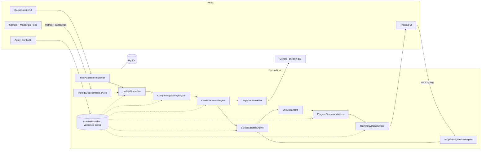
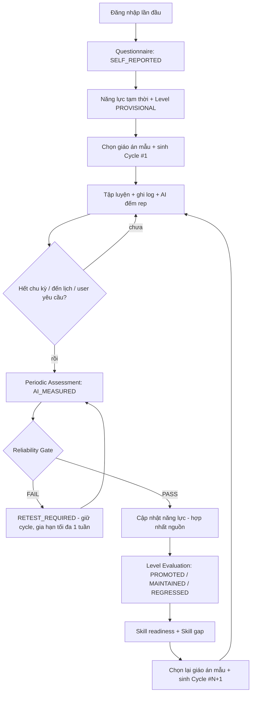
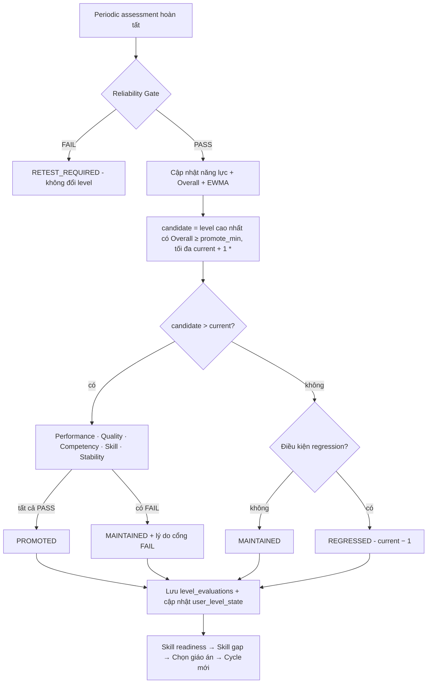
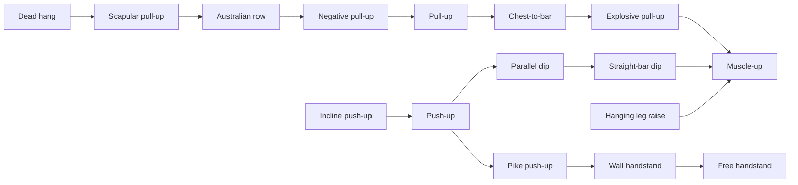
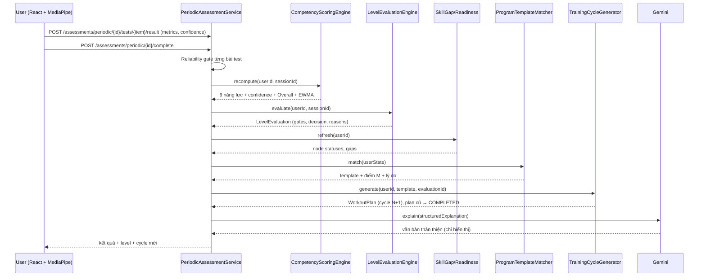

# CalisHealth — Thiết kế hệ thống Phân level, Bài đánh giá & Lộ trình theo level

> **⚠ Một số phần đã bị thay thế bởi `ASSESSMENT_FRAMEWORK_V2.md` (ưu tiên cao hơn):** §5.2/§5.3/§5.5 (Ladder → stage cao nhất,
> dải điểm đơn điệu), §8.2 bước A & §8.4 & §9 bước 4a/4c (sàng lọc an toàn độc lập, trần L2 bất biến), §13.2 (`user_skill_progress` theo stage),
> §16.2 (`competency_ladder_nodes`, `assessment_test_items/results`, `user_screening` bị thay; FK phải dùng `BIGINT UNSIGNED`).
> Xem Conflict Register (Phần A) của V2.
>
> Phiên bản: 1.0 · Ngày: 2026-10-07 · Trạng thái: Đề xuất thiết kế (chưa triển khai)
> Tổng hợp và cụ thể hoá từ: `configLevel.md`, `configLevelAnhTest.md`, `LEVELPROM.OTIONALGORITHM.md`, `functionUpLevel.md`,
> và **đối chiếu với code hiện tại** của backend (Spring Boot) + frontend (React).

---

## Mục lục

0. [Tóm tắt điều hành](#0-tóm-tắt-điều-hành)
1. [Hiện trạng code & khoảng trống](#1-hiện-trạng-code--khoảng-trống)
2. [Nguyên tắc thiết kế & chính sách bằng chứng khoa học](#2-nguyên-tắc-thiết-kế--chính-sách-bằng-chứng-khoa-học)
3. [Kiến trúc tổng thể & vòng lặp thích ứng](#3-kiến-trúc-tổng-thể--vòng-lặp-thích-ứng)
4. [Mô hình năng lực (Competency Framework)](#4-mô-hình-năng-lực-competency-framework)
5. [Chuẩn hoá điểm: Ladder Scoring](#5-chuẩn-hoá-điểm-ladder-scoring)
6. [Độ tin cậy, hợp nhất nguồn dữ liệu & độ tự tin](#6-độ-tin-cậy-hợp-nhất-nguồn-dữ-liệu--độ-tự-tin)
7. [Ba khái niệm level](#7-ba-khái-niệm-level)
8. [Bài đánh giá đầu vào (Initial Questionnaire)](#8-bài-đánh-giá-đầu-vào-initial-questionnaire)
9. [Level tạm thời (Provisional Level)](#9-level-tạm-thời-provisional-level)
10. [Bài đánh giá định kỳ (Periodic Practical Assessment)](#10-bài-đánh-giá-định-kỳ-periodic-practical-assessment)
11. [Level Evaluation Engine — 6 cổng](#11-level-evaluation-engine--6-cổng)
12. [Hysteresis & Regression](#12-hysteresis--regression)
13. [Skill Tree, Skill Readiness & Skill Gap](#13-skill-tree-skill-readiness--skill-gap)
14. [Lộ trình theo level: Giáo án mẫu + Engine](#14-lộ-trình-theo-level-giáo-án-mẫu--engine)
15. [Training Cycle & tiến bộ trong chu kỳ](#15-training-cycle--tiến-bộ-trong-chu-kỳ)
16. [Thiết kế CSDL (delta so với hiện tại)](#16-thiết-kế-csdl-delta-so-với-hiện-tại)
17. [Kiến trúc Spring Boot](#17-kiến-trúc-spring-boot)
18. [REST API](#18-rest-api)
19. [Pseudocode](#19-pseudocode)
20. [Ví dụ số end-to-end](#20-ví-dụ-số-end-to-end)
21. [Edge cases](#21-edge-cases)
22. [Cấu hình Admin / Coach](#22-cấu-hình-admin--coach)
23. [Gemini, versioning & audit](#23-gemini-versioning--audit)
24. [Chiến lược kiểm thử](#24-chiến-lược-kiểm-thử)
25. [Lộ trình triển khai theo giai đoạn](#25-lộ-trình-triển-khai-theo-giai-đoạn)
26. [Tài liệu tham khảo](#26-tài-liệu-tham-khảo)

---

## 0. Tóm tắt điều hành

CalisHealth hiện chấm bài test đầu vào thành **một điểm tổng → một level theo khoảng điểm của từng template**, và
tạo "lộ trình" là một bản ghi `workout_plans` rỗng. Thiết kế này thay bằng một **hệ thống vòng kín (closed-loop)**:

```
ĐÁNH GIÁ → ĐO → TÍNH NĂNG LỰC → XÉT LEVEL (6 cổng) → TÌM KHOẢNG TRỐNG KỸ NĂNG
        → CHỌN GIÁO ÁN MẪU PHÙ HỢP → ĐIỀN BÀI THEO TIẾN TRÌNH → TẬP → ĐÁNH GIÁ LẠI → THÍCH ỨNG
```

Năm quyết định thiết kế cốt lõi:

| # | Quyết định | Lý do |
|---|-----------|-------|
| 1 | **6 năng lực** PUSH / PULL / LEGS / CORE / MOBILITY / SKILL, mỗi năng lực 0–100 | Một level toàn cục che mất điểm yếu (vd. đẩy mạnh nhưng kéo yếu) |
| 2 | **Ladder Scoring**: điểm năng lực = vị trí trên chuỗi tiến trình bài tập + thành tích tại nấc đó | Cùng một thang cho cả dữ liệu tự khai báo và dữ liệu đo bằng MediaPipe → hợp nhất được; không bị "hiệu ứng sàn" khi user chưa làm được pull-up |
| 3 | **Level = điểm tổng + 6 cổng** (Performance, Quality, Competency, Skill, Stability, Reliability) + **hysteresis** | Không lên level vì một lần test may mắn, không tụt level vì một buổi tệ |
| 4 | **Giáo án mẫu có điều kiện áp dụng + "slot" thay vì bài cố định** | Admin kiểm soát cấu trúc giáo án; engine cá nhân hoá bài tập theo nấc tiến trình của từng user. Đây là câu trả lời cho "level nào dùng lộ trình nào" |
| 5 | **Mọi ngưỡng nằm trong `rule_sets` có version** và gắn `source_type` | Đổi ngưỡng không làm sai lịch sử; phân biệt rõ bằng chứng khoa học / thực hành coaching / quy tắc sản phẩm |

> **Lưu ý quan trọng về tính khoa học:** Không tổ chức nào (ACSM, NSCA…) định nghĩa chuẩn "Calisthenics Intermediate
> = X pull-up". Các mốc level L0–L4 và mọi ngưỡng số trong tài liệu này là **quy tắc sản phẩm (PRODUCT_RULE) hoặc
> chuẩn coaching (COACHING_BENCHMARK)** — được *định hướng* bởi khuyến nghị khoa học về tập kháng lực, nhưng phải
> cấu hình được, có version, và có thể hiệu chỉnh bằng dữ liệu thực tế (DATA_DERIVED) sau khi có đủ người dùng.

---

## 1. Hiện trạng code & khoảng trống

### 1.1 Những gì đã có và **tái sử dụng được**

| Thành phần | Vị trí | Dùng lại thế nào |
|---|---|---|
| Ngân hàng câu hỏi, template, option, score rule | `AssessmentQuestion`, `AssessmentTemplate` (`type` = INITIAL/PERIODIC), `AssessmentQuestionOption`, `AssessmentScoreRule` | Giữ nguyên làm lớp "thu thập câu trả lời"; thêm ánh xạ câu hỏi → năng lực |
| Engine chấm điểm theo trọng số | `AssessmentScoringEngine` (Σ điểm×trọng số / Σ trọng số) | Giữ cho điểm từng câu; phần "tính năng lực" và "xét level" chuyển sang engine mới |
| Phiên đánh giá có `source`, `template_version` | `AssessmentSession.source = SELF_REPORTED` | Dùng làm `assessment_id` gốc cho mọi quyết định level & chu kỳ |
| Chuỗi tiến trình bài tập | `ExerciseProgression` (NEXT / REGRESSION / ALTERNATIVE, `required_score`, `min_reps`) | Là xương sống của Skill Tree & Ladder; bổ sung tiêu chí chất lượng |
| Hạn chế/chống chỉ định bài tập | `ExerciseRestriction` | Dùng trong Exercise Eligibility |
| Cấu hình AI cho bài tập | `ExerciseAiProfile`, `AiMotionRule` (`invalid_rep`, `critical_threshold`), `AiLandmarkRequirement.min_visibility` | Là nguồn của Quality Gate & Reliability Gate |
| Kết quả phân tích chuyển động | `MovementSession`, `MovementMetric (confidence)`, `FormAnalysis (overall_score, range_of_motion, stability_score…)` | Là dữ liệu đo khách quan cho bài đánh giá định kỳ |
| Kế hoạch tập của user | `WorkoutPlan` → `WorkoutPlanDay` → `WorkoutPlanExercise` (sets, reps, RPE, tempo, rest) | Dùng làm **Training Cycle** cụ thể (thêm cột liên kết assessment) |
| Nhật ký tập | `WorkoutSession` → `WorkoutSessionExercise` → `ExerciseSet (reps, rpe)` | Dữ liệu cho Stability Gate & tiến bộ trong chu kỳ |
| Giải thích đề xuất | `RecommendationRun (input/output_snapshot)`, `Recommendation (reason)` | Lưu vết lý do chọn giáo án/bài tập |

### 1.2 Khoảng trống phải giải quyết

| # | Khoảng trống | Hậu quả hiện tại |
|---|---|---|
| G1 | Level được quyết định bởi `assessment_template_levels` **riêng của từng template** (khoảng điểm tổng) | Đổi template là đổi định nghĩa level; không có cổng năng lực; không so sánh được giữa các lần đánh giá |
| G2 | 14 nhóm `category` (`UPPER_BODY_STRENGTH`, …) **gộp đẩy và kéo** | Không phát hiện được "đẩy mạnh – kéo yếu" |
| G3 | `FitnessProfile` chỉ có strength/endurance/mobility/balance/core, không có confidence/source/trend | Không phân biệt dữ liệu tự khai báo với dữ liệu đo |
| G4 | Giáo án admin lưu **localStorage** (`services/mock/workoutPlansService.ts`), không có ở backend | Không có cách nào gán giáo án cho user theo level |
| G5 | `WorkoutPlanService.generatePersonalizedPlan` tạo plan **rỗng** (chỉ có tên, level, số tuần) | User không nhận được bài tập thật |
| G6 | `movement_sessions.workout_session_id` **NOT NULL** | Bài đánh giá định kỳ bằng camera không gắn được vào `assessment_session` |
| G7 | Không có bảng lịch sử quyết định level, không có version của bộ quy tắc | Không trả lời được "vì sao user này lên/không lên level" |

---

## 2. Nguyên tắc thiết kế & chính sách bằng chứng khoa học

### 2.1 Mười nguyên tắc bắt buộc

1. **Dữ liệu ban đầu = tự khai báo = tạm thời.** Level từ questionnaire luôn có `status = PROVISIONAL`.
2. **Dữ liệu đo > dữ liệu tự khai báo** khi cả hai cùng tồn tại (thể hiện bằng trọng số tin cậy, không xoá dữ liệu cũ).
3. **Đa chiều:** 6 năng lực độc lập; level tổng không được che điểm yếu.
4. **Chỉ đếm rep hợp lệ** (valid reps) cho mọi quyết định tiến bộ.
5. **Không mở kỹ năng khi thiếu điều kiện tiên quyết**, kể cả khi điểm tổng cao.
6. **Lên level phải qua đủ cổng; tụt level phải theo xu hướng** (trend-based) — không theo một buổi.
7. **Dữ liệu kém tin cậy không được dùng để lên/tụt level** → `RETEST_REQUIRED`.
8. **Quyết định là tất định (deterministic) và giải thích được.** Gemini chỉ diễn giải, không quyết định.
9. **Mỗi chu kỳ tập truy vết được về bài đánh giá sinh ra nó** (`assessment_session_id`, `previous_cycle_id`, `rule_set_id`).
10. **Không có số "ma thuật" trong code Java.** Mọi ngưỡng nằm trong `rule_sets` có version.

### 2.2 Phân loại nguồn của quy tắc (`source_type`)

| source_type | Ý nghĩa | Ví dụ trong thiết kế |
|---|---|---|
| `SCIENTIFIC_EVIDENCE` | Có khuyến nghị/nghiên cứu bình duyệt hỗ trợ trực tiếp | Tần suất 2–3 buổi/tuần cho người mới tập kháng lực [1]; thứ tự bài test [12] |
| `COACHING_BENCHMARK` | Chuẩn thực hành coaching phổ biến, chưa có chuẩn khoa học phổ quát | "Pull-up chuẩn ≥ 5 rep là nền tảng trước khi luyện muscle-up" |
| `PRODUCT_RULE` | Quy ước sản phẩm CalisHealth | Thang L0–L4, trọng số điểm tổng, biên hysteresis 8 điểm |
| `COACH_CONFIGURED` | Coach/Admin điều chỉnh | Ngưỡng form riêng cho một bài |
| `DATA_DERIVED` | Hiệu chỉnh từ dữ liệu người dùng (vd. phân vị) | Giai đoạn 4: ngưỡng benchmark theo phân vị 25/50/75 |

Mọi bảng cấu hình có cột `source_type` + `source_reference` + `rule_set_id`.

### 2.3 Các khuyến nghị khoa học được dùng làm "khung"

| Chủ đề | Nội dung dùng trong thiết kế | Nguồn |
|---|---|---|
| Tiến bộ tải tập kháng lực | Người mới: 2–3 buổi/tuần toàn thân, 1–3 set, 8–12 rep; trung cấp 3–4 buổi; nâng cao 4–6 buổi; tăng tải dần | ACSM Position Stand 2009 [1] |
| Khối lượng tuần | Quan hệ liều–đáp ứng giữa số set/tuần và phì đại cơ → làm cơ sở cho **trần khối lượng theo level** | Schoenfeld et al. 2017 [6] |
| Calisthenics có hiệu quả sức mạnh | Push-up tiến trình tăng sức mạnh tương đương bench press khi mức kích hoạt cơ tương đương | Calatayud 2015 [8], Kotarsky 2018 [7] |
| Cường độ chủ quan | Thang RIR/RPE để kê "còn X rep trong kho" | Zourdos 2016 [9]; session-RPE: Foster 2001 [10] |
| Tự khai báo kém chính xác | Tự khai báo hoạt động thể lực lệch đáng kể so với đo trực tiếp → dữ liệu questionnaire phải có độ tin cậy thấp | Prince et al. 2008 [4] (bối cảnh: hoạt động thể lực) |
| Sai số đo & thay đổi có ý nghĩa | Chỉ coi là "tiến bộ thật" khi thay đổi vượt sai số đo điển hình (typical error / MDC) | Hopkins 2000 [5] |
| Thứ tự bài test | Test không gây mệt → kỹ năng/sức mạnh tối đa → sức bền cơ sau cùng | NSCA Essentials [12] |
| Sàng lọc an toàn | Bộ câu hỏi sẵn sàng vận động kiểu PAR-Q+ (không chẩn đoán) | Warburton et al. 2011 [3] |
| Ngừng tập | Năng lực giảm khi ngừng tập kéo dài → cần trạng thái "quay lại" và đánh giá lại, không tự động hạ level | Mujika & Padilla 2000 [11] |
| Phân chu kỳ | Tập có phân chu kỳ cho hiệu quả sức mạnh tốt hơn không phân chu kỳ | Rhea & Alderman 2004 [14] |
| Ước lượng tư thế | MediaPipe/BlazePose trả về landmark + visibility → nguồn của độ tin cậy đo | Bazarevsky et al. 2020 [13] |

---

## 3. Kiến trúc tổng thể & vòng lặp thích ứng

### 3.1 Sơ đồ thành phần



### 3.2 Vòng lặp thích ứng



> Cycle mới **luôn** được sinh sau mỗi đánh giá hợp lệ, kể cả khi level giữ nguyên — vì nấc tiến trình bài tập
> và điểm yếu có thể đã thay đổi (theo `LEVELPROM.OTIONALGORITHM.md` §19).

---

## 4. Mô hình năng lực (Competency Framework)

### 4.1 Sáu năng lực chính (tính vào điểm tổng)

| Mã | Tên | Mẫu vận động tiêu biểu | Trọng số điểm tổng mặc định |
|---|---|---|---|
| PUSH | Sức mạnh đẩy | Push-up, Dip, Pike/HSPU, Pseudo-planche | 0.20 |
| PULL | Sức mạnh kéo | Dead hang, Australian row, Pull-up, Chest-to-bar, Muscle-up | 0.20 |
| LEGS | Chân | Squat, Split squat, Bulgarian, Shrimp, Pistol | 0.15 |
| CORE | Thân giữa | Plank, Hollow hold, Hanging leg raise, L-sit | 0.20 |
| MOBILITY | Linh hoạt | Gập hông, gập vai, squat sâu (đo góc khớp) | 0.10 |
| SKILL | Kỹ năng thăng bằng/tĩnh | Crow, Wall handstand, Free handstand, Lever | 0.15 |

Ràng buộc: Σ trọng số = 1.00 (validate khi lưu rule set). Trọng số là **PRODUCT_RULE**: ưu tiên PUSH/PULL/CORE vì đây
là nền tảng của gần như mọi kỹ năng calisthenics; MOBILITY thấp hơn vì đo khó chính xác hơn và ít quyết định level.

### 4.2 Năng lực phụ (theo dõi, **không** tính vào điểm tổng ở v1)

`ENDURANCE`, `BALANCE`, `CONTROL`, `POWER` — lưu để phân tích và dùng cho chọn giáo án (vd. mục tiêu giảm mỡ), có thể
đưa vào điểm tổng ở rule set sau mà không đổi code.

### 4.3 Ánh xạ từ 14 `category` hiện có

| Category hiện tại | → Năng lực | Ghi chú |
|---|---|---|
| UPPER_BODY_STRENGTH | **PUSH hoặc PULL theo từng câu** | Bắt buộc ánh xạ ở mức câu hỏi (bảng `question_competency_weights`) |
| LOWER_BODY_STRENGTH | LEGS | |
| CORE_STABILITY | CORE | |
| MUSCULAR_ENDURANCE | Theo từng câu (PUSH/PULL/LEGS/CORE) | vd. "plank bao lâu" → CORE |
| CARDIO_ENDURANCE | ENDURANCE (phụ) | |
| SHOULDER_MOBILITY / HIP_MOBILITY / ANKLE_MOBILITY | MOBILITY | |
| BALANCE / BODY_CONTROL | SKILL (và BALANCE/CONTROL phụ) | |
| CALISTHENICS_SKILL | SKILL | |
| RECOVERY / TRAINING_CONSISTENCY / PERCEIVED_EFFORT | **Không chấm điểm** — dữ liệu ngữ cảnh | Dùng cho kiểm tra mâu thuẫn & kê khối lượng |

`category` vẫn giữ để hiển thị nhóm câu hỏi; việc tính điểm năng lực đọc từ `question_competency_weights`
(một câu có thể đóng góp cho nhiều năng lực với trọng số khác nhau).

### 4.4 Thang level của từng năng lực (Competency Level)

| Band | Khoảng điểm | Biên hysteresis |
|---|---|---|
| FOUNDATION | 0 – 24 | ±5 |
| BEGINNER | 25 – 49 | ±5 |
| INTERMEDIATE | 50 – 69 | ±5 |
| ADVANCED | 70 – 84 | ±5 |
| ELITE | 85 – 100 | ±5 |

Lên band khi điểm ≥ mốc dưới của band mới; xuống band chỉ khi điểm < mốc dưới của band hiện tại − 5.

---

## 5. Chuẩn hoá điểm: Ladder Scoring

### 5.1 Vấn đề của cách hiện tại

Quy tắc khoảng (`AssessmentScoreRule`: "10–20 push-up → 60 điểm") có hai nhược điểm:
- **Bậc thang gãy:** 19 rep và 20 rep chênh nhau cả một mức điểm.
- **Hiệu ứng sàn:** mọi người chưa làm được pull-up đều 0 điểm PULL, dù người treo được 60 giây và chèo
  Australian row 15 rep rõ ràng mạnh hơn người không treo nổi.

### 5.2 Ý tưởng: điểm = vị trí trên chuỗi tiến trình

Mỗi năng lực có một **thang (ladder)** gồm các nấc (node) bài tập theo độ khó tăng dần. Mỗi nấc chiếm một đoạn điểm
`[base, base + span]` và có một chỉ tiêu `target` (rep hợp lệ hoặc giây giữ).

```
nodeScore_k = base_k + span_k × g( perf_k / target_k )         g(x) = min(1, x)  (mặc định tuyến tính,
                                                                 có thể cấu hình anchors nội suy từng đoạn)
CompetencyObservation_c = max_k nodeScore_k   trên các nấc mà user "vào được" (perf ≥ entry_value)
```

**Vì sao dùng `max`:** năng lực được quyết định bởi nấc **khó nhất làm được**. Người làm được 10 pull-up không cần
test dead hang — không bị phạt vì bỏ qua bài dễ. Thiếu dữ liệu ở nấc thấp **không** kéo điểm xuống.

### 5.3 Thang mặc định (COACHING_BENCHMARK — cấu hình được)

**PULL**

| Nấc | Bài | Đoạn điểm | Target | Entry |
|---|---|---|---|---|
| 1 | Dead hang | 0 – 10 | 60 s | 5 s |
| 2 | Scapular pull-up | 10 – 20 | 12 rep | 1 |
| 3 | Australian row | 20 – 35 | 20 rep | 1 |
| 4 | Negative pull-up (≥ 3 s xuống) | 35 – 45 | 5 rep | 1 |
| 5 | Pull-up chuẩn | 45 – 75 | 15 rep | 1 |
| 6 | Chest-to-bar pull-up | 75 – 88 | 10 rep | 1 |
| 7 | Muscle-up (bar) | 88 – 100 | 5 rep | 1 |

**PUSH**

| Nấc | Bài | Đoạn | Target |
|---|---|---|---|
| 1 | Incline push-up | 0 – 20 | 20 rep |
| 2 | Push-up | 20 – 50 | 30 rep |
| 3 | Parallel dip | 50 – 65 | 15 rep |
| 4 | Pike push-up / Diamond | 60 – 72 | 15 rep |
| 5 | Pseudo-planche push-up | 72 – 85 | 12 rep |
| 6 | Wall HSPU | 85 – 100 | 8 rep |

**LEGS**: Assisted squat 0–20 (target 20) → Bodyweight squat 20–45 (50) → Bulgarian split squat 45–65 (15/chân)
→ Shrimp squat (assisted) 65–85 (8/chân) → Pistol squat 85–100 (8/chân).

**CORE**: Plank 5–35 (90 s) → Hollow body hold 30–50 (60 s) → Hanging leg raise 50–65 (15) → L-sit 65–85 (30 s)
→ Dragon flag (negative) 85–100 (8).

**SKILL**: Wall plank/pike hold 0–20 (30 s) → Crow pose 20–40 (30 s) → Chest-to-wall handstand 40–60 (60 s)
→ Freestanding handstand 60–80 (30 s) → Freestanding HSPU (partial) 80–100 (5).

**MOBILITY** (đo góc khớp bằng MediaPipe, hoặc tự đánh giá có hình minh hoạ): 3 bài kiểm tra, mỗi bài 0–100,
năng lực = trung bình:
- Gập vai (shoulder flexion, áp lưng tường): góc cánh tay–thân; 180° → 100.
- Gập hông (forward fold/pike, gối thẳng): góc thân–đùi.
- Squat sâu gót chạm sàn (overhead squat): góc gối + gót có nhấc không.

> Các nấc có thể chồng đoạn (Dip 50–65 và Pike 60–72) vì là các nhánh song song; dùng `max` nên không bị cộng dồn.

### 5.4 Ví dụ

User chèo Australian row 10 rep, chưa làm được pull-up: `PULL = 20 + 15 × 10/20 = 27.5`.
User làm được 7 pull-up chuẩn: `PULL = 45 + 30 × 7/15 = 59.0`.

### 5.5 Câu hỏi không thuộc thang

Câu "lựa chọn" kiểu cũ (option có `score`) vẫn chấm như hiện tại (0–100), rồi đóng góp vào năng lực qua
`question_competency_weights`. Với cùng một năng lực, observation = trung bình có trọng số của (điểm ladder,
điểm các câu khác) — điểm ladder mặc định trọng số 3, câu khác trọng số 1 (cấu hình được).

---

## 6. Độ tin cậy, hợp nhất nguồn dữ liệu & độ tự tin

### 6.1 Độ tin cậy cơ sở theo nguồn (PRODUCT_RULE — cấu hình được, không phải hằng số khoa học)

| Nguồn | r_base mặc định |
|---|---|
| SELF_REPORTED | 0.50 |
| AI_MEASURED | 0.90 × hệ số chất lượng đo (bên dưới) |
| COACH_VERIFIED | 0.95 |

Hệ số chất lượng đo của một bài test AI:

```
r_AI = 0.90 × min(1, poseConfidenceAvg / 0.80) × min(1, keyLandmarkVisibilityAvg / 0.80) × trackedFrameRatio
```

### 6.2 Chất lượng dữ liệu questionnaire (`data_quality_status`)

| Trạng thái | Điều kiện | Hệ số q |
|---|---|---|
| HIGH | Trả lời ≥ 90% câu chấm điểm, không vi phạm luật nhất quán | 1.0 |
| MEDIUM | 70–90% hoặc có vi phạm mức WARNING | 0.8 |
| LOW | < 70% câu chấm điểm | 0.6 |
| CONFLICTED | Có vi phạm mức CONFLICT | 0.3 (chỉ cho năng lực bị ảnh hưởng) |

**Luật nhất quán** (bảng `consistency_rules`, điều kiện dạng JSON), ví dụ:

| Mã | Điều kiện | Mức | Năng lực bị ảnh hưởng |
|---|---|---|---|
| C01 | Kinh nghiệm = "chưa từng tập" **và** pull-up ≥ 10 | CONFLICT | PULL |
| C02 | Push-up < 5 **và** dip ≥ 15 | CONFLICT | PUSH |
| C03 | Plank < 20 s **và** L-sit ≥ 15 s | CONFLICT | CORE |
| C04 | Chưa làm được pull-up **và** muscle-up ≥ 1 | CONFLICT | PULL, SKILL |
| C05 | Pull-up ≥ 25 hoặc push-up ≥ 80 (vượt thực tế với người mới vào app) | WARNING | tương ứng |

Hệ quả: hạ `q` của năng lực bị ảnh hưởng, đặt cờ `needs_verification`, hiển thị câu hỏi làm rõ (tuỳ chọn),
và **ưu tiên lịch đánh giá thực hành sớm**.

### 6.3 Hợp nhất nhiều lần đánh giá (Reliability-weighted, time-decayed blending)

Với năng lực `c`, mỗi lần đánh giá `j` cho một observation `S_j`:

```
w_j = r_j × q_j × d_j × λ_j
d_j = 0.5 ^ (ageDays_j / H)                 H = half-life, mặc định 42 ngày
λ_j = 0.1  nếu j là SELF_REPORTED và đã có AI_MEASURED/COACH_VERIFIED mới hơn với r ≥ 0.7
      1.0  ngược lại

S_c  = Σ_j (w_j × S_j) / Σ_j w_j
C_c  = 1 − Π_j (1 − r_j × q_j × d_j)        (độ tự tin 0..1)
```

**Vì sao chọn công thức này thay vì Σ(score × weight × reliability)/Σ(weight × reliability) thuần tuý:**
- Vẫn là trung bình có trọng số (giải thích được, dễ kiểm thử) — đúng tinh thần công thức gốc.
- Thêm **suy giảm theo thời gian** `d_j`: năng lực đo 5 tháng trước ít đại diện cho hiện tại.
- Thêm **λ** để hiện thực "đo > tự khai báo" một cách rõ ràng, không xoá dữ liệu lịch sử.
- `C_c` tăng khi có thêm bằng chứng độc lập: chỉ tự khai báo → 0.5; thêm một lần đo AI r = 0.85 → 1 − 0.5×0.15 = 0.925.

**Thiếu dữ liệu:** nếu một năng lực không có observation nào → `S_c = null`, `C_c = 0`. Điểm tổng tính lại trọng số
trên các năng lực có dữ liệu; nhưng **Competency Gate coi `null` của năng lực bắt buộc là FAIL** (không cho lên level
khi chưa có bằng chứng).

### 6.4 Điểm tổng & xu hướng

```
Overall = Σ_c W_c × S_c   (6 năng lực chính, Σ W_c = 1)
EWMA_t  = α × Overall_t + (1 − α) × EWMA_{t−1}      α = 0.5 mặc định
trend_c = IMPROVING nếu S_c,t − S_c,t−1 ≥ δ ; DECLINING nếu ≤ −δ ; ngược lại STABLE    (δ = 3 điểm)
```

`δ` nên đặt ≥ sai số đo điển hình của bài test (Hopkins 2000 [5]) — v1 dùng 3 điểm (PRODUCT_RULE), giai đoạn 4 thay
bằng giá trị DATA_DERIVED từ test–retest thực tế.

---

## 7. Ba khái niệm level

| Khái niệm | Phạm vi | Quyết định bởi | Ví dụ |
|---|---|---|---|
| **Overall Level** | Toàn bộ người dùng | Level Evaluation Engine (6 cổng + hysteresis) | INTERMEDIATE |
| **Competency Level** | Từng năng lực | Band điểm + hysteresis ±5 | PULL = BEGINNER, PUSH = ADVANCED |
| **Skill Readiness** | Từng kỹ năng/nấc | Điều kiện tiên quyết của Skill Tree | Muscle-up = NOT_READY (thiếu explosive pull) |

Ba khái niệm **độc lập**: user có thể Overall = INTERMEDIATE, PUSH = ADVANCED, PULL = BEGINNER, Muscle-up = LOCKED.

### 7.1 Thang Overall Level (PRODUCT_RULE)

| Mã | Tên | Mô tả hành vi |
|---|---|---|
| L0 | FOUNDATION | Chưa có nền tảng: chưa làm được push-up chuẩn hoặc chưa treo xà ổn định |
| L1 | BEGINNER | Có nền cơ bản; đang xây push-up, row, squat, plank |
| L2 | INTERMEDIATE | Pull-up, dip, push-up chuẩn với số rep có ý nghĩa; bắt đầu kỹ năng |
| L3 | ADVANCED | Sức mạnh tương đối cao; luyện kỹ năng tĩnh/động nâng cao |
| L4 | ELITE | Kỹ năng nâng cao ổn định; giáo án bắt buộc có coach duyệt |

### 7.2 Yêu cầu từng level (mặc định, lưu trong `fitness_levels` + `level_requirements`)

| Level | Overall lên ≥ | Overall (EWMA) xét tụt < | Competency gate (bắt buộc) | Performance gate (rep hợp lệ) | Skill gate | Quality gate |
|---|---|---|---|---|---|---|
| L1 | 25 | 17 | PUSH ≥ 20, PULL ≥ 15, CORE ≥ 20 | Push-up (bất kỳ nấc) ≥ 5; plank ≥ 30 s | — | Form ≥ 65, valid ratio ≥ 0.7 |
| L2 | 50 | 42 | PUSH ≥ 45, PULL ≥ 40, CORE ≥ 45, LEGS ≥ 40 | Push-up ≥ 20; pull-up ≥ 5; dip ≥ 5; squat ≥ 30 | Node Pull-up = ACHIEVED | Form ≥ 75, valid ratio ≥ 0.8, 0 lỗi nghiêm trọng |
| L3 | 72 | 64 | PUSH, PULL, CORE ≥ 65; LEGS ≥ 55; SKILL ≥ 50 | Pull-up ≥ 12; dip ≥ 15; L-sit ≥ 15 s | Chest-to-wall handstand = ACHIEVED; Shrimp squat = ACHIEVED | Form ≥ 80, valid ratio ≥ 0.85, 0 lỗi nghiêm trọng |
| L4 | 88 | 80 | PUSH, PULL, LEGS, CORE ≥ 80; SKILL ≥ 75; MOBILITY ≥ 60 | Muscle-up ≥ 3; HSPU (tường) ≥ 5 | Free handstand 30 s; Muscle-up = ACHIEVED | Form ≥ 85, valid ratio ≥ 0.9, coach xác minh |

> Tất cả là **COACHING_BENCHMARK / PRODUCT_RULE** — cần coach dự án duyệt trước khi kích hoạt rule set, và hiệu
> chỉnh lại bằng dữ liệu (giai đoạn 4).

---

## 8. Bài đánh giá đầu vào (Initial Questionnaire)

### 8.1 Mục tiêu & ràng buộc

- Thời lượng 6–8 phút, ~20 câu, chia 6 bước (tận dụng cơ chế `section_title` → step hiện có).
- Câu hỏi hiệu năng hỏi theo **dạng thang tiến trình** ("bài khó nhất bạn làm được + bao nhiêu lần") → đổ thẳng vào
  Ladder Scoring, cùng thang với bài đo AI sau này.
- Dữ liệu cơ thể ghi vào `user_profiles` (đúng ghi chú trong `configLevelAnhTest.md` §2.1) — **không** dùng chiều cao,
  cân nặng, BMI để tính năng lực; BMI do hệ thống tính.

### 8.2 Cấu trúc đề xuất

| Bước | Nội dung | Số câu | Chấm điểm? | Ghi vào |
|---|---|---|---|---|
| A. Sàng lọc an toàn | 6–7 câu dạng PAR-Q+ (đau ngực khi vận động, chóng mặt, bệnh tim mạch được chẩn đoán, chấn thương xương khớp đang điều trị…) + vùng đau/chấn thương (multi) | 7 | Không | `user_screening` + `ExerciseRestriction` match |
| B. Hồ sơ cơ thể | Ngày sinh, giới tính, chiều cao, cân nặng | 4 | Không | `user_profiles` (+ lịch sử `body_measurements`) |
| C. Nền tảng tập luyện | Thời gian tập calisthenics (tháng), số buổi/tuần hiện tại | 2 | Không (dùng cho luật nhất quán & tốc độ tiến bộ) | `assessment_responses` |
| D. Hiệu năng tự khai báo | 1 câu ladder cho mỗi PUSH, PULL, LEGS, CORE, SKILL (chọn nấc + số rep/giây) | 5 cặp | **Có** (ladder) | năng lực |
| E. Linh hoạt tự kiểm tra | 3 câu có hình: chạm mũi chân gối thẳng; squat sâu gót chạm sàn; giơ tay thẳng áp tường | 3 | **Có** (option score) | MOBILITY |
| F. Mục tiêu & ràng buộc | Mục tiêu chính (single), mục tiêu phụ (≤ 2), số ngày/tuần có thể tập, phút/buổi, dụng cụ (xà đơn, xà kép/ghế, dây kháng lực, vòng…), nơi tập | 6 | Không | `user_goals`, `user_training_constraints` |

**Lý do không chấm điểm "kinh nghiệm":** kinh nghiệm tương quan nhưng không phải năng lực; cộng nó vào điểm sẽ
tính trùng (double counting) với câu hiệu năng. Kinh nghiệm được dùng để **kiểm tra mâu thuẫn** và để chọn **tốc độ tăng tải**.

### 8.3 Loại câu hỏi mới: `PROGRESSION_LADDER`

Thêm vào `AssessmentQuestionTypes.ADMIN_TYPES` (frontend renderer: chọn nấc → ô nhập số).

```json
// assessment_questions.config_json
{
  "ladderConfig": {
    "competency": "PULL",
    "nodes": [
      {"exerciseCode": "DEAD_HANG",        "label": "Treo xà (dead hang)",  "metric": "HOLD_SEC"},
      {"exerciseCode": "AUSTRALIAN_ROW",   "label": "Kéo xà thấp",          "metric": "VALID_REPS"},
      {"exerciseCode": "NEGATIVE_PULLUP",  "label": "Hạ chậm pull-up",      "metric": "VALID_REPS"},
      {"exerciseCode": "PULLUP",           "label": "Pull-up chuẩn",        "metric": "VALID_REPS"},
      {"exerciseCode": "CHEST_TO_BAR",     "label": "Chest-to-bar",         "metric": "VALID_REPS"},
      {"exerciseCode": "MUSCLE_UP",        "label": "Muscle-up",            "metric": "VALID_REPS"}
    ],
    "allowNone": true
  }
}
// Câu trả lời: {"node": "AUSTRALIAN_ROW", "value": 10}
```

Bảng điểm (base/span/target) **không** nằm trong câu hỏi mà nằm ở `competency_ladder_nodes` của rule set → câu hỏi
và bài test AI dùng chung một định nghĩa thang.

### 8.4 Kết quả sàng lọc an toàn

Nếu có câu sàng lọc trả lời "Có": không chẩn đoán; hiển thị khuyến nghị hỏi ý kiến bác sĩ trước khi tập cường độ cao,
**giới hạn level tạm thời ≤ L1**, khoá bài nhảy/plyometric và bài lộn ngược (handstand) cho tới khi user xác nhận
đã được bác sĩ cho phép hoặc coach mở khoá.

---

## 9. Level tạm thời (Provisional Level)

```
1. Tính S_c cho 6 năng lực từ questionnaire (r = 0.5, q theo data_quality).
2. Overall = Σ W_c × S_c.
3. candidate = level cao nhất mà Overall ≥ overall_promote_min VÀ mọi competency gate bắt buộc đều đạt.
   (Questionnaire không có dữ liệu đo → bỏ qua Performance/Quality/Stability gate; Skill gate dùng nấc tự khai báo.)
4. Áp dụng giới hạn an toàn:
   a. provisional ≤ max_provisional_level (mặc định L2)
   b. nếu có năng lực bắt buộc CONFLICTED → provisional = candidate − 1 (tối thiểu L0)
   c. nếu sàng lọc an toàn có cờ → provisional ≤ L1
5. Lưu user_level_state(status = PROVISIONAL), level_evaluations(decision = PROVISIONAL_ASSIGNED, gates = N/A).
6. Lên lịch "Baseline Test" (bài đánh giá thực hành rút gọn) trong 7–14 ngày đầu.
```

**Vì sao giới hạn L2 và xếp thấp khi có mâu thuẫn:** tự khai báo có xu hướng lệch [4]; rủi ro của việc xếp **thấp**
(tiến bộ nhanh, sẽ được nâng sau Baseline Test) nhỏ hơn nhiều so với xếp **cao** (quá tải, chấn thương, bỏ tập).
Người thực sự ở L3–L4 sẽ được nâng sau Baseline Test qua **fast-track** (§11.6).

**Baseline Test:** là một Periodic Assessment rút gọn (3–4 bài: PUSH, PULL, CORE + 1 bài theo mục tiêu). Nếu kết quả
lệch ≥ 1 level so với provisional → sinh lại Cycle #1 ngay (generation_reason = `BASELINE_RECALIBRATION`).

---

## 10. Bài đánh giá định kỳ (Periodic Practical Assessment)

### 10.1 Lịch

- Mặc định ở **tuần cuối mỗi chu kỳ** (4–6 tuần tuỳ level, §15) — trùng tuần deload nên user ít mệt.
- User có thể yêu cầu sớm, tối thiểu cách lần trước 14 ngày (tránh "test liên tục tới khi may mắn").
- Không tập > 4 tuần → trạng thái `RETURNING`, bắt buộc đánh giá lại trước khi sinh cycle mới.

### 10.2 Bộ test thích ứng theo level (Adaptive Test Battery)

Nguyên tắc: mỗi năng lực test **nấc hiện tại và nấc kế tiếp** — tránh hiệu ứng trần/sàn, giữ buổi test ≤ 25 phút.

| Năng lực | L0 – L1 | L2 | L3 – L4 | Chỉ số |
|---|---|---|---|---|
| PUSH | Incline hoặc Push-up (tối đa rep hợp lệ) | Push-up + Parallel dip | Dip + Pseudo-planche / Wall HSPU | valid reps |
| PULL | Dead hang + Australian row | Pull-up (fallback Australian row nếu 0) | Pull-up + Chest-to-bar / Muscle-up | valid reps / giây |
| LEGS | Bodyweight squat | Bulgarian split squat | Shrimp / Pistol | valid reps |
| CORE | Plank | Hollow hold | Hanging leg raise / L-sit | giây / reps |
| MOBILITY | 3 bài góc khớp (vai, hông, squat sâu) | như trái | như trái | góc (°) → 0–100 |
| SKILL | Wall pike hold / Crow | Chest-to-wall handstand | Freestanding handstand | giây |

### 10.3 Giao thức chuẩn hoá (để kết quả so sánh được giữa các lần)

1. Khởi động chuẩn 5 phút (video hướng dẫn cố định theo rule set).
2. **Thứ tự**: kỹ năng/thăng bằng → sức mạnh tối đa (rep thấp) → sức bền (rep nhiều/giữ lâu) → linh hoạt [12].
3. Nghỉ 2–3 phút giữa các bài.
4. Mỗi bài 1 lần làm tới khi **không còn rep hợp lệ** (technical failure) hoặc đạt trần target × 1.5.
5. Kiểm tra camera trước test: góc quay, khoảng cách, đủ landmark theo `AiLandmarkRequirement`.

### 10.4 Kết quả mỗi bài test (`assessment_test_results`)

| Trường | Nguồn |
|---|---|
| total_reps, valid_reps, invalid_reps | Rule Engine (`AiMotionRule.invalid_rep`) |
| hold_sec | Feature Engine |
| form_score, rom_score, stability_score | `FormAnalysis` |
| major_violations | Số lần chạm `critical_threshold` |
| pose_confidence_avg, visibility_avg, tracked_ratio | `MovementMetric.confidence`, MediaPipe visibility |
| reliability (r_AI) | §6.1 |
| status | VALID / RETEST |

`valid_ratio = valid_reps / total_reps`. **Mọi tính toán năng lực dùng valid_reps**, không dùng total_reps.

---

## 11. Level Evaluation Engine — 6 cổng

### 11.1 Luồng quyết định



\* Không nhảy quá 1 level mỗi lần đánh giá, **trừ** Baseline Test và fast-track (§11.6).

**Vì sao candidate chỉ dựa vào Overall:** để Competency Gate là một cổng **riêng**, nhờ đó hệ thống trả lời được câu
"năng lực nào đã chặn việc lên level" (yêu cầu kiểm toán trong `LEVELPROM.OTIONALGORITHM.md` §20).

### 11.2 Reliability Gate (luôn chạy đầu tiên)

PASS khi **tất cả**:
- Mọi bài test bắt buộc có `status = VALID`.
- `pose_confidence_avg ≥ 0.60`, `visibility_avg` của landmark bắt buộc ≥ `AiLandmarkRequirement.min_visibility`.
- `tracked_ratio ≥ 0.80`.
- Đủ năng lực bắt buộc của candidate level có dữ liệu.

FAIL → `RETEST_REQUIRED`: không lên, không tụt; cycle hiện tại kéo dài tối đa 1 tuần; hướng dẫn cụ thể về camera.

### 11.3 Performance Gate

Với mỗi `level_requirements` loại `PERFORMANCE` của candidate level: so sánh **valid_reps / hold_sec** của bài đó
(lấy bài tương đương theo `ExerciseProgression` nếu user làm nấc cao hơn — vd. làm được chest-to-bar thì coi như đạt
yêu cầu pull-up). Tất cả bắt buộc đạt → PASS.

### 11.4 Quality Gate

Trên các bài test phục vụ performance requirement:
`form_score ≥ min_form` **và** `valid_ratio ≥ min_valid_ratio` **và** `major_violations = 0` **và** `rom_score ≥ min_rom`.

### 11.5 Competency Gate & Skill Gate

- Competency: mọi năng lực bắt buộc `S_c ≥ ngưỡng`, `S_c` ≠ null, và `C_c ≥ 0.6`.
- Skill: mọi node bắt buộc có `user_skill_progress.status = ACHIEVED` (§13).

### 11.6 Stability Gate — so sánh chiến lược & khuyến nghị

| Chiến lược | Ưu | Nhược |
|---|---|---|
| A. 2 lần đánh giá liên tiếp đạt | Đơn giản, chắc chắn | Chậm: phải chờ thêm 4–6 tuần |
| B. N/M buổi tập gần nhất đạt chỉ tiêu | Dùng dữ liệu tập hằng ngày | Buổi tập thường không chuẩn hoá như buổi test |
| C. Trung bình trượt | Mượt nhiễu | Phản ứng chậm, khó giải thích |
| D. Kết hợp | Cân bằng tốc độ & độ chắc | Phức tạp hơn một chút |

**Khuyến nghị: D — Hybrid.** Stability = PASS khi đạt **một trong hai**:

1. Lần đánh giá **trước đó** (trong 10 tuần) cũng có candidate ≥ level đang xét **và** đạt Competency Gate; **hoặc**
2. Trong 21 ngày gần nhất, **≥ 3 trong 4 buổi tập** có bài chủ chốt của level (vd. pull-up với L2) đạt chỉ tiêu
   performance với `form_score ≥ min_form` (đo bằng AI trong buổi tập).

**Fast-track** (bỏ qua Stability Gate) khi: Overall ≥ promote_min + 10 **và** mọi bài test r_AI ≥ 0.85 **và**
(là Baseline Test **hoặc** có coach xác minh). Fast-track có thể nhảy nhiều level — dành cho người khai báo thấp hơn thực tế.

### 11.7 Ma trận quyết định

| Reliability | candidate > current | Perf | Quality | Comp | Skill | Stability | Regression đạt | Kết quả |
|---|---|---|---|---|---|---|---|---|
| FAIL | – | – | – | – | – | – | – | **RETEST_REQUIRED** |
| PASS | có | PASS | PASS | PASS | PASS | PASS | – | **PROMOTED** |
| PASS | có | FAIL | * | * | * | * | – | MAINTAINED (lý do: performance) |
| PASS | có | PASS | FAIL | * | * | * | – | MAINTAINED (lý do: quality) |
| PASS | có | PASS | PASS | FAIL | * | * | – | MAINTAINED (lý do: năng lực X) |
| PASS | có | PASS | PASS | PASS | FAIL | * | – | MAINTAINED (lý do: kỹ năng tiên quyết) |
| PASS | có | PASS | PASS | PASS | PASS | FAIL | – | MAINTAINED (chờ xác nhận ổn định) |
| PASS | không | – | – | – | – | – | không | MAINTAINED |
| PASS | không | – | – | – | – | – | có | **REGRESSED** |
| PASS (status RETURNING) | – | – | – | – | – | – | – | MAINTAINED + hạ khối lượng tập, không tụt level |

Khi nhiều cổng FAIL, `reasons` liệt kê **tất cả** cổng FAIL (không dừng ở cổng đầu tiên) để user và coach thấy đủ.

---

## 12. Hysteresis & Regression

### 12.1 Hysteresis cho Overall Level

```
Lên L(k) khi:  Overall ≥ promote_min(k)          (+ đủ cổng)
Tụt khỏi L(k): EWMA   < regress_below(k) = promote_min(k) − margin      (margin = 8)
Vùng chết:     regress_below(k) ≤ EWMA và Overall < promote_min(k+1)  → giữ nguyên
```

| Level | Lên khi Overall ≥ | Xét tụt khi EWMA < | Vùng giữ nguyên |
|---|---|---|---|
| L1 | 25 | 17 | 17 – 49.99 |
| L2 | 50 | 42 | 42 – 71.99 |
| L3 | 72 | 64 | 64 – 87.99 |
| L4 | 88 | 80 | ≥ 80 |

**Vì sao chống dao động:** nếu dùng một ngưỡng duy nhất 50, user dao động 49 ↔ 51 do sai số đo sẽ lên/xuống liên tục
(thay giáo án liên tục, mất động lực). Với hysteresis, điểm phải **tụt sâu hơn sai số đo** (margin 8 ≫ δ = 3) và
**được làm mượt bởi EWMA** mới bị xét tụt.

### 12.2 Điều kiện Regression (khác với điều kiện Promotion)

REGRESSED khi **tất cả**:
1. Reliability PASS ở lần đánh giá hiện tại;
2. `EWMA < regress_below(current)` trong **2 lần đánh giá hợp lệ liên tiếp**, **hoặc** một năng lực bắt buộc của
   level hiện tại < (ngưỡng − 10) trong 2 lần liên tiếp;
3. User **không** ở trạng thái `RETURNING` và không có cờ "ốm/chấn thương" trong check-in gần nhất (`DailyCheckin`).

Mỗi lần chỉ tụt 1 level. Coach có thể chặn hoặc ép regression (ghi `coach_overrides`).

### 12.3 Ngừng tập & quay lại

- ≥ 28 ngày không có buổi tập hoàn thành → `status = RETURNING`.
- **Không tự động hạ level** (vì chưa có bằng chứng đo), nhưng: cycle tiếp theo bắt đầu với khối lượng 60–70% và nấc
  bài tập lùi 1 bậc (REGRESSION progression); bắt buộc Baseline Test trước khi xét lên level.
- Cơ sở: năng lực suy giảm khi ngừng tập kéo dài [11]; mức suy giảm khác nhau giữa người → phải đo lại thay vì đoán.

---

## 13. Skill Tree, Skill Readiness & Skill Gap

### 13.1 Skill Tree = `exercise_progressions` mở rộng



Mỗi cạnh `prerequisite → exercise` (đã có) bổ sung tiêu chí:

| Cột mới | Ý nghĩa | Mặc định |
|---|---|---|
| `min_reps` (đã có) / `min_hold_sec` | Chỉ tiêu nấc tiên quyết | theo từng cạnh |
| `min_form_score` | Form tối thiểu | 75 |
| `min_qualifying_sessions` | Số buổi đạt chỉ tiêu | 2 |
| `mandatory` | Bắt buộc hay khuyến nghị | true |
| `weight` | Tầm quan trọng (cho readiness %) | 1 |
| `rule_set_id`, `source_type` | Version & nguồn | |

### 13.2 Trạng thái node của user (`user_skill_progress`)

```
LOCKED ──(mọi tiên quyết bắt buộc ACHIEVED)──► READY ──(có trong cycle)──► IN_PROGRESS ──(đạt tiêu chí)──► ACHIEVED
```

ACHIEVED khi: valid_reps ≥ min_reps (hoặc hold ≥ min_hold) với form ≥ min_form trong ≥ `min_qualifying_sessions` buổi
(buổi tập có AI hoặc bài đánh giá định kỳ), **hoặc** coach xác minh. Dữ liệu tự khai báo chỉ đặt node ở mức
`ACHIEVED_SELF_REPORTED` — đủ để mở bài tập **luyện**, **không** đủ cho Skill Gate khi xét lên level.

### 13.3 Skill Readiness cho mục tiêu

```
Readiness(goalSkill) = Σ weight_i × min(1, current_i / required_i) / Σ weight_i     (qua mọi tiên quyết, đệ quy 1 tầng)
Status = READY nếu mọi tiên quyết bắt buộc ACHIEVED; ngược lại NOT_READY (kèm %)
```

### 13.4 Skill Gap Engine

```
deficit_i  = 1 − min(1, current_i / required_i)
priority_i = deficit_i × importance_i × goalRelevance_i × (1 + 0.5 × [competency của i là năng lực yếu nhất])
```

Lấy top 3–5 gap → truyền vào chọn giáo án (WeaknessFit) và chọn bài cho slot. Ví dụ output:
`[Explosive pulling 0.62, Straight-bar dip 0.40, Transition 0.35]`.

---

## 14. Lộ trình theo level: Giáo án mẫu + Engine

> Đây là phần trả lời trực tiếp câu hỏi "**admin cấu hình lộ trình nào dành cho level nào của user**".

### 14.1 Lựa chọn kiến trúc

| Phương án | Mô tả | Đánh giá |
|---|---|---|
| A. Gán cứng level → 1 giáo án | Admin chọn giáo án cho mỗi level | Dễ làm nhưng không cá nhân hoá (bỏ qua mục tiêu, số ngày, điểm yếu, dụng cụ) |
| B. Engine sinh hoàn toàn | Thuật toán tự tạo mọi buổi tập | Cá nhân hoá cao nhưng admin/coach mất kiểm soát chất lượng, khó giải thích |
| **C. Giáo án mẫu + điều kiện áp dụng + slot (khuyến nghị)** | Admin tạo cấu trúc (phase/tuần/ngày/slot, kê liều theo level) và **điều kiện áp dụng**; engine chọn mẫu phù hợp nhất và **điền bài theo nấc tiến trình của user** | Admin kiểm soát cấu trúc; user nhận bài đúng nấc; giải thích được |

### 14.2 Giáo án mẫu (`program_templates`) — Admin cấu hình

**Điều kiện áp dụng (eligibility):**

| Trường | Ví dụ |
|---|---|
| `level_min`, `level_max`, `primary_level` | L1 – L2, chính L1 |
| `goal_codes` | FIRST_PULL_UP, GENERAL_STRENGTH |
| `days_per_week_min/max` | 3 – 3 |
| `session_minutes` | 45 |
| `required_equipment` | PULL_UP_BAR |
| `emphasis` (vector năng lực) | `{PUSH:0.25, PULL:0.40, LEGS:0.10, CORE:0.20, SKILL:0.05}` |
| `duration_weeks`, `deload_week` | 4, không deload (L1) |
| `requires_coach_review` | false (L4: true) |
| `priority` | 10 (để phá hoà) |

**Cấu trúc:** template → days (`day_index`, `focus`) → **slots**. Một slot **không phải bài tập cố định**:

| Trường slot | Ví dụ |
|---|---|
| `role` | PRIMARY / SECONDARY / ACCESSORY / SKILL / MOBILITY / WARMUP |
| `movement_pattern` / `competency_code` | VERTICAL_PULL / PULL |
| `locked_exercise_id` (tuỳ chọn) | null (engine chọn) hoặc ID nếu admin muốn cố định |
| Kê liều | sets 3, rep 5–8, RIR 2, rest 120 s, tempo 3-1-1 |
| `week_progression` | `[{week:1, sets:3}, {week:2, sets:3, repMax:+1}, {week:3, sets:4}, {week:4, deload:true}]` |

### 14.3 Thuật toán chọn giáo án mẫu (`ProgramTemplateMatcher`)

**Bước 1 — Lọc cứng:** PUBLISHED; `level_min ≤ L ≤ level_max`; `days_min ≤ days ≤ days_max`;
`session_minutes ≤ user_minutes + 10`; `required_equipment ⊆ user_equipment` (nếu thiếu thì mọi slot có
ALTERNATIVE không cần dụng cụ); không vi phạm hạn chế từ sàng lọc an toàn.

**Bước 2 — Chấm điểm:**

```
M = 0.35 × GoalFit + 0.25 × LevelFit + 0.20 × WeaknessFit + 0.10 × ScheduleFit + 0.10 × Variety

GoalFit     = 1 nếu goal chính ∈ goal_codes; 0.6 nếu goal phụ ∈ goal_codes; 0.3 nếu template là GENERAL; 0 còn lại
LevelFit    = 1 nếu primary_level = L; 0.7 nếu L trong khoảng nhưng khác primary
WeaknessFit = cosine(emphasis, deficitVector)   với deficit_c = (100 − S_c)/100 (6 năng lực)
ScheduleFit = 1 − |session_minutes − user_minutes| / user_minutes  (cắt về [0,1])
Variety     = 0 nếu template đã dùng ở 2 cycle liên tiếp gần nhất; 1 ngược lại
```

Trọng số M là PRODUCT_RULE trong `engine_parameters`. Hoà điểm → `priority` cao hơn → mới hơn.

**Bước 3 — Không có template nào qua lọc:** dùng **khung mặc định theo level** (bảng §14.5) để engine tự sinh
(`generation_reason = FALLBACK_SKELETON`) **và** tạo cảnh báo "thiếu độ phủ giáo án" cho admin.

**Ma trận độ phủ (Coverage Matrix)** cho admin: lưới Level × Mục tiêu × Số ngày/tuần, mỗi ô hiển thị số giáo án
áp dụng được; ô trống tô đỏ → admin biết cần tạo thêm giáo án nào.

### 14.4 Điền bài cho slot (Slot Filling)

Với mỗi slot có `movement_pattern` P:
1. Lấy chuỗi tiến trình của P; ứng viên = node `IN_PROGRESS` hiện tại + node `READY` kế tiếp + node `ACHIEVED` cao nhất.
2. Loại theo **Exercise Eligibility**: thiếu dụng cụ (→ dùng ALTERNATIVE), `ExerciseRestriction` khớp vùng đau, tiên quyết chưa đạt.
3. Chấm điểm (công thức trong tài liệu gốc, trọng số cấu hình):

```
RecScore = 0.25·GoalFit + 0.20·SkillGapFit + 0.15·PrerequisiteFit + 0.15·DifficultyFit
         + 0.10·WeaknessFit + 0.10·EquipmentFit + 0.05·RecentPerformance − 0.10·OverloadRisk
DifficultyFit = 1 nếu là node IN_PROGRESS; 0.7 node READY kế tiếp; 0.4 node ACHIEVED (dùng cho volume)
```

4. Theo role: PRIMARY → node khó nhất user đang luyện; ACCESSORY → node ACHIEVED/ALTERNATIVE; SKILL → node của mục tiêu.
5. Lưu `Recommendation` (reason JSON: điểm từng thành phần) cho mỗi bài đã chọn.

### 14.5 Kê liều mặc định theo level (khung khi không có template / mặc định cho slot)

Dựa trên khoảng khuyến nghị tập kháng lực của ACSM 2009 [1] chuyển đổi cho calisthenics — **PRODUCT_RULE**:

| Level | Buổi/tuần | Cấu trúc | Set/bài | Rep (hoặc giữ) | Cường độ | Nghỉ | Chu kỳ |
|---|---|---|---|---|---|---|---|
| L0 | 2 – 3 | Toàn thân | 1 – 2 | 8 – 12 (15–30 s) | RIR 3 – 4 | 60 – 90 s | 4 tuần |
| L1 | 3 | Toàn thân | 2 – 3 | 6 – 12 | RIR 2 – 3 | 90 – 120 s | 4 tuần |
| L2 | 3 – 4 | Toàn thân / Trên–Dưới | 3 – 4 | 5 – 10 (sức mạnh), 10 – 15 (phụ) | RIR 1 – 3 | 2 – 3 phút bài chính | 5 tuần (4 + 1 deload) |
| L3 | 4 – 5 | Push/Pull/Legs + kỹ năng | 3 – 5 | 3 – 8 + kỹ năng 10–15 phút | RIR 1 – 2 | 2 – 3 phút | 6 tuần (5 + 1 deload) |
| L4 | 4 – 6 | Cá nhân hoá | Cá nhân hoá | Cá nhân hoá | Cá nhân hoá | — | 6 tuần, **coach duyệt bắt buộc** |

### 14.6 Ràng buộc khối lượng & thời lượng

- **Trần set khó/tuần cho mỗi năng lực** (PRODUCT_RULE, định hướng bởi [6]): L0 ≤ 6, L1 ≤ 10, L2 ≤ 14, L3 ≤ 18, L4 ≤ 22.
- **Năng lực yếu nhất** được cộng tối đa +2 set/tuần (trong trần) — đây là cách "ưu tiên điểm yếu" khi level giữ nguyên.
- **Ước lượng thời lượng buổi** = khởi động 8' + Σ(set × (thời gian làm + nghỉ)) + giãn cơ 5'. Nếu > phút user có:
  cắt theo thứ tự ACCESSORY → MOBILITY → giảm 1 set SECONDARY; **không** cắt PRIMARY/SKILL.
- **Tải tuần** = Σ sets × reps × difficultyFactor (isometric: × giây/5) — chỉ để theo dõi; tăng tải tuần > 15% so với
  tuần trước → cảnh báo (PRODUCT_RULE, không phải quy luật khoa học).
- Không xếp hai buổi liên tiếp cùng nhấn một năng lực chính (tối thiểu 48 h nghỉ cho nhóm đó).

---

## 15. Training Cycle & tiến bộ trong chu kỳ

### 15.1 Cycle = `workout_plans` mở rộng

Mỗi cycle là một bản ghi `workout_plans` (giữ nguyên các màn hình đang dùng) và có thêm:
`cycle_number`, `assessment_session_id`, `level_evaluation_id`, `previous_plan_id`, `program_template_id`,
`program_template_version`, `rule_set_id`, `generation_reason`, `input_snapshot` (JSON: năng lực, level, gap, ràng buộc).

`generation_reason` ∈ `INITIAL_PROVISIONAL`, `BASELINE_RECALIBRATION`, `PERIODIC_PROMOTED`, `PERIODIC_MAINTAINED`,
`PERIODIC_REGRESSED`, `GOAL_CHANGED`, `CONSTRAINT_CHANGED`, `RETURNING`, `COACH_OVERRIDE`, `FALLBACK_SKELETON`.

→ Trả lời được: "Cycle #2 được sinh từ Periodic Assessment #2, theo rule set v3, giáo án mẫu X v2".

### 15.2 Tiến bộ trong chu kỳ (Double Progression) — không phụ thuộc level

Trong một cycle, mỗi bài có khoảng rep `[repMin, repMax]`:
- Nếu ở **2 buổi liên tiếp** mọi set đạt `repMax` với RPE ≤ mục tiêu và form ≥ min_form → tăng: +1 set (trong trần)
  hoặc chuyển **nấc tiến trình kế tiếp** (nếu node READY) và quay về `repMin`.
- Nếu **2 buổi liên tiếp** không đạt `repMin` hoặc có lỗi form nghiêm trọng → giảm: lùi khoảng rep hoặc dùng REGRESSION.
- Một buổi tệ đơn lẻ → không đổi gì (trend-based).

Điều này cho phép user tiến bộ **từng bài** hằng tuần, còn **level** chỉ đổi qua bài đánh giá định kỳ — tách hai nhịp
"thích ứng nhanh" (bài tập) và "thích ứng chậm" (level).

### 15.3 Sequence: Periodic Assessment → Cycle mới



---

## 16. Thiết kế CSDL (delta so với hiện tại)

### 16.1 ERD (bảng mới/đổi)

```mermaid
erDiagram
  rule_sets ||--o{ competency_ladder_nodes : has
  rule_sets ||--o{ fitness_levels : has
  rule_sets ||--o{ engine_parameters : has
  rule_sets ||--o{ consistency_rules : has
  fitness_levels ||--o{ level_requirements : requires
  competencies ||--o{ competency_ladder_nodes : ladder
  exercises ||--o{ competency_ladder_nodes : node
  assessment_questions ||--o{ question_competency_weights : maps
  competencies ||--o{ question_competency_weights : to
  users ||--o{ assessment_sessions : takes
  assessment_sessions ||--o{ assessment_test_results : has
  assessment_test_items ||--o{ assessment_test_results : of
  movement_sessions ||--o| assessment_test_results : measured_by
  assessment_sessions ||--o{ user_competency_scores : produces
  assessment_sessions ||--o| level_evaluations : evaluated_by
  users ||--|| user_level_state : current
  users ||--o{ user_skill_progress : progress
  program_templates ||--o{ program_template_days : has
  program_template_days ||--o{ program_template_slots : has
  level_evaluations ||--o{ workout_plans : generates
  program_templates ||--o{ workout_plans : instantiated_as
  workout_plans ||--o| workout_plans : previous
  users ||--o{ coach_overrides : subject
```

### 16.2 DDL (MySQL)

```sql
-- ===== Versioning cấu hình =====
CREATE TABLE rule_sets (
  id BIGINT PRIMARY KEY AUTO_INCREMENT,
  code VARCHAR(80) NOT NULL,                 -- 'LEVEL_ENGINE'
  version INT NOT NULL,
  status VARCHAR(20) NOT NULL DEFAULT 'DRAFT', -- DRAFT | ACTIVE | ARCHIVED (ACTIVE thì bất biến; muốn sửa -> clone)
  parent_id BIGINT NULL,
  notes TEXT,
  activated_at DATETIME(6) NULL,
  created_by VARCHAR(150),
  created_at DATETIME(6) NOT NULL,
  UNIQUE KEY uk_rule_set (code, version)
);

CREATE TABLE engine_parameters (              -- trọng số, độ tin cậy, half-life, alpha, margin, trọng số M...
  id BIGINT PRIMARY KEY AUTO_INCREMENT,
  rule_set_id BIGINT NOT NULL,
  param_key VARCHAR(100) NOT NULL,           -- 'overall.weight.PUSH', 'reliability.SELF_REPORTED', 'ewma.alpha'
  param_value DECIMAL(12,4) NOT NULL,
  source_type VARCHAR(30) NOT NULL,
  source_reference VARCHAR(500),
  UNIQUE KEY uk_param (rule_set_id, param_key),
  FOREIGN KEY (rule_set_id) REFERENCES rule_sets(id)
);

-- ===== Năng lực & thang =====
CREATE TABLE competencies (
  code VARCHAR(30) PRIMARY KEY,              -- PUSH, PULL, LEGS, CORE, MOBILITY, SKILL, ENDURANCE...
  name VARCHAR(100) NOT NULL,
  description TEXT,
  is_primary BOOLEAN NOT NULL DEFAULT TRUE,  -- tính vào Overall
  display_order INT NOT NULL,
  active BOOLEAN NOT NULL DEFAULT TRUE
);

CREATE TABLE competency_ladder_nodes (
  id BIGINT PRIMARY KEY AUTO_INCREMENT,
  rule_set_id BIGINT NOT NULL,
  competency_code VARCHAR(30) NOT NULL,
  exercise_id BIGINT NOT NULL,
  node_order INT NOT NULL,
  metric VARCHAR(30) NOT NULL,               -- VALID_REPS | HOLD_SEC | ANGLE_DEG
  base_score DECIMAL(5,2) NOT NULL,
  span_score DECIMAL(5,2) NOT NULL,
  target_value DECIMAL(10,2) NOT NULL,
  entry_value DECIMAL(10,2) NOT NULL DEFAULT 1,
  anchors_json JSON NULL,                    -- [[0,0],[0.5,0.6],[1,1]] nội suy từng đoạn (tuỳ chọn)
  source_type VARCHAR(30) NOT NULL,
  source_reference VARCHAR(500),
  FOREIGN KEY (rule_set_id) REFERENCES rule_sets(id),
  FOREIGN KEY (competency_code) REFERENCES competencies(code),
  FOREIGN KEY (exercise_id) REFERENCES exercises(id)
);

CREATE TABLE question_competency_weights (
  id BIGINT PRIMARY KEY AUTO_INCREMENT,
  question_id BIGINT NOT NULL,
  competency_code VARCHAR(30) NOT NULL,
  weight DECIMAL(6,2) NOT NULL DEFAULT 1,
  UNIQUE KEY uk_qc (question_id, competency_code),
  FOREIGN KEY (question_id) REFERENCES assessment_questions(id),
  FOREIGN KEY (competency_code) REFERENCES competencies(code)
);

CREATE TABLE consistency_rules (
  id BIGINT PRIMARY KEY AUTO_INCREMENT,
  rule_set_id BIGINT NOT NULL,
  code VARCHAR(30) NOT NULL,
  condition_json JSON NOT NULL,              -- {"all":[{"q":"EXPERIENCE","op":"EQ","v":"NONE"},{"q":"PULL_LADDER","node":"PULLUP","op":"GTE","v":10}]}
  severity VARCHAR(20) NOT NULL,             -- WARNING | CONFLICT
  affected_competencies JSON NOT NULL,
  message TEXT NOT NULL,
  FOREIGN KEY (rule_set_id) REFERENCES rule_sets(id)
);

-- ===== Level =====
CREATE TABLE fitness_levels (
  id BIGINT PRIMARY KEY AUTO_INCREMENT,
  rule_set_id BIGINT NOT NULL,
  code VARCHAR(10) NOT NULL,                 -- L0..L4
  rank_no INT NOT NULL,
  name VARCHAR(50) NOT NULL,                 -- FOUNDATION..ELITE
  overall_promote_min DECIMAL(5,2) NOT NULL,
  overall_regress_below DECIMAL(5,2) NOT NULL,
  min_competency_confidence DECIMAL(4,3) NOT NULL DEFAULT 0.6,
  description TEXT,
  color_scheme VARCHAR(20),
  UNIQUE KEY uk_level (rule_set_id, code),
  FOREIGN KEY (rule_set_id) REFERENCES rule_sets(id)
);

CREATE TABLE level_requirements (
  id BIGINT PRIMARY KEY AUTO_INCREMENT,
  level_id BIGINT NOT NULL,
  gate VARCHAR(20) NOT NULL,                 -- COMPETENCY | PERFORMANCE | QUALITY | SKILL
  competency_code VARCHAR(30) NULL,
  exercise_id BIGINT NULL,
  metric VARCHAR(30) NULL,                   -- VALID_REPS | HOLD_SEC | FORM_SCORE | VALID_RATIO | ROM | MAJOR_VIOLATIONS | NODE_ACHIEVED
  operator VARCHAR(5) NOT NULL,              -- GTE | LTE | EQ
  value DECIMAL(10,2) NOT NULL,
  mandatory BOOLEAN NOT NULL DEFAULT TRUE,
  source_type VARCHAR(30) NOT NULL,
  source_reference VARCHAR(500),
  FOREIGN KEY (level_id) REFERENCES fitness_levels(id)
);

-- ===== Trạng thái người dùng (append-only + con trỏ hiện tại) =====
CREATE TABLE user_competency_scores (
  id BIGINT PRIMARY KEY AUTO_INCREMENT,
  user_id BIGINT NOT NULL,
  assessment_session_id BIGINT NOT NULL,
  competency_code VARCHAR(30) NOT NULL,
  observation_score DECIMAL(5,2) NULL,       -- điểm của riêng lần đánh giá này
  blended_score DECIMAL(5,2) NULL,           -- S_c sau hợp nhất
  confidence DECIMAL(4,3) NOT NULL,
  band VARCHAR(20) NULL,                     -- competency level
  source VARCHAR(20) NOT NULL,
  data_quality VARCHAR(20) NOT NULL,
  trend VARCHAR(20) NULL,
  rule_set_id BIGINT NOT NULL,
  created_at DATETIME(6) NOT NULL,
  INDEX ix_ucs_user (user_id, competency_code, created_at)
);

CREATE TABLE user_level_state (
  user_id BIGINT PRIMARY KEY,
  level_code VARCHAR(10) NOT NULL,
  status VARCHAR(20) NOT NULL,               -- PROVISIONAL | VERIFIED | RETURNING
  overall_score DECIMAL(5,2),
  ewma_overall DECIMAL(5,2),
  consecutive_below INT NOT NULL DEFAULT 0,
  last_evaluation_id BIGINT,
  next_assessment_due DATE,
  updated_at DATETIME(6) NOT NULL
);

CREATE TABLE level_evaluations (
  id BIGINT PRIMARY KEY AUTO_INCREMENT,
  user_id BIGINT NOT NULL,
  assessment_session_id BIGINT NOT NULL,
  previous_level VARCHAR(10),
  candidate_level VARCHAR(10),
  final_level VARCHAR(10) NOT NULL,
  overall_score DECIMAL(5,2),
  ewma_overall DECIMAL(5,2),
  reliability_gate VARCHAR(10), performance_gate VARCHAR(10), quality_gate VARCHAR(10),
  competency_gate VARCHAR(10), skill_gate VARCHAR(10), stability_gate VARCHAR(10),
  decision VARCHAR(30) NOT NULL,             -- PROVISIONAL_ASSIGNED | PROMOTED | MAINTAINED | REGRESSED | RETEST_REQUIRED
  reasons_json JSON NOT NULL,                -- [{gate, code, competency, required, actual, message}]
  snapshot_json JSON NOT NULL,               -- toàn bộ input để tái lập
  rule_set_id BIGINT NOT NULL,
  algorithm_version VARCHAR(30) NOT NULL,     -- LEVEL_ENGINE_V1
  coach_override_id BIGINT NULL,
  created_at DATETIME(6) NOT NULL,
  INDEX ix_le_user (user_id, created_at)
);

CREATE TABLE user_skill_progress (
  id BIGINT PRIMARY KEY AUTO_INCREMENT,
  user_id BIGINT NOT NULL,
  exercise_id BIGINT NOT NULL,
  status VARCHAR(30) NOT NULL,               -- LOCKED | READY | IN_PROGRESS | ACHIEVED_SELF_REPORTED | ACHIEVED
  best_value DECIMAL(10,2),
  best_form_score DECIMAL(5,2),
  qualifying_sessions INT NOT NULL DEFAULT 0,
  source VARCHAR(20),
  achieved_at DATETIME(6),
  updated_at DATETIME(6) NOT NULL,
  UNIQUE KEY uk_usp (user_id, exercise_id)
);

-- ===== Bài đánh giá định kỳ =====
CREATE TABLE assessment_test_items (
  id BIGINT PRIMARY KEY AUTO_INCREMENT,
  template_id BIGINT NOT NULL,               -- assessment_templates.type = 'PERIODIC'
  exercise_id BIGINT NOT NULL,
  competency_code VARCHAR(30) NOT NULL,
  metric VARCHAR(30) NOT NULL,
  level_min VARCHAR(10) NOT NULL, level_max VARCHAR(10) NOT NULL,   -- bộ test thích ứng
  protocol_json JSON NOT NULL,               -- {"restSec":150,"maxDurationSec":120,"cap":1.5}
  mandatory BOOLEAN NOT NULL DEFAULT TRUE,
  sort_order INT NOT NULL,                   -- theo thứ tự NSCA
  FOREIGN KEY (template_id) REFERENCES assessment_templates(id)
);

CREATE TABLE assessment_test_results (
  id BIGINT PRIMARY KEY AUTO_INCREMENT,
  assessment_session_id BIGINT NOT NULL,
  test_item_id BIGINT NOT NULL,
  movement_session_id BIGINT NULL,
  total_reps INT, valid_reps INT, hold_sec DECIMAL(7,2), angle_deg DECIMAL(6,2),
  form_score DECIMAL(5,2), rom_score DECIMAL(5,2), major_violations INT,
  pose_confidence_avg DECIMAL(4,3), visibility_avg DECIMAL(4,3), tracked_ratio DECIMAL(4,3),
  reliability DECIMAL(4,3),
  status VARCHAR(20) NOT NULL,               -- VALID | RETEST
  created_at DATETIME(6) NOT NULL
);

-- ===== Giáo án mẫu =====
CREATE TABLE program_templates (
  id BIGINT PRIMARY KEY AUTO_INCREMENT,
  code VARCHAR(80) NOT NULL,
  version INT NOT NULL DEFAULT 1,
  name VARCHAR(255) NOT NULL,
  description TEXT,
  status VARCHAR(20) NOT NULL DEFAULT 'DRAFT',   -- DRAFT | PUBLISHED | ARCHIVED
  level_min VARCHAR(10) NOT NULL, level_max VARCHAR(10) NOT NULL, primary_level VARCHAR(10) NOT NULL,
  goal_codes JSON NOT NULL,
  days_per_week_min INT NOT NULL, days_per_week_max INT NOT NULL,
  session_minutes INT NOT NULL,
  duration_weeks INT NOT NULL,
  deload_week INT NULL,
  required_equipment JSON NOT NULL,
  emphasis_json JSON NOT NULL,               -- {"PUSH":0.25,"PULL":0.40,...}
  requires_coach_review BOOLEAN NOT NULL DEFAULT FALSE,
  priority INT NOT NULL DEFAULT 0,
  created_by BIGINT, created_at DATETIME(6) NOT NULL, updated_at DATETIME(6) NOT NULL,
  UNIQUE KEY uk_pt (code, version)
);

CREATE TABLE program_template_days (
  id BIGINT PRIMARY KEY AUTO_INCREMENT,
  template_id BIGINT NOT NULL,
  day_index INT NOT NULL,
  name VARCHAR(150) NOT NULL,
  focus VARCHAR(100),
  FOREIGN KEY (template_id) REFERENCES program_templates(id)
);

CREATE TABLE program_template_slots (
  id BIGINT PRIMARY KEY AUTO_INCREMENT,
  day_id BIGINT NOT NULL,
  sequence_no INT NOT NULL,
  role VARCHAR(20) NOT NULL,                 -- WARMUP | PRIMARY | SECONDARY | ACCESSORY | SKILL | MOBILITY
  movement_pattern VARCHAR(50) NOT NULL,
  competency_code VARCHAR(30) NOT NULL,
  locked_exercise_id BIGINT NULL,
  sets INT NOT NULL, rep_min INT NULL, rep_max INT NULL, hold_sec INT NULL,
  target_rir DECIMAL(3,1) NULL, rest_seconds INT NULL, tempo VARCHAR(30) NULL,
  week_progression_json JSON NULL,
  FOREIGN KEY (day_id) REFERENCES program_template_days(id)
);

CREATE TABLE coach_overrides (
  id BIGINT PRIMARY KEY AUTO_INCREMENT,
  user_id BIGINT NOT NULL,
  coach_id BIGINT NOT NULL,
  target_type VARCHAR(30) NOT NULL,          -- LEVEL | SKILL_NODE | PLAN | EXERCISE
  target_id BIGINT NULL,
  original_value_json JSON NOT NULL,
  new_value_json JSON NOT NULL,
  reason TEXT NOT NULL,
  created_at DATETIME(6) NOT NULL
);

-- ===== Sửa bảng đang có =====
ALTER TABLE assessment_sessions
  ADD COLUMN data_quality_status VARCHAR(20) NULL,
  ADD COLUMN confidence DECIMAL(4,3) NULL,
  ADD COLUMN rule_set_id BIGINT NULL;

ALTER TABLE movement_sessions
  MODIFY workout_session_id BIGINT NULL,                 -- G6: cho phép phiên đo thuộc bài đánh giá
  ADD COLUMN assessment_session_id BIGINT NULL;

ALTER TABLE exercise_progressions
  ADD COLUMN min_hold_sec INT NULL,
  ADD COLUMN min_form_score DECIMAL(5,2) NULL,
  ADD COLUMN min_qualifying_sessions INT NOT NULL DEFAULT 2,
  ADD COLUMN mandatory BOOLEAN NOT NULL DEFAULT TRUE,
  ADD COLUMN weight DECIMAL(5,2) NOT NULL DEFAULT 1;

ALTER TABLE workout_plans                                -- workout_plans đóng vai trò Training Cycle
  ADD COLUMN cycle_number INT NULL,
  ADD COLUMN assessment_session_id BIGINT NULL,
  ADD COLUMN level_evaluation_id BIGINT NULL,
  ADD COLUMN previous_plan_id BIGINT NULL,
  ADD COLUMN program_template_id BIGINT NULL,
  ADD COLUMN program_template_version INT NULL,
  ADD COLUMN rule_set_id BIGINT NULL,
  ADD COLUMN generation_reason VARCHAR(40) NULL,
  ADD COLUMN input_snapshot JSON NULL;

CREATE TABLE user_training_constraints (
  user_id BIGINT PRIMARY KEY,
  days_per_week INT NOT NULL,
  session_minutes INT NOT NULL,
  equipment_json JSON NOT NULL,
  environment VARCHAR(30),
  updated_at DATETIME(6) NOT NULL
);
```

**Tương thích ngược:**
- `assessment_template_levels` giữ để hiển thị nhãn/màu/lời khuyên trên trang kết quả; thêm cột
  `fitness_level_code` để ánh xạ sang level toàn cục. **Không** dùng để quyết định level nữa.
- `fitness_profiles` vẫn được ghi (các màn hình cũ đọc), nhưng nguồn sự thật là `user_competency_scores` + `user_level_state`.
- Dự án đang dùng `ddl-auto: update` → nên chuyển phần delta này sang Flyway (đã có cấu hình `flyway` trong `application.yml`).

---

## 17. Kiến trúc Spring Boot

```
com.calishealth.api
├── engine/level
│   ├── RuleSetProvider              // nạp rule set ACTIVE (cache), trả về object cấu hình bất biến
│   ├── LadderNormalizer             // observation -> nodeScore -> competency observation
│   ├── ConsistencyChecker           // chạy consistency_rules -> data_quality
│   ├── CompetencyScoringEngine      // hợp nhất nguồn, confidence, band, trend, Overall, EWMA
│   ├── LevelEvaluationEngine        // điều phối các gate, quyết định, reasons
│   ├── gate/
│   │   ├── LevelGate (interface: GateResult evaluate(LevelContext ctx, FitnessLevel target))
│   │   ├── ReliabilityGate, PerformanceGate, QualityGate,
│   │   ├── CompetencyGate, SkillGate, StabilityGate
│   ├── stability/StabilityStrategy  // Strategy: ConsecutiveAssessment, TrainingLogWindow, Hybrid
│   └── RegressionPolicy
├── engine/skill
│   ├── SkillReadinessEngine         // cập nhật user_skill_progress từ log tập + test
│   └── SkillGapEngine
├── engine/program
│   ├── ProgramTemplateMatcher       // lọc cứng (Specification) + chấm M
│   ├── ExerciseEligibilityEngine    // Specification: Equipment, Restriction, Prerequisite
│   ├── SlotFiller                   // chọn bài cho slot (RecScore)
│   ├── VolumeGuard                  // trần set, thời lượng buổi, 48h
│   ├── TrainingCycleGenerator       // tạo WorkoutPlan + Day + Exercise
│   └── InCycleProgressionEngine     // double progression sau mỗi buổi
├── service
│   ├── assessment/OnboardingAssessmentService   // (đã có) -> gọi engine sau khi lưu câu trả lời
│   ├── assessment/PeriodicAssessmentService     // mới
│   ├── LevelQueryService, AdminRuleSetService, AdminProgramTemplateService, CoachOverrideService
│   └── ai/LevelExplanationService               // build structured explanation -> Gemini
```

- Mỗi `LevelGate` là một bean; engine nhận `List<LevelGate>` → thêm cổng mới không sửa engine (Open/Closed).
- Engine **thuần** (không gọi repository): nhận `LevelContext` đã nạp sẵn → unit test dễ, tái lập kết quả từ `snapshot_json`.
- Toàn bộ quá trình "complete periodic assessment → cycle mới" trong **một transaction**; gọi Gemini **sau commit**
  (lỗi Gemini không làm hỏng quyết định level).

---

## 18. REST API

| Method | Endpoint | Vai trò | Mô tả |
|---|---|---|---|
| GET | `/api/v1/onboarding-assessment/status` | USER | (đã có) |
| POST | `/api/v1/onboarding-assessment/submit` | USER | (đã có) + trả thêm `competencies`, `provisionalLevel`, `dataQuality`, `firstCycleId` |
| GET | `/api/v1/me/fitness-state` | USER | Level hiện tại, status, 6 năng lực (score, band, confidence, trend), next assessment |
| GET | `/api/v1/me/level-history` | USER | Danh sách `level_evaluations` (gates + reasons) |
| GET | `/api/v1/me/skills` | USER | Skill tree với trạng thái node + readiness theo mục tiêu |
| POST | `/api/v1/assessments/periodic/start` | USER | Tạo session, trả bộ test thích ứng theo level |
| POST | `/api/v1/assessments/periodic/{id}/tests/{itemId}/result` | USER | Nộp kết quả 1 bài test (metrics + confidence) |
| POST | `/api/v1/assessments/periodic/{id}/complete` | USER | Chạy pipeline, trả evaluation + cycle mới |
| GET | `/api/v1/me/training-cycle` | USER | Cycle hiện tại (WorkoutPlan) + lý do sinh |
| POST | `/api/v1/me/training-cycle/regenerate` | USER | Khi đổi mục tiêu/ràng buộc (reason bắt buộc) |
| CRUD | `/api/v1/admin/rule-sets` (+ `/clone`, `/activate`, `/simulate`) | ADMIN | Quản lý cấu hình có version |
| CRUD | `/api/v1/admin/program-templates` (+ `/publish`, `/coverage`) | ADMIN, COACH | Giáo án mẫu (thay localStorage) |
| GET | `/api/v1/coach/users/{id}/fitness-state` | COACH | Xem hồ sơ học viên được phân công |
| POST | `/api/v1/coach/users/{id}/overrides` | COACH | Override level/node/plan (reason bắt buộc) |

**Lỗi:** 409 `ASSESSMENT_TOO_SOON` (< 14 ngày), 409 `TEMPLATE_OUTDATED`, 422 `RETEST_REQUIRED` (kèm chi tiết bài/landmark),
400 `RULE_SET_INVALID` (Σ trọng số ≠ 1, ngưỡng hysteresis sai thứ tự, ladder chồng sai), 403 với coach không được phân công.

**Ví dụ response `complete`:**

```json
{
  "evaluationId": 812,
  "previousLevel": "L1", "candidateLevel": "L2", "finalLevel": "L2", "decision": "PROMOTED",
  "overallScore": 57.4, "ewmaOverall": 54.2,
  "competencies": {
    "PUSH": {"score": 68, "band": "INTERMEDIATE", "confidence": 0.93, "trend": "IMPROVING"},
    "PULL": {"score": 55, "band": "INTERMEDIATE", "confidence": 0.92, "trend": "IMPROVING"}
  },
  "gates": {"reliability": "PASS", "performance": "PASS", "quality": "PASS",
            "competency": "PASS", "skill": "PASS", "stability": "PASS"},
  "reasons": [{"gate": "STABILITY", "code": "TRAINING_LOG_WINDOW", "message": "3/4 buổi gần nhất pull-up ≥ 5 rep, form ≥ 75"}],
  "newCycle": {"planId": 145, "cycleNumber": 3, "template": "L2_UPPER_LOWER_4D_PULL_FOCUS v2", "generationReason": "PERIODIC_PROMOTED"},
  "explanation": "Bạn đã lên Intermediate vì …",
  "ruleSet": "LEVEL_ENGINE v1", "algorithmVersion": "LEVEL_ENGINE_V1"
}
```

---

## 19. Pseudocode

### 19.1 Initial assessment

```java
OnboardingResult submitInitial(userId, answers):
    rs        = ruleSetProvider.active()
    session   = saveSessionAndResponses(userId, answers, source = SELF_REPORTED)       // code hiện có
    quality   = consistencyChecker.check(answers, rs)                                  // per competency q + flags
    obs       = ladderNormalizer.fromAnswers(answers, rs)                              // Map<Competency, Double|null>
    comp      = competencyScoring.blend(userId, session, obs, r = rs.reliability(SELF_REPORTED), quality)
    overall   = Σ rs.weight(c) * comp[c].score   // renormalize trên năng lực có dữ liệu
    candidate = highestLevel(l -> overall >= l.promoteMin && competencyGate(l, comp, ignoreConfidence = true).pass)
    level     = min(candidate, rs.maxProvisionalLevel)
    if quality.anyMandatoryConflicted(level): level = max(L0, level - 1)
    if screening.hasFlag(userId):             level = min(level, L1)
    saveEvaluation(decision = PROVISIONAL_ASSIGNED, final = level, reasons = …)
    upsertLevelState(userId, level, status = PROVISIONAL, ewma = overall, nextAssessmentDue = today + 14d)
    skillReadiness.seedFromSelfReport(userId, answers)          // node -> ACHIEVED_SELF_REPORTED / READY / LOCKED
    plan = cycleGenerator.generate(userId, reason = INITIAL_PROVISIONAL, evaluation)
    return result(comp, overall, level, quality, plan)
```

### 19.2 Hợp nhất năng lực

```java
CompetencyResult blend(userId, c, newObs, rs):
    history = userCompetencyScores.observations(userId, c) + newObs
    hasNewerMeasured = any(h.source in {AI_MEASURED, COACH_VERIFIED} && h.r >= 0.7)
    num = den = 0; miss = 1
    for h in history:
        d = 0.5 ^ (daysSince(h.at) / rs.halfLife)
        λ = (h.source == SELF_REPORTED && hasNewerMeasured && h.at < newestMeasured.at) ? rs.selfReportDamp : 1
        w = h.r * h.q * d * λ
        num += w * h.score; den += w
        miss *= (1 - h.r * h.q * d)
    score = den > 0 ? num / den : null
    return (score, confidence = 1 - miss, band = bandWithHysteresis(prevBand, score, rs), trend = trend(prev, score, rs.delta))
```

### 19.3 Level evaluation (periodic)

```java
LevelEvaluation evaluate(userId, sessionId):
    rs = ruleSetProvider.active(); state = levelState(userId); cur = state.level
    rel = reliabilityGate.evaluate(session, rs)
    if rel.fail:
        return save(decision = RETEST_REQUIRED, final = cur, gates = {reliability: FAIL}, reasons = rel.reasons)

    comp    = competencyScoring.recompute(userId, sessionId, rs)
    overall = weightedOverall(comp, rs)
    ewma    = rs.alpha * overall + (1 - rs.alpha) * state.ewma
    maxJump = (session.isBaseline || fastTrackEligible(overall, session, rs)) ? L4 : cur + 1
    cand    = highestLevel(l -> overall >= l.promoteMin, cap = maxJump)

    ctx = LevelContext(userId, comp, overall, ewma, sessionResults, skillProgress, logs21d, history)
    gates = {}; decision = MAINTAINED; final = cur
    if cand > cur:
        for (gate in [performance, quality, competency, skill]) gates[gate] = gate.evaluate(ctx, level(cand))
        gates[stability] = fastTrack ? PASS("FAST_TRACK") : stabilityStrategy.evaluate(ctx, level(cand))
        if all(gates.pass): decision = PROMOTED; final = cand
    else if state.status != RETURNING && !recentIllnessFlag(userId):
        below = ewma < level(cur).regressBelow || anyMandatoryBelow(comp, level(cur), margin = 10)
        state.consecutiveBelow = below ? state.consecutiveBelow + 1 : 0
        if state.consecutiveBelow >= rs.regressConfirmations:       // mặc định 2
            decision = REGRESSED; final = max(L0, cur - 1); state.consecutiveBelow = 0

    ev = save(prev = cur, cand, final, overall, ewma, gates, decision,
              reasons = collectAllReasons(gates, comp), snapshot = ctx, rs, "LEVEL_ENGINE_V1")
    updateLevelState(userId, final, status = VERIFIED, ewma, state.consecutiveBelow, ev.id)
    return ev
```

### 19.4 Pipeline sau đánh giá → cycle mới

```java
@Transactional
CompleteResult completePeriodic(userId, sessionId):
    ev = levelEngine.evaluate(userId, sessionId)
    if ev.decision == RETEST_REQUIRED:
        cycleService.extendCurrent(userId, maxDays = 7); return result(ev)
    skillReadiness.refreshFromAssessment(userId, sessionId)
    gaps     = skillGapEngine.compute(userId, activeGoal(userId))
    template = programMatcher.best(userState(userId), gaps)            // hoặc FALLBACK_SKELETON
    plan     = cycleGenerator.generate(userId, template, ev, gaps, reason = reasonOf(ev.decision))
    cycleService.completePrevious(userId, newPlan = plan)
    afterCommit(() -> explanationService.explain(ev, plan))            // Gemini, không chặn transaction
    return result(ev, plan)
```

### 19.5 Sinh cycle từ giáo án mẫu

```java
WorkoutPlan generate(userId, template, ev, gaps, reason):
    plan = new WorkoutPlan(user, name = template.name, level = ev.final, weeks = template.durationWeeks,
                           cycleNumber = prev.cycleNumber + 1, previousPlan = prev, assessmentSession = ev.session,
                           levelEvaluation = ev, programTemplate = template, ruleSet = rs, reason, inputSnapshot)
    days = scheduleDays(template.days, constraints.daysPerWeek)          // đảm bảo 48h cho năng lực chính
    for d in days:
        for slot in d.slots:
            ex = slot.locked ?: slotFiller.pick(userId, slot, gaps)      // RecScore + Eligibility
            if ex == null: logCoverageGap(template, slot); continue
            dose = prescription(slot, ev.final, weakestCompetency(userId))
            addExercise(plan, d, ex, dose, reason = slotFiller.lastReason())
    volumeGuard.enforce(plan, ev.final, constraints.sessionMinutes)      // cắt ACCESSORY → MOBILITY → SECONDARY set
    return save(plan)
```

---

## 20. Ví dụ số end-to-end

Trọng số Overall: PUSH .20 · PULL .20 · LEGS .15 · CORE .20 · MOBILITY .10 · SKILL .15.

### Ví dụ 1 — Người mới, chỉ có questionnaire, mục tiêu "Pull-up đầu tiên"

**A. Dữ liệu tự khai báo:** push-up 15; pull-up chưa được, Australian row 10; squat 30; plank 60 s; linh hoạt 3/5
(trung bình 3 câu → 50); chưa có kỹ năng; tập 3 tháng; 3 buổi/tuần; 45 phút; có xà đơn.

**C. Tính toán (quy tắc):**

| Năng lực | Ladder | Điểm |
|---|---|---|
| PUSH | Push-up: 20 + 30 × 15/30 | 35.0 |
| PULL | Australian row: 20 + 15 × 10/20 | 27.5 |
| LEGS | Squat: 20 + 25 × 30/50 | 35.0 |
| CORE | Plank: 5 + 30 × 60/90 | 25.0 |
| MOBILITY | Tự kiểm tra | 50.0 |
| SKILL | Không có | 0.0 |

`Overall = 7.0 + 5.5 + 5.25 + 5.0 + 5.0 + 0 = 27.75`

- L1: Overall 27.75 ≥ 25 ✓; PUSH 35 ≥ 20 ✓; PULL 27.5 ≥ 15 ✓; CORE 25 ≥ 20 ✓ → candidate **L1**.
- Không vi phạm luật nhất quán → data_quality HIGH; confidence mọi năng lực = 0.5.
- **Kết quả: L1 BEGINNER · PROVISIONAL · SELF_REPORTED · confidence 0.5**. Baseline Test hẹn trong 14 ngày.

**Skill gap (mục tiêu Pull-up):** node Pull-up cần Negative pull-up ≥ 5 rep (chưa có dữ liệu → deficit 1.0),
Australian row ≥ 15 (10/15 → deficit 0.33), Dead hang ≥ 30 s (đạt). Gap: `[Negative pull-up 1.0, Horizontal pull 0.33, Core 0.17]`.

**Chọn giáo án** (2 mẫu qua lọc):

| Mẫu | GoalFit | LevelFit | WeaknessFit | ScheduleFit | Variety | M |
|---|---|---|---|---|---|---|
| `L1_FULLBODY_3D_PULL_FOUNDATION` (goal FIRST_PULL_UP, emphasis PUSH .25 / PULL .40 / LEGS .10 / CORE .20 / SKILL .05) | 1.0 | 1.0 | 0.77 | 1.0 | 1 | **0.953** |
| `L1_FULLBODY_3D_GENERAL` (GENERAL, emphasis PUSH/PULL/LEGS/CORE .20, MOBILITY/SKILL .10) | 0.3 | 1.0 | 0.93 | 1.0 | 1 | 0.741 |

Deficit vector = (100 − S_c)/100 = PUSH .65, PULL .725, LEGS .65, CORE .75, MOBILITY .50, SKILL 1.0. Mẫu GENERAL khớp
điểm yếu tổng quát hơn (vì SKILL = 0), nhưng GoalFit làm mẫu "Pull foundation" thắng — đúng ý đồ: mục tiêu chính được ưu tiên.

→ Cycle #1 (4 tuần, 3 buổi): slot VERTICAL_PULL → *Negative pull-up* 3×3 (hạ 3–5 s); HORIZONTAL_PULL → *Australian row*
3×8–12 RIR 2; PUSH → *Push-up* 3×8–12; LEGS → *Squat* 3×12–15; CORE → *Hollow hold* 3×20 s; SKILL (5') → *Wall pike hold*.

**D. Gemini (chỉ diễn giải):** "Bạn đang ở mức Beginner (tạm thời). Sức kéo là điểm cần ưu tiên cho mục tiêu pull-up…"

### Ví dụ 2 — Điểm tổng đủ nhưng PULL yếu → giữ nguyên level

User L1 (VERIFIED), Periodic Assessment #2, mọi bài test hợp lệ (r_AI ≈ 0.86):

| PUSH | PULL | LEGS | CORE | MOBILITY | SKILL |
|---|---|---|---|---|---|
| 62 | 38 | 60 | 55 | 55 | 30 |

`Overall = 12.4 + 7.6 + 9.0 + 11.0 + 5.5 + 4.5 = 50.0` → candidate **L2** (50.0 ≥ 50).

| Cổng | Kết quả | Chi tiết |
|---|---|---|
| Performance | FAIL | Pull-up 3 rep hợp lệ < 5 |
| Quality | PASS | Form 81, valid ratio 0.86 |
| Competency | **FAIL** | PULL 38 < 40 |
| Skill | FAIL | Node Pull-up chưa ACHIEVED |
| Stability | — (không cần xét) | |

→ **MAINTAINED L1**. Đồng thời: PUSH band = INTERMEDIATE, PULL band = BEGINNER (hợp lệ). Muscle-up/Chest-to-bar vẫn LOCKED.
Cycle #3 được sinh (`PERIODIC_MAINTAINED`) với WeaknessFit kéo chọn mẫu nhấn PULL, slot kéo +2 set/tuần (trong trần 10),
PRIMARY kéo = *Pull-up* (node IN_PROGRESS) 4×2–4 + *Negative* 2×3.

### Ví dụ 3 — Lên level qua đủ 6 cổng

User L1, Periodic Assessment #3: PUSH 68 · PULL 55 · LEGS 64 · CORE 60 · MOBILITY 52 · SKILL 40.
`Overall = 13.6 + 11.0 + 9.6 + 12.0 + 5.2 + 6.0 = 57.4`; EWMA = 0.5 × 57.4 + 0.5 × 51.0 = 54.2.

| Cổng | Kết quả | Bằng chứng |
|---|---|---|
| Reliability | PASS | pose 0.82, visibility 0.90, tracked 0.93 |
| Performance | PASS | Push-up 30 ≥ 20; Pull-up 7 ≥ 5; Dip 8 ≥ 5; Squat 45 ≥ 30 |
| Quality | PASS | Form 83 ≥ 75; valid ratio 0.88 ≥ 0.8; 0 lỗi nghiêm trọng |
| Competency | PASS | PUSH 68 ≥ 45; PULL 55 ≥ 40; CORE 60 ≥ 45; LEGS 64 ≥ 40; confidence ≥ 0.9 |
| Skill | PASS | Pull-up ACHIEVED (2 buổi ≥ 5 rep, form ≥ 75) |
| Stability | PASS | Lần #2 không đạt Competency → nhánh 1 FAIL; nhánh 2: bài nút cổ chai là pull-up (7/5 = 1.4 thấp nhất), 3/4 buổi gần nhất pull-up ≥ 5 rep form ≥ 75 → PASS |

→ **PROMOTED L1 → L2**. Cycle #4: mẫu L2 Upper/Lower 4 buổi, 5 tuần (4 + deload).

### Ví dụ 4 — Một buổi đánh giá tệ không làm tụt level; suy giảm kéo dài thì có

User L2, EWMA trước = 55, `regress_below(L2) = 42`, cần 2 lần xác nhận.

| Lần | Overall | EWMA | < 42? | consecutive_below | Quyết định |
|---|---|---|---|---|---|
| A (đang ốm nhẹ) | 36 | 45.5 | không | 0 | **MAINTAINED** — cycle mới giảm khối lượng (nấc REGRESSION cho bài chính) |
| B | 38 | 41.75 | có | 1 | MAINTAINED + cảnh báo "theo dõi suy giảm" |
| C | 37 | 39.4 | có | 2 | **REGRESSED L2 → L1** (kèm quality cũng giảm: form 68 < 75) |

Lần A tụt 19 điểm nhưng EWMA vẫn trên ngưỡng → không đổi level; chỉ khi suy giảm **lặp lại và kéo dài** mới tụt.

### Ví dụ 5 — Dữ liệu đo kém tin cậy

Pose confidence trung bình 0.45 (< 0.60), 31% frame mất landmark cổ tay → Reliability FAIL → **RETEST_REQUIRED**:
không đổi level, không cập nhật năng lực, cycle hiện tại gia hạn ≤ 7 ngày, hiển thị hướng dẫn "đặt camera ngang hông,
cách 2.5–3 m, đủ sáng, thấy toàn thân".

---

## 21. Edge cases

| Tình huống | Xử lý |
|---|---|
| Bỏ câu tuỳ chọn | Năng lực thiếu → null, confidence 0; Overall tính lại trọng số; gate coi null là FAIL |
| Câu trả lời mâu thuẫn / phi thực tế | `consistency_rules` → CONFLICTED/WARNING, hạ q, hạ provisional 1 level, Baseline Test sớm |
| Không có dụng cụ | Lọc template theo `required_equipment`; slot dùng ALTERNATIVE (vd. row dưới bàn thay xà); PULL dựa vào ladder không cần xà |
| Chỉ 2 buổi/tuần | Chỉ template `days_min ≤ 2`; nếu không có → khung toàn thân 2 buổi |
| Chỉ 20 phút/buổi | VolumeGuard cắt ACCESSORY/MOBILITY; giữ PRIMARY + SKILL; có thể dùng superset đối kháng (push–pull) |
| Đổi mục tiêu giữa chu kỳ | Không đổi level; regenerate cycle (`GOAL_CHANGED`), giữ tiến trình node |
| Ngừng tập ≥ 28 ngày | `RETURNING`, khối lượng 60–70%, bắt buộc Baseline Test, không tự hạ level |
| Chững lại (plateau) 2 cycle | Variety = 0 cho template cũ → đổi mẫu; đổi biến thể bài (ALTERNATIVE); gợi ý coach xem |
| Tiến bộ rất nhanh | Fast-track (§11.6) |
| Một buổi tập tệ | Không đổi bài/level (double progression cần 2 buổi) |
| Camera kém / MediaPipe confidence thấp | Bài đó RETEST; nếu là bài bắt buộc → toàn bộ RETEST_REQUIRED |
| Bài chưa có AI profile | Không đưa vào test battery; nếu bắt buộc → cho phép COACH_VERIFIED hoặc tự khai (r thấp, không dùng cho gate) |
| Kết quả mâu thuẫn giữa test và log tập | Ưu tiên test chuẩn hoá; nếu chênh > 2 band → cờ cho coach xem |
| Coach override | Ghi `coach_overrides`, `level_evaluations.coach_override_id`; lần đánh giá kế tiếp vẫn chạy engine bình thường |
| Admin đổi rule set | Chỉ áp dụng cho đánh giá **sau** khi kích hoạt; kết quả cũ giữ `rule_set_id` cũ, tái lập được từ `snapshot_json` |
| Có cờ sàng lọc an toàn | Level ≤ L1, khoá bài lộn ngược/plyometric tới khi được mở khoá |

---

## 22. Cấu hình Admin / Coach

### 22.1 Màn hình Admin

| # | Màn hình | Chức năng chính |
|---|---|---|
| 1 | **Rule Sets** | Danh sách version; clone → sửa DRAFT → validate → **Mô phỏng** → kích hoạt; xem diff giữa 2 version |
| 2 | **Năng lực & trọng số** | 6 năng lực + phụ; trọng số Overall (validate Σ = 1); band & hysteresis |
| 3 | **Thang tiến trình (Ladders)** | Kéo-thả nấc, base/span/target/entry, nguồn (source_type + tham chiếu) |
| 4 | **Level & điều kiện** | L0–L4: ngưỡng lên/tụt, yêu cầu theo từng cổng, số lần xác nhận, fast-track |
| 5 | **Luật nhất quán** | Builder điều kiện, mức WARNING/CONFLICT, năng lực bị ảnh hưởng |
| 6 | **Bài đánh giá** (đã có) | + ánh xạ câu hỏi → năng lực; + loại `PROGRESSION_LADDER`; + bộ test định kỳ thích ứng |
| 7 | **Giáo án mẫu** (thay bản mock localStorage) | Điều kiện áp dụng, emphasis, ngày → slot, kê liều theo tuần, publish/version |
| 8 | **Ma trận độ phủ** | Level × Mục tiêu × Số ngày → số mẫu áp dụng; ô trống cảnh báo |
| 9 | **Mô phỏng (Simulator)** | Nhập bộ điểm/kết quả test giả lập → xem level, cổng, giáo án được chọn, bài tập được điền và lý do — **bắt buộc chạy trước khi kích hoạt rule set** |
| 10 | **Nhật ký quyết định** | Tra cứu `level_evaluations` theo user/khoảng ngày/quyết định; lọc "bị chặn bởi năng lực X" |

### 22.2 Coach

Xem hồ sơ năng lực + lịch sử đánh giá + video test; xác minh kết quả (`COACH_VERIFIED`); mở khoá node; chỉnh cycle;
override level (bắt buộc lý do). Level L4 và giáo án `requires_coach_review` phải được coach duyệt trước khi user thấy.

---

## 23. Gemini, versioning & audit

### 23.1 Gemini

- Input: **structured explanation** (JSON quyết định, gates, reasons, gap, giáo án) — không có dữ liệu thô để "tự suy luận".
- Prompt ràng buộc: không đưa số liệu ngoài input, không chẩn đoán y khoa, không đề xuất bài tập khác.
- Hậu kiểm: mọi con số trong văn bản trả về phải có trong input; sai → dùng mẫu văn bản dựng sẵn theo `reasons.code`.
- Lưu văn bản kèm `evaluation_id` (hiển thị lại không gọi lại Gemini).

### 23.2 Versioning

| Đối tượng | Version bằng |
|---|---|
| Ngưỡng, trọng số, ladder, level, luật | `rule_sets.version` (ACTIVE bất biến) |
| Bộ câu hỏi | `assessment_templates.version` (đã có) + `assessment_sessions.template_version` |
| Giáo án mẫu | `program_templates.version` + `workout_plans.program_template_version` |
| Thuật toán | `algorithm_version` (`LEVEL_ENGINE_V1`) |
| Mô hình AI | `movement_sessions.model_version`, `form_analysis.analysis_version` (đã có) |

### 23.3 Câu hỏi kiểm toán hệ thống trả lời được

| Câu hỏi | Truy vấn |
|---|---|
| Vì sao user được/không được lên level? | `level_evaluations.reasons_json` + 6 cột gate |
| Năng lực nào chặn việc lên level? | reasons có `gate = COMPETENCY` |
| Đánh giá nào gây ra quyết định? | `level_evaluations.assessment_session_id` |
| Dùng rule version nào? | `rule_set_id`, `algorithm_version` |
| Cycle #N sinh từ đâu? | `workout_plans.assessment_session_id`, `level_evaluation_id`, `previous_plan_id`, `program_template_id` |
| Coach đã can thiệp gì? | `coach_overrides` |

---

## 24. Chiến lược kiểm thử

| Loại | Nội dung |
|---|---|
| Unit — LadderNormalizer | Biên entry/target, nấc song song, anchors, thiếu nấc thấp |
| Unit — Blending | Một nguồn; tự khai + đo (λ); suy giảm thời gian; confidence |
| Unit — từng Gate | Bảng test cho mỗi cổng (PASS/FAIL/null) |
| Unit — Decision matrix | **Mỗi dòng của §11.7 là một test** |
| Unit — Hysteresis | Chuỗi 49/51/49/51 không đổi level; chuỗi ví dụ 4 đúng thời điểm REGRESS |
| Property-based | Overall ∈ [0,100]; tăng một chỉ số đầu vào không bao giờ làm level giảm (monotonic); không nhảy > 1 level ngoài fast-track |
| Golden tests | 5 ví dụ §20 cố định input → output (kể cả M của giáo án) |
| Tái lập | Chạy lại từ `snapshot_json` + `rule_set_id` phải ra cùng quyết định |
| Integration | Questionnaire → cycle #1; periodic → cycle mới trong 1 transaction; Gemini lỗi không rollback |
| Rule set validation | Σ trọng số, `regress_below < promote_min`, ladder không có khoảng trống, ngưỡng level tăng dần |
| Kiểm chứng khoa học (giai đoạn 4) | Test–retest cùng người trong 48 h để ước lượng typical error mỗi bài → cập nhật δ, margin |

---

## 25. Lộ trình triển khai theo giai đoạn

| Giai đoạn | Phạm vi | Kết quả |
|---|---|---|
| **P1 — Nền tảng năng lực & level tạm thời** | `rule_sets`, `engine_parameters`, `competencies`, ladder, `question_competency_weights`, `consistency_rules`, `user_competency_scores`, `user_level_state`, `level_evaluations`; loại câu `PROGRESSION_LADDER`; nối vào `OnboardingAssessmentService.submit` | Questionnaire cho ra 6 năng lực + level PROVISIONAL có giải thích (thay cho level theo khoảng điểm template) |
| **P2 — Giáo án mẫu & cycle thật** | Backend `program_templates/days/slots` + API admin (thay `services/mock/workoutPlansService.ts`), Matcher, SlotFiller, VolumeGuard, CycleGenerator; sửa `generatePersonalizedPlan`; ma trận độ phủ | User nhận cycle có bài tập thật theo level + mục tiêu + ràng buộc |
| **P3 — Đánh giá định kỳ & 6 cổng** | `assessment_test_items/results`, sửa `movement_sessions`, Reliability/Performance/Quality/Skill/Stability gate, hysteresis, regression, `user_skill_progress`, double progression | Vòng kín hoàn chỉnh: đánh giá → level → cycle mới |
| **P4 — Coach, Simulator, hiệu chỉnh dữ liệu** | Coach override & xác minh, Simulator, nhật ký quyết định, Gemini explanation; ngưỡng DATA_DERIVED (phân vị), typical error từ test–retest | Sẵn sàng bảo vệ học thuật & vận hành thật |

---

## 25b. Trạng thái triển khai (2026-10-07)

Đã triển khai P1 → P3 và phần chính của P4. Các ví dụ số ở §20 là **golden test**
(`backend/src/test/java/com/calishealth/api/engine/LevelEngineExamplesTest.java`, `ProgramEngineTest.java`).

### Mã nguồn chính

| Phần | Vị trí |
|---|---|
| Engine thuần (không DB) | `engine/config/RuleSetConfig`, `engine/level/{CompetencyScoringEngine, LevelGates, LevelEvaluationEngine, ConsistencyChecker, ExplanationBuilder}`, `engine/skill/{SkillGraph, SkillEngine}`, `engine/program/ProgramEngine` |
| Cấu hình mặc định (rule set v1, ladder, level, cổng, Skill Tree, bộ test, bài test đầu vào v2) | `engine/config/DefaultLevelEngineConfig` → seed bởi `service/level/LevelEngineSeeder` |
| Pipeline | `InitialAssessmentPipeline` (nối vào `OnboardingAssessmentService.submit`), `PeriodicAssessmentService`, `TrainingCycleService`, `TrainingLogService` (nối vào `WorkoutSessionService`) |
| API | `/api/v1/me/*`, `/api/v1/assessments/periodic/*`, `/api/v1/admin/level-engine/*`, `/api/v1/admin/program-templates/*`, `/api/v1/coach/*` |
| Frontend | Admin: `/admin/level-engine` (level & cổng, tham số, mô phỏng, ma trận độ phủ), builder giáo án dùng API backend + điều kiện áp dụng; Học viên: `/roadmap` |
| Migration tay | `backend/src/main/resources/db/migration_level_engine.sql` (chạy 1 lần sau lần khởi động đầu) |

### Điều chỉnh so với bản thiết kế (và lý do)

| Thiết kế | Triển khai | Lý do |
|---|---|---|
| Bảng `program_template_days/slots` | `program_templates.structure_json` lưu nguyên cấu trúc của Admin Workout Plan Builder; mỗi bài = 1 slot, `locked` để cố định | Giữ nguyên builder hiện có; slot vẫn đúng ngữ nghĩa: engine đổi bài trong chuỗi tiến trình (+1 nấc khó hơn, tối đa 3 nấc dễ hơn, bài thay thế) |
| Loại câu hỏi mới `PROGRESSION_LADDER` | Cặp câu SINGLE_CHOICE (nấc) + NUMERIC (số rep/giây) ánh xạ `LADDER_NODE`/`LADDER_VALUE` trong `question_competency_weights` | Dùng lại renderer có sẵn; admin sửa câu hỏi không làm mất ánh xạ (bản sao câu hỏi được chép cả ánh xạ và `semantic_key`) |
| Mỗi cổng là một Spring bean | Hàm tĩnh trong `LevelGates` | Engine thuần, test không cần Spring; thêm cổng vẫn chỉ sửa một chỗ |
| Level tạm thời được xác nhận qua Stability Gate | **Hiệu chỉnh (calibration)**: lần đo đầu tiên đặt thẳng level cao nhất đạt 4 cổng Performance/Quality/Competency/Skill | Level tạm thời không phải bằng chứng nên không dùng hysteresis/ổn định để "giữ" nó |
| Mức "làm chủ" một nấc | = ngưỡng **thấp nhất** trong các cạnh bắt buộc nó mở ra; mở một nấc cụ thể vẫn phải đạt ngưỡng riêng của cạnh đó | Tránh việc pull-up bị coi là chưa làm chủ chỉ vì front lever cần 12 rep |
| Bài nút cổ chai ở Stability Gate | Bài có tỉ lệ thành tích/yêu cầu thấp nhất (hoà thì xét tất cả) | Xác nhận đúng bài yếu nhất thay vì bắt mọi bài phải có log AI |
| Baseline Test | = các bài bắt buộc của bộ test theo level; bài cần dụng cụ học viên không có tự chuyển thành tuỳ chọn | Không thể bắt test bài không làm được |
| Gemini diễn giải | Chưa gọi Gemini; dùng `ExplanationBuilder` (văn bản tất định từ lý do của engine) | Đúng phương án dự phòng ở §23.1; có thể nối Gemini sau mà không đổi quyết định |
| Coach chỉ xem học viên được phân công | Mọi COACH/ADMIN xem được mọi học viên | Hệ thống chưa có mô hình phân công coach–học viên |
| "Ốm/chấn thương" khi xét tụt level | Check-in 3 ngày gần nhất có `energy_level ≤ 2` | Dữ liệu sẵn có trong `daily_checkins` |

### Còn lại

- Màn hình đo bằng camera cho bài đánh giá định kỳ: trang `/roadmap` hiện cho nhập tay (tính là SELF_REPORTED, độ tin cậy thấp); cần nối luồng MediaPipe sẵn có để gửi `AI_MEASURED` kèm pose confidence / visibility / tracked ratio vào `POST /assessments/periodic/{id}/tests/{itemId}/result`.
- Giao diện sửa thang tiến trình (ladder) và luật nhất quán: API đã có (`PUT /admin/level-engine/rule-sets/{id}`), UI hiện chỉ sửa ngưỡng level, giá trị điều kiện và tham số.
- Ngưỡng DATA_DERIVED và typical error từ test–retest (P4) cần dữ liệu người dùng thật.

---

## 26. Tài liệu tham khảo

> Danh sách các nguồn được dùng làm "khung" khoa học. Trước khi đưa vào báo cáo/luận văn, hãy kiểm tra lại số trang
> và năm xuất bản trên PubMed hoặc nguồn gốc.

1. American College of Sports Medicine. *Progression models in resistance training for healthy adults* (Position Stand). Med Sci Sports Exerc. 2009;41(3):687–708.
2. American College of Sports Medicine. *ACSM's Guidelines for Exercise Testing and Prescription*, 11th ed. Wolters Kluwer; 2021.
3. Warburton DER, Jamnik VK, Bredin SSD, Gledhill N. *The Physical Activity Readiness Questionnaire for Everyone (PAR-Q+) and electronic Physical Activity Readiness Medical Examination (ePARmed-X+)*. Health Fit J Can. 2011;4(2):3–23.
4. Prince SA, Adamo KB, Hamel ME, et al. *A comparison of direct versus self-report measures for assessing physical activity in adults: a systematic review*. Int J Behav Nutr Phys Act. 2008;5:56.
5. Hopkins WG. *Measures of reliability in sports medicine and science*. Sports Med. 2000;30(1):1–15.
6. Schoenfeld BJ, Ogborn D, Krieger JW. *Dose-response relationship between weekly resistance training volume and increases in muscle mass: a systematic review and meta-analysis*. J Sports Sci. 2017;35(11):1073–1082.
7. Kotarsky CJ, Christensen BK, Miller JS, Hackney KJ. *Effect of progressive calisthenic push-up training on muscle strength and thickness*. J Strength Cond Res. 2018;32(3):651–659.
8. Calatayud J, Borreani S, Colado JC, et al. *Bench press and push-up at comparable levels of muscle activity results in similar strength gains*. J Strength Cond Res. 2015;29(1):246–253.
9. Zourdos MC, Klemp A, Dolan C, et al. *Novel resistance training-specific rating of perceived exertion scale measuring repetitions in reserve*. J Strength Cond Res. 2016;30(1):267–275.
10. Foster C, Florhaug JA, Franklin J, et al. *A new approach to monitoring exercise training*. J Strength Cond Res. 2001;15(1):109–115.
11. Mujika I, Padilla S. *Detraining: loss of training-induced physiological and performance adaptations. Part I*. Sports Med. 2000;30(2):79–87.
12. Haff GG, Triplett NT (eds.). *Essentials of Strength Training and Conditioning*, 4th ed. NSCA / Human Kinetics; 2016 — chương về lựa chọn và thứ tự bài test.
13. Bazarevsky V, Grishchenko I, Raveendran K, et al. *BlazePose: On-device Real-time Body Pose tracking*. arXiv:2006.10204; 2020.
14. Rhea MR, Alderman BL. *A meta-analysis of periodized versus nonperiodized strength and power training programs*. Res Q Exerc Sport. 2004;75(4):413–422.
